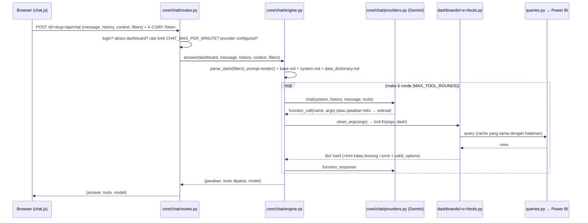

# Panduan Development Berurutan — web-pbi-portal (MANTRA / Power BI Portal)

> Disusun dari analisis source code pada **28 Oktober 2026** (sudut pandang system analyst).
> Tujuan: membangun project ini **dari folder kosong sampai jadi**, dengan urutan yang benar dan link ke **file yang
> dikerjakan di setiap langkah**. Semua link relatif dari folder `docs/`, jadi bisa di-klik langsung di VS Code / GitHub.
>
> Baseline saat panduan ini ditulis (MacBook, Python 3.13.17 di `.venv`): `python -m pytest` → **58 passed** (28 Okt 2026,
> setelah `PBI_CLIENT_ID` di `.env` diisi; lihat [§7 Temuan analis](#7-temuan-analis--catatan-penting) no. 1).

---

## Daftar isi

1. [Cara memakai panduan ini](#1-cara-memakai-panduan-ini)
2. [Analisis sistem: apa yang dibangun](#2-analisis-sistem-apa-yang-dibangun)
3. [Kenapa urutannya seperti ini (peta dependency)](#3-kenapa-urutannya-seperti-ini-peta-dependency)
4. [Roadmap ringkas (1 halaman)](#4-roadmap-ringkas-1-halaman)
5. [Langkah development detail, Fase 0 s.d. Fase 14](#5-langkah-development-detail)
6. [Setelah jadi: siklus development harian](#6-setelah-jadi-siklus-development-harian)
7. [Temuan analis & catatan penting](#7-temuan-analis--catatan-penting)
8. [Definition of Done](#8-definition-of-done)

---

## 1. Cara memakai panduan ini

### 1.1 Format setiap langkah

Setiap langkah ditulis dengan pola yang sama:

| Bagian | Isi |
|---|---|
| **File** | Link ke file yang kamu buat / ubah di langkah ini |
| **Kerjakan** | Isi yang harus ditulis (fungsi, tabel, template) |
| **Kenapa** | Alasan langkah ini ada / alasan urutannya |
| **Cek** | Perintah + hasil yang diharapkan. **Jangan lanjut sebelum cek lulus** |

Kerjakan **berurutan**. File di fase N hanya bergantung pada file di fase < N. Di beberapa titik ada **stub**
(versi sementara) supaya aplikasi bisa dites lebih awal; stub itu diganti di fase berikutnya dan ditandai jelas.

### 1.2 Perintah macOS vs Windows

Panduan ini dan seluruh dokumentasi project (README, AUTH.md, playbook) memakai **macOS (zsh)** sejak revisi
28 Okt 2026. Tabel padanan Windows lengkap ada di [04 §Q](development_playbook/04_MACOS_VSCODE_SETUP.md#q-padanan-windows-powershell);
ringkasnya:

| Kebutuhan | macOS (zsh) | Windows PowerShell |
|---|---|---|
| Buat venv | `python3.13 -m venv .venv` | `py -m venv .venv` |
| Aktifkan venv | `source .venv/bin/activate` | `.venv\Scripts\Activate.ps1` |
| Salin file | `cp .env.example .env` | `Copy-Item .env.example .env` |
| Set env sementara | `export MANTRA_SEED_PASSWORD='...'` | `$env:MANTRA_SEED_PASSWORD = "..."` |
| Hapus env | `unset MANTRA_SEED_PASSWORD` | `Remove-Item Env:MANTRA_SEED_PASSWORD` |
| Jalankan script | `python scripts/check_setup.py` | sama (`/` juga jalan di Windows) |
| Proses di port 5001 | `lsof -nP -iTCP:5001 -sTCP:LISTEN` | `netstat -ano \| findstr :5001` |
| Launcher double-click | `run_mantra.command` (Finder) | tidak ada (jalankan `python run.py`) |

Pakai `python3.13` **eksplisit** saat membuat venv: di Mac ini `python3` global menunjuk Python 3.14 dari venv
project lain (`project_data_engineer/venv`), jadi venv yang dibuat dengan `python3` bisa salah versi.

Semua perintah `python ...` di bawah dianggap dijalankan dari **root project** dengan `.venv` **aktif**.

### 1.3 Hubungan dengan dokumen lain

- [README.md](../README.md): ringkasan & setup cepat.
- [docs/AUTH.md](AUTH.md): detail login, role, skema DB, migrasi, backup.
- **Seri pendalaman panduan ini** (dibaca bersama fase yang bersangkutan; setiap fase punya baris "Pendalaman"):

  | File | Isi | Dipakai di |
  |---|---|---|
  | [01_KONSEP_TEKNOLOGI](panduan_development/01_KONSEP_TEKNOLOGI.md) | konsep venv, `.env`, Flask, Jinja, SQLite, keamanan web, MSAL, DAX, thread & cache, frontend, function calling, pytest + latihan | semua fase |
  | [02_KODE_INTI_FONDASI](panduan_development/02_KODE_INTI_FONDASI.md) | kode `config.py`, `create_app`, `db.py`, `accounts.py`, `auth.py`, `registry.py`, `portal.py` dijelaskan per bagian | Fase 1-6 |
  | [03_KODE_INTI_DATA_DAN_AI](panduan_development/03_KODE_INTI_DATA_DAN_AI.md) | kode `powerbi.py`, `cache.py`, `errors.py`, pola dashboard, `guards.py`, `prompt.py`, `providers.py`, `engine.py`, chat, tools | Fase 7-12 |
  | [04_LOGIKA_BISNIS_DASHBOARD](panduan_development/04_LOGIKA_BISNIS_DASHBOARD.md) | dari mana setiap angka Material Readiness & PANI berasal: aturan baris, status, rumus, jebakan | Fase 10, 12 |
- [docs/development_playbook/](development_playbook/00_START_HERE.md): buku panduan 33 bab (penjelasan mendalam per topik).
  Panduan ini adalah **"jalur utama"**-nya: urutan kerja + link file. Kalau butuh teori lebih dalam di satu langkah,
  ikuti link "Baca juga" ke bab playbook.

---

## 2. Analisis sistem: apa yang dibangun

### 2.1 Gambaran satu kalimat

**Power BI Portal (MANTRA)** adalah website **Flask** yang menampilkan banyak dashboard Power BI **tanpa iframe**:
setiap halaman menjalankan **query DAX langsung** ke semantic model Power BI lewat REST API `executeQueries`,
merender hasilnya sendiri (HTML + JS), dan setiap dashboard punya **AI agent** (Gemini) yang menjawab pertanyaan
dengan memanggil "tools" Python yang memakai query yang sama. Akses dashboard per user diatur Super Admin.

### 2.2 Diagram konteks (aktor, sistem, data)

```
                ┌──────────────────────── Aktor ────────────────────────┐
                │  User biasa     : buka dashboard yang diizinkan        │
                │  Super Admin    : kelola user, akses, katalog, audit   │
                │  Developer/Ops  : script di server (seed, backup, cek) │
                └───────────────┬───────────────────────────────────────┘
                                │ HTTP (browser)
                                ▼
┌────────────────────────── Flask app: mantra/ ──────────────────────────┐
│ auth  ─ login email+password / Microsoft (opsional)                    │
│ portal─ Home, Reports, Favorites, History, Settings                    │
│ admin ─ Users, Dashboard Access, Dashboards, Audit Log                 │
│ registry ─ auto-discovery dashboard + guard akses                      │
│ dashboards/<x> ─ queries.py (DAX) · routes.py · templates · static     │
│ core/chat ─ mesin AI agent (prompt, provider, tools, guards)           │
└──────┬──────────────────────────┬───────────────────────────┬──────────┘
       │ SQLite                   │ HTTPS (service principal)  │ HTTPS (API key)
       ▼                          ▼                           ▼
 instance/mantra.db       Power BI REST API              Google Gemini API
 (users, akses, audit,    executeQueries                 (AI agent)
  favorites, history)     ← token dari Microsoft Entra ID (MSAL)
                          Microsoft Entra ID juga dipakai untuk login SSO (opsional)
```

**Prinsip arsitektur yang harus dipegang selama development:**

1. **Data dashboard tidak disimpan** di MANTRA. `mantra.db` hanya berisi data milik portal (akun, akses, audit, favorit, riwayat).
2. **Dashboard = plug-in.** Satu folder di `mantra/dashboards/` = satu report. Folder berawalan `_` diabaikan.
3. **Akses dicek di server** pada setiap route dashboard (halaman, API, file static), bukan sekadar menyembunyikan menu.
4. **Satu pintu ke Power BI:** `queries.py` dashboard → `core/powerbi.query()` (token, rate limit, timeout bersama).
5. **AI tidak menulis DAX.** AI hanya memanggil tool terdaftar; parameternya divalidasi kode (`guards.py`).
6. **Secret di `.env`**, tidak pernah di kode / log / audit.

### 2.3 Data store: tabel di `instance/mantra.db`

Didefinisikan di [mantra/core/db.py](../mantra/core/db.py) (list `MIGRATIONS`, versi di `PRAGMA user_version`).

| Migrasi | Tabel / kolom | Dipakai oleh |
|---|---|---|
| v1 | `favorites (user_id, slug)`, `history (user_id, slug, title, url, visited_at)` | [portal.py](../mantra/portal.py), [registry.py](../mantra/core/registry.py) (catat History) |
| v2 | `users`, `dashboards` (katalog), `user_dashboard_access`, `audit_log` | [accounts.py](../mantra/core/accounts.py), [auth.py](../mantra/core/auth.py), [admin.py](../mantra/admin.py) |
| v3 | `users.reset_requested_at` (permintaan Forgot password) | [accounts.py](../mantra/core/accounts.py), [admin.py](../mantra/admin.py) |

### 2.4 Flow utama sistem

#### Flow A — Startup aplikasi (`python run.py`)

```
run.py
 └─ mantra.create_app()                                   mantra/__init__.py
     1. import config → baca .env (override=True)          mantra/config.py
     2. cek FLASK_SECRET_KEY (kosong = gagal start)
     3. db.init_app → migrate() + backup otomatis           mantra/core/db.py
     4. register blueprint: auth, portal, chat, admin
     5. registry.init_app → scan mantra/dashboards/*        mantra/core/registry.py
          per dashboard: import modul → ambil DASHBOARD
                         → prompt.load() (kalau ada AI)    mantra/core/chat/prompt.py
                         → pasang _guard di blueprint
                         → register blueprint
     6. accounts.sync_dashboards → katalog DB = kode       mantra/core/accounts.py
     7. pasang hook: csrf_protect, security_headers, inject_globals, error handler 400/404/500
 └─ app.run(host="localhost", port=PORT)
```

#### Flow B — Request ke halaman portal (mis. `GET /reports`)

```
Browser ─▶ before_request: csrf_protect (hanya POST)              mantra/__init__.py
        ─▶ before_app_request: require_password_change            mantra/core/auth.py
        ─▶ @login_required → current_user() dibaca ulang dari DB  mantra/core/auth.py
        ─▶ view portal.reports → registry.visible_for(user)       mantra/portal.py
        ─▶ render_template + inject_globals (csrf, user, admin, badge, dashboard, chat_enabled)
        ─▶ after_request: X-Frame-Options, nosniff, Referrer-Policy
```

#### Flow C — Login email + password

```
GET /login ─▶ form (portal/login.html)
POST /login ─▶ CSRF ok? ─▶ throttle IP (20 gagal/15 mnt)?            auth.py
            ─▶ accounts.authenticate(email, password)                accounts.py
                 ├ email tak terdaftar → cek hash dummy (waktu sama) → "invalid"
                 ├ locked_until > now → "locked"
                 ├ password salah → failed_logins+1 (5x → kunci 15 mnt)
                 └ sukses → record_login + audit
            ─▶ _start_session: session.clear(), uid, sv (session_version)
            ─▶ must_change_password? → /account/password (wajib ganti)
            ─▶ redirect ke next (hanya path lokal) / Home
```

Karena session hanya menyimpan `uid` + `sv`, menonaktifkan akun / reset password / ganti role menaikkan
`session_version` → sesi lama otomatis tidak berlaku di request berikutnya.

#### Flow D — Request halaman dashboard (mis. `GET /d/material-readiness/`)

```
Browser ─▶ blueprint dashboard.before_request = registry._guard(dashboard)
             ├ belum login → redirect /login (API: 401 JSON)
             ├ tidak punya akses → audit access_denied + 403 (API: JSON)
             └ halaman (GET) → db.add_history()
        ─▶ routes.summary()                                 dashboards/material_readiness/routes.py
             └ queries.summary_cube()                        dashboards/material_readiness/queries.py
                 └ Cache.get(key, load)  (TTL CACHE_MINUTES) core/cache.py
                     └ powerbi.query(DATASET, dax)            core/powerbi.py
                         ├ RateLimiter (PBI_MAX_QUERIES_PER_MINUTE, bersama)
                         ├ token MSAL (client credentials, auto-refresh)
                         └ POST /groups/<ws>/datasets/<ds>/executeQueries
        ─▶ render template: payload → <script>window.SUMMARY = {{ payload|tojson }}</script>
        ─▶ browser: summary.js menggambar chart/slicer dari window.SUMMARY
Gagal Power BI ─▶ errors.data_error_page(): pesan umum + kode ref; detail hanya di log server (502)
```

#### Flow E — Super Admin memberi akses

```
Admin > Users > Manage ─▶ POST /admin/users/<id>/access (CSRF)        admin.py
  ─▶ @admin_required (role dicek di server)                            auth.py
  ─▶ accounts.set_access(user_id, dashboard_ids) → grant/revoke + audit accounts.py
  ─▶ request berikutnya user: allowed_slugs() membaca DB → langsung berlaku
```

#### Flow F — AI agent (tombol "Ask AI")



### 2.5 Peta route lengkap (hasil `app.url_map`)

| Method | URL | Endpoint | File |
|---|---|---|---|
| GET/POST | `/login` | `auth.login` | [core/auth.py](../mantra/core/auth.py) |
| GET/POST | `/forgot-password` | `auth.forgot_password` | [core/auth.py](../mantra/core/auth.py) |
| GET/POST | `/account/password` | `auth.change_password` | [core/auth.py](../mantra/core/auth.py) |
| GET | `/auth/microsoft`, `/auth/callback` | `auth.microsoft`, `auth.callback` | [core/auth.py](../mantra/core/auth.py) |
| POST | `/logout` | `auth.logout` | [core/auth.py](../mantra/core/auth.py) |
| GET | `/`, `/reports`, `/favorites`, `/history`, `/settings` | `portal.*` | [portal.py](../mantra/portal.py) |
| POST | `/api/favorites/<slug>` | `portal.toggle_favorite` | [portal.py](../mantra/portal.py) |
| GET/POST | `/admin/users`, `/admin/users/new`, `/admin/users/<id>` (+ `/access`, `/status`, `/reset-password`, `/dismiss-reset`) | `admin.*` | [admin.py](../mantra/admin.py) |
| GET/POST | `/admin/dashboards`, `/admin/dashboards/<id>/status`, `/admin/audit` | `admin.*` | [admin.py](../mantra/admin.py) |
| POST | `/d/<slug>/api/chat` | `chat.chat` | [core/chat/routes.py](../mantra/core/chat/routes.py) |
| GET | `/d/material-readiness/`, `/detail`, `/api/detail`, `/api/detail/export` | `material_readiness.*` | [material_readiness/routes.py](../mantra/dashboards/material_readiness/routes.py) |
| GET | `/d/pani-processing/`, `/equipment`, `/mining`, `/production` | `pani_processing.*` | [pani_processing/routes.py](../mantra/dashboards/pani_processing/routes.py) |

---

## 3. Kenapa urutannya seperti ini (peta dependency)

Urutan development mengikuti **siapa meng-import siapa**. Lapisan bawah harus jadi dulu:

| Level | File | Bergantung pada |
|---|---|---|
| 0 | [config.py](../mantra/config.py), [core/common.py](../mantra/core/common.py), [core/cache.py](../mantra/core/cache.py), [core/chat/guards.py](../mantra/core/chat/guards.py) | library saja |
| 1 | [core/db.py](../mantra/core/db.py), [core/powerbi.py](../mantra/core/powerbi.py), [core/errors.py](../mantra/core/errors.py), [core/chat/providers.py](../mantra/core/chat/providers.py) | level 0 |
| 2 | [core/accounts.py](../mantra/core/accounts.py), [core/chat/prompt.py](../mantra/core/chat/prompt.py) | db / powerbi |
| 3 | [core/auth.py](../mantra/core/auth.py) | config, accounts |
| 4 | [core/registry.py](../mantra/core/registry.py) | accounts, auth, db (+ prompt, di-import saat dibutuhkan) |
| 5 | [core/chat/engine.py](../mantra/core/chat/engine.py) → [core/chat/routes.py](../mantra/core/chat/routes.py), [portal.py](../mantra/portal.py), [admin.py](../mantra/admin.py) | level 0-4 |
| 6 | [mantra/\_\_init\_\_.py](../mantra/__init__.py) (`create_app`) → [run.py](../run.py) | semuanya |
| plug-in | `mantra/dashboards/<x>/` | core/* |

Tiga catatan penting hasil analisis (sudah diterapkan juga di playbook [03](development_playbook/03_DEVELOPMENT_ROADMAP.md)
dan [27](development_playbook/27_REBUILD_FROM_ZERO.md), revisi 28 Okt 2026):

- [portal.py](../mantra/portal.py) meng-import `registry` dan `providers`, jadi **registry harus dibangun sebelum portal**.
  Versi lama playbook memakai urutan Portal → Registry yang tidak bisa dijalankan apa adanya.
- Manifest dashboard yang punya `chat=ChatSpec(...)` membuat `prompt.load()` dijalankan saat start. Karena itu dashboard
  **dibangun tanpa AI dulu** (`chat=None`), lalu AI ditambahkan sebagai lapisan di Fase 11.
- [registry.py:110](../mantra/core/registry.py#L110) meng-import `core/chat/prompt.py` untuk **setiap** dashboard,
  termasuk yang `chat=None`. Jadi `prompt.py` dibuat di awal Fase 9 (Langkah 9.0), sebelum dashboard pertama.

---

## 4. Roadmap ringkas (1 halaman)

| Fase | Nama | File utama | Checkpoint (bukti fase selesai) |
|---|---|---|---|
| 0 | Repo & environment | [.gitignore](../.gitignore), [requirements.txt](../requirements.txt), [requirements-dev.txt](../requirements-dev.txt), [pytest.ini](../pytest.ini) | Import semua library sukses dari `.venv` |
| 1 | Konfigurasi | [.env.example](../.env.example), `.env`, [config.py](../mantra/config.py) | `Config.PORT` tercetak |
| 2 | Kerangka Flask | [mantra/\_\_init\_\_.py](../mantra/__init__.py), [run.py](../run.py) | Server start di `localhost:5001` |
| 3 | Database | [core/db.py](../mantra/core/db.py) | `user_version = 3` |
| 4 | Akun & login | [core/accounts.py](../mantra/core/accounts.py), [core/auth.py](../mantra/core/auth.py), template auth, [scripts/manage_users.py](../scripts/manage_users.py) | Login → wajib ganti password → "Login OK" |
| 5 | Registry dashboard | [core/registry.py](../mantra/core/registry.py), [dashboards/\_\_init\_\_.py](../mantra/dashboards/__init__.py) | App start, katalog sinkron |
| 6 | Shell UI, Portal, Admin | [base.html](../mantra/templates/base.html), [sidebar](../mantra/templates/components/sidebar.html), [topbar](../mantra/templates/components/topbar.html), [portal.py](../mantra/portal.py), [admin.py](../mantra/admin.py) | Semua menu portal & admin terbuka sesuai role |
| 7 | Integrasi Power BI | [core/powerbi.py](../mantra/core/powerbi.py), [cache.py](../mantra/core/cache.py), [errors.py](../mantra/core/errors.py), [common.py](../mantra/core/common.py), [scripts/check_setup.py](../scripts/check_setup.py) | `check_setup.py` → `SEMUA CEK LULUS` |
| 8 | Kerangka halaman report | [dashboard/base.html](../mantra/templates/dashboard/base.html), [dashboard.css](../mantra/static/css/dashboard.css), [dash-common.js](../mantra/static/js/dash-common.js) | (dites di Fase 9) |
| 9 | Template & generator dashboard | [core/chat/prompt.py](../mantra/core/chat/prompt.py), [dashboards/\_template/](../mantra/dashboards/_template/__init__.py), [scripts/create_dashboard.py](../scripts/create_dashboard.py) | Kartu "Coming soon" → halaman Overview tampil |
| 10 | Dashboard #1 Material Readiness | [material_readiness/](../mantra/dashboards/material_readiness/__init__.py) | Angka identik dengan report Power BI |
| 11 | Mesin AI agent | [core/chat/](../mantra/core/chat/engine.py), [base.md](../mantra/core/prompts/base.md), [chat.js](../mantra/static/js/chat.js), tools/prompts per dashboard | `check_ai_agent.py --static` → `SEMUA LULUS` |
| 12 | Dashboard #2 PANI (`pani-processing`) | [pani_processing/](../mantra/dashboards/pani_processing/__init__.py), [scripts/compare_pani_with_powerbi.py](../scripts/compare_pani_with_powerbi.py) | Compare script: semua sama (kecuali bug report) |
| 13 | Test otomatis | [tests/conftest.py](../tests/conftest.py) + 4 file test | `python -m pytest` → semua lulus |
| 14 | Hardening, dokumentasi, rilis | [README.md](../README.md), [docs/AUTH.md](AUTH.md), [run_mantra.command](../run_mantra.command) | Checklist keamanan & DoD (§8) terpenuhi |

---

## 5. Langkah development detail

### Fase 0 — Repo & environment

> **Pendalaman:** [Konsep §1 venv & pip](panduan_development/01_KONSEP_TEKNOLOGI.md#1-virtual-environment--pip)

#### Langkah 0.1 — Folder project + git

- **File:** folder `web-pbi-portal/`
- **Kerjakan:**
  ```bash
  mkdir web-pbi-portal && cd web-pbi-portal
  git init
  mkdir -p mantra/core/chat mantra/core/prompts mantra/dashboards mantra/templates mantra/static/{css,js,img} scripts tests docs
  ```
- **Kenapa:** struktur folder menentukan nama package Python (`mantra`) yang dipakai semua import relatif (`from .core import ...`).
- **Cek:** `ls mantra` → `core dashboards static templates`.

#### Langkah 0.2 — `.gitignore`

- **File:** [.gitignore](../.gitignore)
- **Kerjakan:** isi 8 baris: `.env`, `.venv/`, `__pycache__/`, `*.pyc`, `instance/`, `.claude/`, `.pytest_cache/`, `.DS_Store` (metadata Finder macOS).
- **Kenapa:** `.env` berisi secret dan `instance/` berisi database akun. Keduanya **tidak boleh** masuk GitHub. Buat file
  ini **sebelum** commit pertama.
- **Cek:** `git check-ignore .env instance/mantra.db` → keduanya tercetak.

#### Langkah 0.3 — Daftar dependency

- **File:** [requirements.txt](../requirements.txt), [requirements-dev.txt](../requirements-dev.txt)
- **Kerjakan:**
  - `requirements.txt`: `Flask>=3.0,<4`, `msal>=1.28,<2`, `requests>=2.31,<3`, `python-dotenv>=1.0,<2`,
    `google-genai>=2.0,<3`, `httpx>=0.27,<1`.
  - `requirements-dev.txt`: `-r requirements.txt` + `pytest>=8.0,<10`.
- **Kenapa:** batas atas versi mayor mencegah upgrade otomatis yang mengubah API. Fungsi tiap library:

  | Library | Dipakai di | Untuk |
  |---|---|---|
  | Flask (+ Werkzeug) | seluruh `mantra/` | web framework, session, hash password |
  | msal | [core/powerbi.py](../mantra/core/powerbi.py), [core/auth.py](../mantra/core/auth.py) | token Microsoft Entra (service principal & SSO) |
  | requests | [core/powerbi.py](../mantra/core/powerbi.py) | HTTP ke Power BI REST API |
  | python-dotenv | [config.py](../mantra/config.py) | baca `.env` |
  | google-genai, httpx | [core/chat/providers.py](../mantra/core/chat/providers.py) | Gemini API + deteksi timeout |
  | pytest | `tests/` | test otomatis |

#### Langkah 0.4 — Virtual environment + install

- **Kerjakan:**
  ```bash
  brew install python@3.13        # sekali saja, kalau python3.13 belum ada
  python3.13 -m venv .venv
  source .venv/bin/activate
  pip install -r requirements-dev.txt
  ```
- **Cek:**
  ```bash
  python -c "import sys; print(sys.executable)"        # harus .../web-pbi-portal/.venv/bin/python
  python -c "import flask, msal, requests, dotenv, httpx; from google import genai; print('OK')"
  ```
  Output nyata (sandbox macOS, 28 Okt 2026):
  ```text
  $ python --version
  Python 3.13.17
  $ python -c "import sys; print(sys.executable)"
  /Users/<kamu>/Documents/Portfolio/web-pbi-portal/.venv/bin/python
  $ python -c "import flask, msal, requests, dotenv, httpx; from google import genai; print('OK')"
  OK
  ```
  Kalau muncul `cannot import name 'genai' from 'google'` → kamu memakai Python global, aktifkan `.venv` lagi.
- **Baca juga:** [05_PYTHON_ENVIRONMENT_AND_DEPENDENCIES](development_playbook/05_PYTHON_ENVIRONMENT_AND_DEPENDENCIES.md)

#### Langkah 0.5 — Konfigurasi pytest

- **File:** [pytest.ini](../pytest.ini)
- **Kerjakan:** `[pytest]`, `testpaths = tests`, `addopts = -q`.
- **Kenapa:** supaya `python -m pytest` hanya mencari test di `tests/` (bukan di `.venv`).
- **Penting:** pytest baru bisa dijalankan di Fase 13, karena `tests/conftest.py` meng-import `mantra.core.chat.routes` (Fase 11) dan memberi akses ke dashboard `material-readiness` + `pani-processing` (Fase 10 & 12). Sebelum itu, setiap fase dicek **manual** lewat bagian "Cek". Catatan "Test otomatis"
  di tiap fase memberi tahu test mana yang nanti menguji fase itu.

---

### Fase 1 — Konfigurasi

> **Pendalaman:** [Konsep §2 `.env`](panduan_development/01_KONSEP_TEKNOLOGI.md#2-file-env-dan-python-dotenv) · [Kode §1 `config.py`](panduan_development/02_KODE_INTI_FONDASI.md#1-configpy--membaca-env)

#### Langkah 1.1 — Template konfigurasi

- **File:** [.env.example](../.env.example)
- **Kerjakan:** tulis semua variabel beserta komentar penjelasannya, dikelompokkan:
  - **Flask:** `PORT=5001`, `FLASK_SECRET_KEY=`, `SESSION_COOKIE_SECURE=0`, `FLASK_DEBUG=0`, `SESSION_HOURS=8`, `DASHBOARD_STRICT=1`
  - **Login:** `ENTRA_TENANT_ID=`, `ENTRA_CLIENT_ID=`, `ENTRA_CLIENT_SECRET=`, `AUTH_DISABLED=0`
  - **Power BI:** `PBI_TENANT_ID=`, `PBI_CLIENT_ID=`, `PBI_CLIENT_SECRET=`, `PBI_MAX_QUERIES_PER_MINUTE=100`, `CACHE_MINUTES=10`, `PBI_TIMEOUT_SECONDS=120`
  - **AI:** `AI_PROVIDER=gemini`, `GEMINI_API_KEY=`, `GEMINI_MODEL=...`, `GEMINI_FALLBACK_MODELS=...`, `CHAT_MAX_PER_MINUTE=10`
- **Kenapa:** `.env.example` masuk git (tanpa secret) dan jadi dokumentasi konfigurasi untuk developer berikutnya.

#### Langkah 1.2 — File `.env` asli

- **File:** `.env` (tidak masuk git)
- **Kerjakan:**
  ```bash
  cp .env.example .env
  python -c "import secrets; print(secrets.token_hex(32))"   # tempel hasilnya ke FLASK_SECRET_KEY
  ```
  Pastikan `AUTH_DISABLED=0`. Kredensial Power BI / Gemini / Entra boleh kosong dulu (diisi di Fase 7 & 11).

#### Langkah 1.3 — Pembaca konfigurasi

- **File:** [mantra/config.py](../mantra/config.py)
- **Kerjakan:**
  1. `BASE_DIR` = root project.
  2. `_ENV_FILE = dotenv_values(BASE_DIR / ".env")`, hitung `ENV_OVERRIDDEN` (nama variabel terminal yang ditimpa `.env`).
  3. `load_dotenv(..., override=True)` → **`.env` MANTRA selalu menang** atas variabel terminal (VS Code bisa membawa `.env` project lain).
  4. Helper `_flag()`, `_env_file_flag()` (khusus `AUTH_DISABLED`: **hanya** dibaca dari file `.env`, bukan dari environment), `_list()`.
  5. `class Config` berisi semua nilai (PORT, SECRET_KEY, cookie Lax/HttpOnly/Secure, PERMANENT_SESSION_LIFETIME, ENTRA_*,
     PBI_*, CACHE_SECONDS, AI_*, DASHBOARD_STRICT, `INSTANCE_DIR`, `APP_DB`).
- **Kenapa:** semua modul lain membaca konfigurasi dari sini, bukan dari `os.environ` langsung.
- **Cek:**
  ```bash
  python -c "from mantra.config import Config; print(Config.PORT, Config.AUTH_DISABLED, Config.APP_DB)"
  ```
  Output nyata (sandbox macOS, 28 Okt 2026); sandbox memakai `PORT=5055`, di laptopmu `5001`):
  ```text
  5055 False ~/web-pbi-portal/instance/mantra.db
  ```
  `False` = `AUTH_DISABLED=0` (login wajib). Kalau tercetak `True`, cek baris `AUTH_DISABLED` di `.env`.
  (Butuh `mantra/__init__.py` ada walaupun kosong; buat file kosong dulu kalau belum ada.)
- **Test otomatis (dijalankan di Fase 13):** `test_passwords_and_database.py::test_auth_disabled_is_read_only_from_env_file`, `::test_env_file_wins_over_inherited_terminal_variables`
- **Baca juga:** [06_CONFIGURATION_GUIDE](development_playbook/06_CONFIGURATION_GUIDE.md)

---

### Fase 2 — Kerangka Flask

> **Pendalaman:** [Konsep §3-4 Flask](panduan_development/01_KONSEP_TEKNOLOGI.md#3-flask-aplikasi-route-dan-blueprint) · [Kode §2 `create_app()`](panduan_development/02_KODE_INTI_FONDASI.md#2-create_app--merakit-aplikasi)

#### Langkah 2.1 — Application factory (versi awal)

- **File:** [mantra/\_\_init\_\_.py](../mantra/__init__.py)
- **Kerjakan:** versi minimal dulu; akan ditambah di setiap fase berikutnya (lihat tabel di akhir fase 6).
  ```python
  from flask import Flask
  from .config import Config

  def create_app(test_config=None):
      app = Flask(__name__, instance_path=str(Config.INSTANCE_DIR))
      app.config.from_object(Config)
      if test_config:
          app.config.update(test_config)      # dipakai tests/ (database sementara)
      if not app.config["SECRET_KEY"]:
          raise RuntimeError("FLASK_SECRET_KEY belum diisi di .env")
      return app
  ```
- **Kenapa:** pola *application factory* membuat test bisa membuat app baru dengan DB sementara, tanpa menyentuh DB asli.

#### Langkah 2.2 — Entry point

- **File:** [run.py](../run.py)
- **Kerjakan:** `app = create_app()`; `app.run(host="localhost", port=Config.PORT, debug=Config.DEBUG)`; cetak baris status
  (URL, mode login, debug) dan penyebab server berhenti (Ctrl+C vs crash). Cek `WERKZEUG_RUN_MAIN` supaya tidak dicetak dua kali di mode debug.
- **Kenapa `localhost`, bukan `127.0.0.1`:** redirect URI login Microsoft didaftarkan sebagai `http://localhost:5001/auth/callback`.
- **Cek:** `python run.py`. Output nyata (sandbox macOS, 28 Okt 2026):
  ```text
   * Power BI Portal: http://localhost:5055  |  Login: ON (email + password)  |  Debug: OFF
   * Serving Flask app 'mantra'
   * Debug mode: off
  WARNING: This is a development server. Do not use it in a production deployment. Use a production WSGI server instead.
   * Running on http://localhost:5055
  ```
  Peringatan "development server" itu normal untuk localhost. Dengan factory **minimal** Langkah 2.1,
  `curl -s -o /dev/null -w "%{http_code}\n" http://localhost:5001/` → `404` (belum ada route). Dengan kode final,
  URL yang sama → `302` ke `/login`.

#### Langkah 2.3 — Launcher double-click (opsional)

- **File:** [run_mantra.command](../run_mantra.command)
- **Kerjakan:** script zsh: `cd "${0:A:h}"` (folder script), cek `.venv/bin/python` executable, jalankan
  `run.py`, tunggu satu tombol sebelum jendela ditutup. Lalu `chmod +x run_mantra.command`.
- **Kenapa:** bisa di-double-click dari Finder; server tidak ikut mati kalau terminal VS Code ditutup.
- **Cek:** double-click `run_mantra.command` di Finder → jendela Terminal "MANTRA server" berisi baris status.
  Kalau ditolak Gatekeeper: klik kanan > Open sekali.

---

### Fase 3 — Database

> **Pendalaman:** [Konsep §6 SQLite & migrasi](panduan_development/01_KONSEP_TEKNOLOGI.md#6-sqlite-dan-migrasi-berbasis-user_version) · [Kode §3 `db.py`](panduan_development/02_KODE_INTI_FONDASI.md#3-dbpy--koneksi--migrasi)

#### Langkah 3.1 — Modul database + migrasi

- **File:** [mantra/core/db.py](../mantra/core/db.py) (buat juga [mantra/core/\_\_init\_\_.py](../mantra/core/__init__.py) sebagai penanda package)
- **Kerjakan (urut dari atas file):**
  1. `MIGRATIONS = [v1, v2, v3]` — string SQL (lihat tabel §2.3). **Aturan:** migrasi hanya boleh *menambah*; jangan ubah migrasi lama, tambah di akhir list.
  2. `connect(path)` — `row_factory = sqlite3.Row`, `PRAGMA foreign_keys = ON`.
  3. `backup(conn, backup_dir, label)` — SQLite backup API → `instance/backups/mantra-<waktu>-<label>.db`.
  4. `migrate(path, backup_dir)` — baca `PRAGMA user_version`; tolak kalau DB lebih baru dari kode; backup dulu kalau sudah ada tabel; jalankan migrasi yang belum ada dalam transaksi.
  5. `init_app(app)` — buat folder `instance/`, panggil `migrate`, daftarkan `teardown_appcontext(_close_db)`.
  6. `get_db()` / `_close_db()` — satu koneksi per request di `flask.g`.
  7. Fungsi Favorites & History: `favorites`, `toggle_favorite`, `add_history` (kunjungan ulang < 30 menit hanya update waktu; simpan maks 100), `history`.
- **Kerjakan di factory:** tambahkan `from .core import db` dan `db.init_app(app)` di `create_app`.
- **Cek:**
  ```bash
  python run.py            # log: Database dimigrasi dari versi 0 ke 3
  sqlite3 instance/mantra.db "PRAGMA user_version; .tables"
  ```
  Output nyata (sandbox macOS, 28 Okt 2026):
  ```text
  [2026-10-28 03:06:07,629] WARNING in db: Database dimigrasi dari versi 0 ke 3
  $ sqlite3 instance/mantra.db "PRAGMA user_version; .tables"
  3
  audit_log              favorites              user_dashboard_access
  dashboards             history                users
  ```
  Pesan migrasi hanya muncul **sekali** (DB baru). Start berikutnya diam, karena `user_version` sudah 3.
- **Test otomatis (dijalankan di Fase 13):** `test_passwords_and_database.py` (migrasi tidak menghapus data & membuat backup, constraint tabel akses).
- **Baca juga:** [11_DATABASE_AND_MIGRATIONS](development_playbook/11_DATABASE_AND_MIGRATIONS.md), [AUTH.md](AUTH.md)

---

### Fase 4 — Akun, login, dan keamanan dasar

> **Pendalaman:** [Konsep §4 session & hook](panduan_development/01_KONSEP_TEKNOLOGI.md#4-flask-siklus-request-g-session-hook) · [Konsep §7 keamanan](panduan_development/01_KONSEP_TEKNOLOGI.md#7-keamanan-web-yang-dipakai-portal) · [Konsep §8 MSAL](panduan_development/01_KONSEP_TEKNOLOGI.md#8-microsoft-entra-id--msal) · [Kode §4 `accounts.py`](panduan_development/02_KODE_INTI_FONDASI.md#4-accountspy--autentikasi--hak-akses) · [Kode §5 `auth.py`](panduan_development/02_KODE_INTI_FONDASI.md#5-authpy--session-decorator-route-login)

#### Langkah 4.1 — Logika akun (tanpa HTTP)

- **File:** [mantra/core/accounts.py](../mantra/core/accounts.py)
- **Kerjakan (bagian per bagian, sesuai urutan di file):**
  1. Konstanta: `ROLES`, `MAX_FAILED_LOGINS=5`, `LOCK_MINUTES=15`, `PASSWORD_MIN_LENGTH=10`, `EMAIL_RE`, `_DUMMY_HASH`.
  2. Validasi: `normalize_email`, `validate_email`, `password_problem` (≥10 karakter, huruf + angka, tidak memuat nama email), `temporary_password`.
  3. **Users:** `get_user`, `get_user_by_email`, `list_users`, `create_user`, `set_password` (naikkan `session_version`).
  4. **Lupa password:** `request_password_reset` (tidak membedakan email terdaftar/tidak), `dismiss_reset_request`, `pending_reset_count`.
  5. **Status & role:** `set_active`, `set_role` (tidak boleh menonaktifkan/menurunkan Super Admin aktif terakhir), `_active_admins`.
  6. **Login:** `authenticate` (hash dummy untuk email tak terdaftar → waktu respons sama; kunci akun setelah 5 gagal), `record_login`.
  7. **Katalog dashboard:** `sync_dashboards`, `list_dashboards`, `get_dashboard`, `set_dashboard_active`.
  8. **Hak akses:** `allowed_slugs` (Super Admin = semua aktif; user = hanya yang di-grant; default deny), `granted_ids`, `set_access`, `dashboard_ids_for`.
  9. **Audit log:** `audit` (**jangan pernah** memasukkan password/token), `audit_entries`, `audit_for_user`, `audit_actions`, `AUDIT_LABELS`, `describe_audit`.
- **Kenapa duluan:** `auth.py`, `admin.py`, `registry.py`, dan script CLI semuanya memanggil fungsi ini. Memisahkan logika akun dari route membuat aturan bisnis bisa dites tanpa browser.

#### Langkah 4.2 — Login, session, dan hak akses (HTTP)

- **File:** [mantra/core/auth.py](../mantra/core/auth.py)
- **Kerjakan:**
  1. `bp = Blueprint("auth", __name__)`.
  2. Throttle IP `_IpThrottle`: 20 login gagal & 5 permintaan reset per 15 menit.
  3. Identitas: `auth_disabled`, `_dev_user` (mode tanpa login), `_session_user`, **`current_user()`** (dibaca ulang dari DB sekali per request; session tak valid → `session.clear()`).
  4. Otorisasi: `is_admin`, `allowed_slugs`, `can_open`, `login_required`, `role_required(*roles)`, `admin_required`.
  5. `require_password_change` (`before_app_request`): password sementara → hanya boleh ke halaman ganti password/logout.
  6. Helper: `_safe_next` (anti open-redirect), `_login_url`, `_start_session` (cegah session fixation), `reset_ip_throttle`, `_login_background`.
  7. Route: `/login`, `/forgot-password`, `/account/password`, `/auth/microsoft`, `/auth/callback`, `/logout` (POST).
  8. SSO Entra (opsional): `entra_configured`, `_entra` (MSAL auth code flow + PKCE). Hanya email yang **sudah terdaftar & aktif** di tabel `users`.
- **Baca juga:** [12_AUTHENTICATION_AUTHORIZATION](development_playbook/12_AUTHENTICATION_AUTHORIZATION.md)

#### Langkah 4.3 — STUB portal (sementara)

- **File:** [mantra/portal.py](../mantra/portal.py) — **versi sementara**, diganti penuh di Langkah 6.4.
- **Kenapa perlu:** setelah login, `auth._safe_next()` memanggil `url_for("portal.home")`. Tanpa endpoint itu, login sukses berakhir error 500 (BuildError).
  ```python
  from flask import Blueprint
  from .core.auth import current_user, login_required

  bp = Blueprint("portal", __name__)

  @bp.get("/")
  @login_required
  def home():
      return f"Login OK sebagai {current_user()['email']}"
  ```

#### Langkah 4.4 — Aset & template halaman akun

Halaman login tidak memakai sidebar, jadi bisa dibuat sebelum kerangka portal.

| Urutan | File | Isi |
|---|---|---|
| 1 | [static/img/mantra-mark.svg](../mantra/static/img/mantra-mark.svg) | logo / favicon |
| 2 | [static/css/shell.css](../mantra/static/css/shell.css) | token warna di `:root` (`--sidebar-w`, `--topbar-h`, dst.) + gaya dasar |
| 3 | [static/css/portal.css](../mantra/static/css/portal.css) | gaya halaman portal, login, admin |
| 4 | [templates/portal/\_ui.html](../mantra/templates/portal/_ui.html) | macro `icon`, `mantra_mark`, `brand`, `ms_logo`, `merdeka`, `report_card` |
| 5 | [templates/portal/\_auth_layout.html](../mantra/templates/portal/_auth_layout.html) | kerangka halaman login & lupa password |
| 6 | [templates/portal/login.html](../mantra/templates/portal/login.html) | form email + password (+ field `_csrf`), link Forgot password, tombol Microsoft |
| 7 | [templates/portal/forgot_password.html](../mantra/templates/portal/forgot_password.html) | form email; pesan selalu sama |
| 8 | [templates/portal/bare.html](../mantra/templates/portal/bare.html) | kerangka tanpa sidebar (ganti password wajib, error sebelum login) |
| 9 | [templates/portal/change_password.html](../mantra/templates/portal/change_password.html) | `forced` → extend `bare.html`; tidak → extend `portal/base.html` |
| 10 | [templates/portal/error.html](../mantra/templates/portal/error.html) | halaman error umum (extend `portal/base.html` kalau login, `bare.html` kalau belum) |

#### Langkah 4.5 — Lengkapi factory: blueprint, CSRF, header keamanan, error handler

- **File:** [mantra/\_\_init\_\_.py](../mantra/__init__.py)
- **Kerjakan:**
  1. `app.register_blueprint(auth.bp)` dan `app.register_blueprint(portal.bp)` (stub).
  2. `@app.before_request csrf_protect` — setiap POST wajib membawa token `_csrf` (form) atau header `X-CSRF-Token` (fetch);
     dibandingkan dengan `hmac.compare_digest` dalam bentuk bytes.
  3. `@app.after_request security_headers` — `X-Frame-Options: DENY`, `X-Content-Type-Options: nosniff`, `Referrer-Policy: same-origin`.
  4. `@app.context_processor inject_globals` — **versi awal** cukup `csrf_token` dan `current_user` (dilengkapi di Langkah 6.5).
  5. `_error()` + handler 400/404/500 — JSON untuk path `/api/`, HTML untuk halaman.
  6. Peringatan log kalau `ENV_OVERRIDDEN` tidak kosong atau `AUTH_DISABLED=1`.

#### Langkah 4.6 — Script kelola akun

- **File:** [scripts/manage_users.py](../scripts/manage_users.py)
- **Kerjakan:** subcommand `seed` (3 akun awal: `pbi_premium` Super Admin, `pbi_pro_a`, `pbi_pro_b`), `seed --generate`,
  `list`, `create`, `set-access`, `reset-password`, `set-active`, `set-role`, `backup`. Password seed dari
  `MANTRA_SEED_PASSWORD` atau prompt `getpass`, tidak pernah ditulis ke file/log. Actor audit = `cli:<user OS>`.
- **Kenapa:** role `super_admin` **hanya** bisa diberikan lewat script ini (butuh akses server), tidak ada tombolnya di web.

#### ✅ Checkpoint Fase 4

```bash
export MANTRA_SEED_PASSWORD='Sementara-2026'
python scripts/manage_users.py seed
unset MANTRA_SEED_PASSWORD
python scripts/manage_users.py list
python run.py
```

| Uji | Cara | Hasil yang benar |
|---|---|---|
| Halaman login | buka `http://localhost:5001/login` | form tampil |
| Password salah | login dengan password asal | "Wrong email or password." (HTTP 401) |
| Login pertama | login `pbi_pro_a@merdeka.com` + password seed | dipaksa ke halaman ganti password |
| Ganti password | isi password baru ≥10 karakter, huruf+angka | redirect → "Login OK sebagai pbi_pro_a@merdeka.com" |
| CSRF | `curl -s -o /dev/null -w "%{http_code}\n" -X POST http://localhost:5001/login` | `400` |
| Header keamanan | `curl -sI http://localhost:5001/login \| grep -i x-frame` | `X-Frame-Options: DENY` |

Output nyata (sandbox macOS, 28 Okt 2026), kode final di port 5055:
```text
$ python scripts/manage_users.py seed
[2026-10-28 03:06:07,629] WARNING in db: Database dimigrasi dari versi 0 ke 3
  dibuat  pbi_premium@merdeka.com [super_admin] akses: semua dashboard aktif
  dibuat  pbi_pro_a@merdeka.com [user] akses: material-readiness
  dibuat  pbi_pro_b@merdeka.com [user] akses: pani-processing
Password awal bersifat sementara; setiap akun wajib menggantinya saat login pertama.

$ python scripts/manage_users.py list
    1  pbi_premium@merdeka.com          super_admin  aktif     semua dashboard aktif | wajib ganti password
    2  pbi_pro_a@merdeka.com            user         aktif     material-readiness | wajib ganti password
    3  pbi_pro_b@merdeka.com            user         aktif     pani-processing | wajib ganti password

$ curl -s -o /dev/null -w "%{http_code}\n" -X POST -d "email=x&password=x" http://localhost:5055/login
400
$ curl -s -D - -o /dev/null http://localhost:5055/login | grep -E "X-Frame|X-Content|Referrer"
X-Frame-Options: DENY
X-Content-Type-Options: nosniff
Referrer-Policy: same-origin
```
Alur login yang direkam dengan `curl` (cookie + token CSRF):

| Langkah | HTTP | Redirect / pesan |
|---|---|---|
| POST `/login`, password salah | `401` | `Wrong email or password.` |
| POST `/login`, password sementara benar | `302` | `/account/password?next=` |
| GET `/` sebelum ganti password | `302` | `/account/password?next=/` (dipaksa `require_password_change`) |
| POST `/account/password` (password baru) | `302` | `/` |
| GET `/` setelah ganti password | `200` | (versi stub: teks "Login OK sebagai ..."; versi final: halaman Home) |
| Login gagal ke-1 s.d. ke-5 (`pbi_pro_b`) | `401` | `Wrong email or password.` |
| Login gagal ke-6 | `401` | `Too many failed attempts. Your account is locked for 15 minutes.` |

Akun dikunci **pada** kegagalan ke-5, tetapi pesan "locked" baru muncul di percobaan ke-6, karena
`accounts.authenticate` sengaja tetap menjawab `invalid` saat kegagalan yang memicu kunci.

- **Test otomatis (dijalankan di Fase 13):** `test_login_and_access.py` (login, akun terkunci, throttle, CSRF, cookie palsu), `test_forgot_password.py`.

---

### Fase 5 — Registry dashboard (sistem plug-in)

> **Pendalaman:** [Kode §6 `registry.py`](panduan_development/02_KODE_INTI_FONDASI.md#6-registrypy--sistem-plug-in-dashboard)

#### Langkah 5.1 — STUB provider AI (sementara)

- **File:** [mantra/core/chat/\_\_init\_\_.py](../mantra/core/chat/__init__.py) (penanda package) dan
  [mantra/core/chat/providers.py](../mantra/core/chat/providers.py) — **versi sementara**, diganti penuh di Langkah 11.4.
  ```python
  def configured():
      return False      # belum ada AI: tombol "Ask AI" disembunyikan
  ```
- **Kenapa:** `portal.py` (Settings) dan `inject_globals` (`chat_enabled`) memanggil `providers.configured()`.

#### Langkah 5.2 — Registry

- **File:** [mantra/core/registry.py](../mantra/core/registry.py)
- **Kerjakan:**
  1. Dataclass kontrak plug-in: **`Tool`** (name, label, description, parameters JSON schema, fn), **`ChatSpec`** (tools, prompt_dir,
     suggestions, clean_args, parse_dash, placeholders, prompt_values), **`Dashboard`** (slug, title, description, category, icon,
     color, dataset, blueprint, pages, chat, ready, order; property `url`).
  2. Penyimpanan: `_DASHBOARDS`, `_BY_BLUEPRINT`; fungsi `all_dashboards`, `get`, `current`, `visible_for`.
  3. **`_guard(dashboard)`** — before_request di setiap blueprint dashboard: belum login → login/401; tanpa akses → audit + 403; halaman GET → catat History.
  4. `_load(app, module_name)` — import modul, validasi `DASHBOARD`, slug dobel, `ready=True` wajib punya blueprint & pages, `prompt.load` kalau ada chat, pasang guard **sekali per proses**, register blueprint.
  5. `module_names()` (scan `mantra/dashboards/`, lewati awalan `_`), `manifests()` (untuk script), `init_app(app)` (hormati `DASHBOARD_STRICT`).
- **Baca juga:** [14_DASHBOARD_REGISTRY](development_playbook/14_DASHBOARD_REGISTRY.md)

#### Langkah 5.3 — Package dashboards

- **File:** [mantra/dashboards/\_\_init\_\_.py](../mantra/dashboards/__init__.py)
- **Kerjakan:** hanya docstring (aturan: setiap subfolder = satu dashboard, `_` diabaikan).

#### Langkah 5.4 — Pasang di factory

- **File:** [mantra/\_\_init\_\_.py](../mantra/__init__.py)
- **Kerjakan:** setelah register blueprint: `registry.init_app(app)`, lalu buka koneksi DB dan
  `accounts.sync_dashboards(conn, registry.all_dashboards())`.
- **Cek:** `python run.py` tetap start tanpa error; `sqlite3 instance/mantra.db "select count(*) from dashboards"` → `0`
  (di fase ini folder dashboard masih kosong). Sebagai pembanding, output nyata (sandbox macos, 28 okt 2026) dengan kode final (2 dashboard):
  ```text
  $ sqlite3 instance/mantra.db "select slug, name, is_active from dashboards"
  material-readiness|Material Readiness|1
  pani-processing|PROCESSING, EQUIPMENT, MINING & STOCKPILE PRODUCTION|1
  ```
  Kolom `name` selalu mengikuti `title` di manifest (`sync_dashboards` menimpanya setiap start).

---

### Fase 6 — Shell UI, Portal, Admin

> **Pendalaman:** [Konsep §5 Jinja](panduan_development/01_KONSEP_TEKNOLOGI.md#5-jinja-template-pewarisan-macro) · [Konsep §11 frontend](panduan_development/01_KONSEP_TEKNOLOGI.md#11-frontend-tanpa-framework) · [Kode §2 `inject_globals`](panduan_development/02_KODE_INTI_FONDASI.md#2-create_app--merakit-aplikasi) · [Kode §7 `portal.py`](panduan_development/02_KODE_INTI_FONDASI.md#7-portalpy--contoh-view-yang-memakai-semuanya)

#### Langkah 6.1 — Komponen sidebar & top bar

- **File:** [templates/components/sidebar.html](../mantra/templates/components/sidebar.html), [templates/components/topbar.html](../mantra/templates/components/topbar.html)
- **Kerjakan:**
  - Sidebar (macro `sidebar(report)`): Home, Reports (+ nama report aktif di bawahnya), Favorites, History; blok Admin
    (Users + badge permintaan reset, Dashboards, Audit Log) hanya kalau `user_is_admin`; Settings.
  - Top bar (macro `topbar(report)`): tombol menu, breadcrumb `Reports › report › halaman` + bintang favorit (di halaman report),
    pencarian report, tombol **Ask AI** (``), user chip, ganti password, logout (POST + `_csrf`).
- **Catatan:** template ini memanggil `url_for('portal.reports')`, `url_for('admin.users')`, dst. Semua endpoint itu
  baru ada setelah Langkah 6.4 & 6.6, jadi **cek tampilan dilakukan di akhir fase**.

#### Langkah 6.2 — Kerangka halaman

- **File:** [templates/base.html](../mantra/templates/base.html), [templates/portal/base.html](../mantra/templates/portal/base.html)
- **Kerjakan:**
  - `base.html`: `<meta name="csrf-token">`, `<meta name="favorite-url">`, `shell.css`, blok `styles/head/main/overlays/layer_scripts`,
    script kecil yang memasang mode sidebar sebelum render (anti-kedip), `sidebar(report)` + `topbar(report)` + `<main class="content">` + page loader.
  - `portal/base.html`: extend `base.html`, tambah `portal.css`, banner `AUTH_DISABLED`, flash messages, `portal.js`.
- **Baca juga:** [08_FRONTEND_ARCHITECTURE](development_playbook/08_FRONTEND_ARCHITECTURE.md)

#### Langkah 6.3 — JavaScript shell

- **File:** [static/js/shell.js](../mantra/static/js/shell.js)
- **Kerjakan:** sidebar ringkas (desktop ≥1200px, disimpan di `localStorage`), selalu ringkas (900-1199px), drawer (<900px);
  loader saat pindah halaman; tombol bintang favorit → `POST` ke URL dari meta `favorite-url` dengan header `X-CSRF-Token`.

#### Langkah 6.4 — Portal penuh (ganti stub)

- **File:** [mantra/portal.py](../mantra/portal.py) — **timpa stub Langkah 4.3**
- **Kerjakan:** `_cards`, `home` (Quick Access: favorit dulu, maks 5), `reports` (filter kategori & pencarian),
  `favorites`, `history` (hanya dashboard yang masih boleh dibuka), `settings` (status integrasi untuk Super Admin),
  `toggle_favorite` (`POST /api/favorites/<slug>`, tolak 404 kalau tidak punya akses).
- **Template:** [home.html](../mantra/templates/portal/home.html), [reports.html](../mantra/templates/portal/reports.html),
  [favorites.html](../mantra/templates/portal/favorites.html), [history.html](../mantra/templates/portal/history.html),
  [settings.html](../mantra/templates/portal/settings.html), [denied.html](../mantra/templates/portal/denied.html)
- **JS:** [static/js/portal.js](../mantra/static/js/portal.js) (pencarian & filter kategori di Reports).
- **Baca juga:** [13_PORTAL_DEVELOPMENT](development_playbook/13_PORTAL_DEVELOPMENT.md)

#### Langkah 6.5 — Context processor lengkap

- **File:** [mantra/\_\_init\_\_.py](../mantra/__init__.py) (`inject_globals`)
- **Kerjakan:** kembalikan `csrf_token`, `current_user`, `user_is_admin`, `pending_resets` (badge Admin > Users),
  `dashboard` (`registry.current()`), `chat_enabled` (`dashboard.chat` dan `providers.configured()`),
  `report_favorite`. Tambahkan juga `app.jinja_env.globals["now_str"]`.
- **Kenapa:** sidebar/top bar di **setiap** halaman membaca variabel ini; satu variabel hilang = semua halaman error.

#### Langkah 6.6 — Halaman Super Admin

- **File:** [mantra/admin.py](../mantra/admin.py) (blueprint `admin`, prefix `/admin`) → register di factory.
- **Kerjakan:** route `users`, `new_user` (password sementara acak, tampil sekali, header `Cache-Control: no-store`),
  `user_detail`, `user_access`, `user_status` (tidak bisa menonaktifkan diri sendiri), `user_reset_password`,
  `user_dismiss_reset`, `dashboards`, `dashboard_status`, `audit` (filter per aksi). Semua `@admin_required`, POST → redirect 303.
- **Template:** [admin/\_ui.html](../mantra/templates/admin/_ui.html) (macro `role_pill`, `active_status`, `dashboard_checks`),
  [users.html](../mantra/templates/admin/users.html), [user_new.html](../mantra/templates/admin/user_new.html),
  [user_detail.html](../mantra/templates/admin/user_detail.html), [temp_password.html](../mantra/templates/admin/temp_password.html),
  [dashboards.html](../mantra/templates/admin/dashboards.html), [audit.html](../mantra/templates/admin/audit.html),
  [\_audit_table.html](../mantra/templates/admin/_audit_table.html)

#### ✅ Checkpoint Fase 6

| Uji | Hasil yang benar |
|---|---|
| Login `pbi_premium@merdeka.com` | Home tampil dengan sidebar + top bar + menu Admin |
| Reports | "belum ada report" (dashboard belum dibuat) |
| Admin > Users > Add user | password sementara tampil sekali; user baru di daftar |
| Login sebagai user baru | menu Admin **tidak** tampil; buka `/admin/users` → 403 |
| Forgot password dari login | badge merah di Admin > Users |
| Admin > Audit Log | login sukses/gagal, user dibuat, reset tercatat |
| Resize browser 1200/900px | sidebar ringkas / drawer |

Output nyata (sandbox macOS, 28 Okt 2026), login `pbi_premium` lalu `curl` setiap halaman:
```text
GET /                200      GET /admin/users      200
GET /reports         200      GET /admin/dashboards 200
GET /favorites       200      GET /admin/audit      200
GET /history         200      GET /admin/users/new  200
GET /settings        200      GET /nggak-ada        404
```
| Uji | Hasil nyata |
|---|---|
| `pbi_pro_a` membuka `/admin/users` | `403` |
| Admin > Users > Add user (`budi@merdeka.com`) | `200`, header `Cache-Control: no-store`, password sementara 12 karakter tampil sekali |
| Forgot password `pbi_pro_b@merdeka.com` | `200`: "If pbi_pro_b@merdeka.com belongs to an active account, the Super Admin has received your request. ..." |
| Forgot password email tidak terdaftar | `200`, pesan **sama persis** (tidak membocorkan email mana yang terdaftar) |
| Badge Admin > Users setelah 1 permintaan | `1` |
| Admin > Audit Log teratas setelah 6x gagal login | "Login failed for pbi_pro_b@merdeka.com: account is locked", "Account pbi_pro_b@merdeka.com locked for 15 minutes after too many failed attempts", "... wrong email or password (attempt 5)" |

**Evolusi `create_app` sampai fase ini** (urutan final sama dengan [mantra/\_\_init\_\_.py](../mantra/__init__.py)):
`db.init_app` → register `auth`, `portal`, (`chat` di Fase 11), `admin` → `registry.init_app` → `sync_dashboards` →
peringatan env → `now_str` → `csrf_protect` → `security_headers` → `inject_globals` → error handler.

---

### Fase 7 — Integrasi Power BI

> **Pendalaman:** [Konsep §8 MSAL](panduan_development/01_KONSEP_TEKNOLOGI.md#8-microsoft-entra-id--msal) · [Konsep §9 Power BI & DAX](panduan_development/01_KONSEP_TEKNOLOGI.md#9-power-bi-rest-api--dax) · [Konsep §10 thread & cache](panduan_development/01_KONSEP_TEKNOLOGI.md#10-thread-lock-rate-limit-dan-cache) · [Kode §1-3](panduan_development/03_KODE_INTI_DATA_DAN_AI.md#1-powerbipy--satu-pintu-ke-power-bi)

#### Langkah 7.0 — Setup eksternal (di luar kode)

Ikuti [README §3](../README.md):
1. Microsoft Entra: app registration **`mantra-powerbi`** (single tenant) → client secret → isi `PBI_CLIENT_ID`, `PBI_CLIENT_SECRET` (+ `PBI_TENANT_ID` / `ENTRA_TENANT_ID`).
2. Tambahkan service principal ke grup **`sg-powerbi-api`** (grup yang diizinkan memakai Power BI API; tunggu ±15 menit).
3. Di setiap workspace Power BI dashboard: Manage access → `mantra-powerbi` sebagai **Contributor**.

#### Langkah 7.1 — Helper bersama

- **File:** [mantra/core/common.py](../mantra/core/common.py)
- **Kerjakan:** `WIB`, `now_wib`, `stamp_info(ts)` (kotak "Last Update"), **`dax_str(value)`** (escape string DAX dengan menggandakan `"` → anti DAX injection), `fix_logo_url`.

#### Langkah 7.2 — Klien Power BI

- **File:** [mantra/core/powerbi.py](../mantra/core/powerbi.py)
- **Kerjakan:** `PowerBIError`, `DATA_ERRORS`, dataclass **`Dataset(env_prefix, workspace_id, dataset_id)`** (ID bisa ditimpa
  `.env` `<PREFIX>_WORKSPACE_ID`/`_DATASET_ID`), `_clean_column` (`'Tabel'[Kolom]` → `Kolom`), `_RateLimiter` (bersama semua
  dashboard), class `PowerBI` (MSAL client credentials, `requests.Session` per thread, timeout, `execute_query`), singleton `client()`, fungsi **`query(dataset, dax)`**.
- **Kenapa satu pintu:** kuota Power BI dihitung per service principal; rate limit & token harus dibagi semua dashboard.
- **Baca juga:** [15_POWERBI_INTEGRATION](development_playbook/15_POWERBI_INTEGRATION.md)

#### Langkah 7.3 — Cache

- **File:** [mantra/core/cache.py](../mantra/core/cache.py)
- **Kerjakan:** `Cache(ttl, size).get(key, load)` → `(data, waktu_ambil)`. Request bersamaan untuk key sama menunggu satu
  `load()` saja (lock per key); error tidak di-cache; buang entri tertua kalau melebihi `size`.

#### Langkah 7.4 — Respons error standar

- **File:** [mantra/core/errors.py](../mantra/core/errors.py)
- **Kerjakan:** `log_data_error` (kode ref 8 hex, detail ke log), `data_error_page` (HTML 502), `data_error_json` (`{error, ref}` 502), `data_error_text`.
- **Kenapa:** pesan error Power BI berisi ID workspace/dataset; user hanya boleh melihat pesan umum + ref.

#### Langkah 7.5 — Script cek setup

- **File:** [scripts/check_setup.py](../scripts/check_setup.py)
- **Kerjakan:** `check_env`, `check_entra`, `check_powerbi(dashboards)` (token, akses tiap semantic model), `check_ai`,
  `run_dax(--dashboard, --dax)` untuk eksplorasi model. Output `OK / GAGAL / LEWAT` + `SEMUA CEK LULUS`.
- **Cek:** `python scripts/check_setup.py` → bagian `.env` & token Power BI `OK`.
  Output nyata (sandbox macOS, 28 Okt 2026), **sebelum** kredensial Power BI diisi (contoh hasil gagal yang benar):
  ```text
  [1] File .env
    OK    FLASK_SECRET_KEY terisi
    OK    AUTH_DISABLED  -> 0 (login email + password aktif)
    LEWAT ENTRA_TENANT_ID terisi
    LEWAT ENTRA_CLIENT_ID terisi
    LEWAT ENTRA_CLIENT_SECRET terisi
    GAGAL PBI_CLIENT_ID terisi
    GAGAL PBI_CLIENT_SECRET terisi

  [2] Login Microsoft Entra, opsional (app registration MANTRA Portal)
    LEWAT dilewati, ENTRA_* belum lengkap

  [3] Power BI (service principal mantra-powerbi)
    GAGAL token Microsoft Entra  -> Belum diisi di .env: PBI_TENANT_ID, PBI_CLIENT_ID, PBI_CLIENT_SECRET
          - Cek PBI_CLIENT_ID / PBI_CLIENT_SECRET (kolom Value) / tenant ID.

  [4] AI agent (gemini)
    LEWAT GEMINI_API_KEY kosong: tombol Tanya AI disembunyikan

  3 cek GAGAL
  ```
  `LEWAT` = opsional dan belum diisi (bukan error). Setelah `PBI_*` benar, baris `[3]` menjadi `OK` per dashboard dan
  akhir output `SEMUA CEK LULUS`. Output versi sukses **tidak** direkam di sini, karena memanggil Power BI sungguhan.

---

### Fase 8 — Kerangka halaman report (dipakai semua dashboard)

> **Pendalaman:** [Konsep §11 frontend](panduan_development/01_KONSEP_TEKNOLOGI.md#11-frontend-tanpa-framework)

#### Langkah 8.1 — Template report bersama

- **File:**
  - [templates/dashboard/base.html](../mantra/templates/dashboard/base.html) — extend `base.html`, set `report = dashboard`,
    header biru (logo entity, judul, pill halaman, deskripsi, menu halaman report, "Last Update"), blok
    `title/head/main_title/pill/desc/stat_note/content/scripts`, panel chat (hanya kalau `chat_enabled`).
  - [templates/dashboard/\_icons.html](../mantra/templates/dashboard/_icons.html) — macro `icon` SVG khusus report.
  - [templates/dashboard/empty.html](../mantra/templates/dashboard/empty.html) — "belum ada data".
  - [templates/dashboard/error.html](../mantra/templates/dashboard/error.html) — "gagal memuat data" + kode ref.

#### Langkah 8.2 — CSS & JS report bersama

- **File:** [static/css/dashboard.css](../mantra/static/css/dashboard.css) (pakai `@container dash (...)`, **bukan** `@media`,
  supaya responsif terhadap lebar area report setelah sidebar), [static/js/dash-common.js](../mantra/static/js/dash-common.js)
  (`window.Dash`: `esc`, `fmt`, `statusRank`, `badgeColor`, warna header per company, `setHeaderCompany`, `moName`).

---

### Fase 9 — Template dashboard & generator

> **Pendalaman:** [Kode §6 `prompt.py`](panduan_development/03_KODE_INTI_DATA_DAN_AI.md#6-promptpy--memuat--memvalidasi-prompt) · [Kode §6 `_load`](panduan_development/02_KODE_INTI_FONDASI.md#6-registrypy--sistem-plug-in-dashboard)

#### Langkah 9.0 — Loader prompt (prasyarat dashboard pertama)

- **File:** [mantra/core/chat/prompt.py](../mantra/core/chat/prompt.py) — versi penuh (`load`, `values`, `render`; detail di Langkah 11.3).
- **Kenapa sekarang:** [registry.py:110](../mantra/core/registry.py#L110) menjalankan `from .chat import prompt` di awal
  `_load()` untuk **setiap** dashboard, termasuk yang `chat=None`. Tanpa file ini, dashboard pertama membuat app gagal
  start dengan `ImportError: cannot import name 'prompt' from 'mantra.core.chat'`. File ini hanya bergantung pada
  `core/powerbi.py` (Fase 7); fungsi `load()` sendiri baru dipanggil untuk dashboard yang punya `ChatSpec` (Fase 11).

#### Langkah 9.1 — Kerangka `_template` (tanpa AI dulu)

- **File (buat dalam urutan ini):**
  1. [\_template/queries.py](../mantra/dashboards/_template/queries.py) — `DATASET = Dataset("__ENV__", ...)`, `_cache`, contoh query `tables()` (`INFO.VIEW.TABLES()`).
  2. [\_template/routes.py](../mantra/dashboards/_template/routes.py) — `Blueprint("__NAME__", url_prefix="/d/__SLUG__", template_folder="templates", static_folder="static")`, route `overview`.
  3. [\_template/templates/\_\_NAME\_\_/overview.html](../mantra/dashboards/_template/templates/__NAME__/overview.html) — extend `dashboard/base.html`.
  4. [\_template/static/.gitkeep](../mantra/dashboards/_template/static/.gitkeep)
  5. [\_template/\_\_init\_\_.py](../mantra/dashboards/_template/__init__.py) — `DASHBOARD = Dashboard(..., ready=False)`.
     **Untuk sementara tanpa AI.** Versi final di repo meng-import `ChatSpec` dan `tools` (baris 11-12) dan mengisi
     `chat=ChatSpec(...)`; di tahap ini **ketiganya harus dibuang**, karena `tools.py` belum ada (`ImportError`) dan
     `ChatSpec` memicu `prompt.load()` yang butuh file prompt (`RuntimeError`). Tulis seperti ini:
     ```python
     """Dashboard __TITLE__ (dibuat dari dashboards/_template oleh scripts/create_dashboard.py)."""
     from ...core.registry import Dashboard          # BELUM: ChatSpec
     from . import queries                           # BELUM: tools
     from .routes import bp

     DASHBOARD = Dashboard(
         slug="__SLUG__",
         title="__TITLE__",
         description="TODO: satu kalimat untuk kartu di halaman Reports.",
         category="Others",
         icon="chart",
         color="slate",
         dataset=queries.DATASET,
         blueprint=bp,
         pages=[("Overview", "__NAME__.overview")],
         chat=None,      # diganti ChatSpec(...) di Langkah 11.10
         ready=False,    # True setelah halaman selesai; selama False kartunya tampil "Coming soon"
     )
     ```
     `from pathlib import Path` juga belum perlu (hanya dipakai untuk `prompt_dir`). `tools.py`, `chat_cases.py`,
     `prompts/` ditambahkan di Langkah 11.10.
     Output nyata kalau import `tools` tidak dibuang sementara `tools.py` belum ada:
     ```text
     ImportError: cannot import name 'tools' from partially initialized module 'mantra.dashboards._template'
     ```
- **Token yang diganti generator:** `__SLUG__` (URL, `work-order`), `__NAME__` (nama Python/blueprint, `work_order`), `__TITLE__`, `__ENV__` (prefix `.env`, `WORK_ORDER`).

#### Langkah 9.2 — Generator

- **File:** [scripts/create_dashboard.py](../scripts/create_dashboard.py)
- **Kerjakan:** validasi slug (`[a-z][a-z0-9]*(-[a-z0-9]+)*`), salin `_template`, ganti token di file `.py/.md/.html/.js/.css`, rename folder `__NAME__`, cetak langkah lanjutan.

#### ✅ Checkpoint Fase 9

```bash
python scripts/create_dashboard.py coba-data "Coba Data"
# isi workspace_id & dataset_id asli di mantra/dashboards/coba_data/queries.py
python run.py
```
- Super Admin → Reports: kartu **"Coba Data — Coming soon"**.
- Ubah `ready=True` di `mantra/dashboards/coba_data/__init__.py`, restart → `/d/coba-data/` menampilkan daftar tabel model.
- User biasa membuka `/d/coba-data/` tanpa akses → **403**.
- Setelah selesai: hapus folder `coba_data/`, lalu nonaktifkan barisnya di Admin > Dashboards (katalog tidak menghapus baris otomatis).

Output nyata (sandbox macOS, 28 Okt 2026), generator dari `_template` **final** (karena itu ikut menyalin file AI; di Fase 9 hanya 5 file pertama + folder templates):
```text
$ python scripts/create_dashboard.py coba-data "Coba Data"
Dashboard dibuat: mantra/dashboards/coba_data
Langkah berikutnya:
  1. Isi workspace_id & dataset_id di mantra/dashboards/coba_data/queries.py
  2. Start Flask: dashboard otomatis masuk katalog. Beri akses user di Admin > Users (Super Admin otomatis bisa)
  3. Beri mantra-powerbi akses ke workspace-nya, lalu: python scripts/check_setup.py
  4. Restart Flask dan buka http://localhost:<PORT dari .env, default 5001>/d/coba-data/
$ find mantra/dashboards/coba_data -type f | sort
mantra/dashboards/coba_data/__init__.py
mantra/dashboards/coba_data/chat_cases.py
mantra/dashboards/coba_data/prompts/data_dictionary.md
mantra/dashboards/coba_data/prompts/system.md
mantra/dashboards/coba_data/queries.py
mantra/dashboards/coba_data/routes.py
mantra/dashboards/coba_data/static/.gitkeep
mantra/dashboards/coba_data/templates/coba_data/overview.html
mantra/dashboards/coba_data/tools.py
$ grep -rnE "__SLUG__|__NAME__|__TITLE__|__ENV__" mantra/dashboards/coba_data
(tidak ada output = semua token sudah diganti)
```
Setelah restart: Reports menampilkan kartu "Coba Data" + "Coming soon", dan katalog berisi `coba-data|1`.

Yang perlu diperhatikan dari output ini:
- `ready=False` **hanya menyembunyikan link** di kartu. Route-nya tetap terdaftar: Super Admin yang membuka
  `/d/coba-data/` langsung mendapat `502` (ID dataset masih `TODO`), bukan halaman "Coming soon".

---

### Fase 10 — Dashboard #1: Material Readiness (tanpa AI dulu)

> **Pendalaman:** [Kode §4 pola satu dashboard](panduan_development/03_KODE_INTI_DATA_DAN_AI.md#4-pola-satu-dashboard-queries--routes--template--js) · [Logika bisnis §1 Material Readiness](panduan_development/04_LOGIKA_BISNIS_DASHBOARD.md#1-material-readiness) · [Konsep §9 DAX](panduan_development/01_KONSEP_TEKNOLOGI.md#9-power-bi-rest-api--dax)

Dashboard nyata dibangun dengan urutan **data → route → tampilan → JS → manifest**.

#### Langkah 10.1 — Generate & eksplorasi model

```bash
python scripts/create_dashboard.py material-readiness "Material Readiness"
python scripts/check_setup.py --dashboard material-readiness --dax "EVALUATE INFO.VIEW.COLUMNS()"
```
Catat tabel & kolom (`DWMaterialReadiness`, `DWMasterIconCompany`) dan rumus measure di report Power BI aslinya.

#### Langkah 10.2 — Query & logika data

- **File:** [material_readiness/queries.py](../mantra/dashboards/material_readiness/queries.py)
- **Kerjakan (urut):** `DATASET`, konstanta (`BRANCHES = ("FP","ME")`, `DETAIL_LIMIT`, `FILTER_KEYS`, `COLUMNS`, `VIEWS` PO/SO),
  `_query`, `status_rank`, `summary_cube` (data chart Summary), `company_logos`, `parse_filters` (**validasi semua input URL**),
  `_table` (FILTER DAX + `dax_str`), `_cache_key`, `detail_rows`, `kpi`, `company_names`, `breakdown`, `lookup`, `detail`, `export_tsv`.
- **Aturan:** semua nilai dari user masuk DAX lewat `dax_str()`; semua query lewat `_cache.get(...)`.

#### Langkah 10.3 — Route

- **File:** [material_readiness/routes.py](../mantra/dashboards/material_readiness/routes.py)
- **Kerjakan:** `summary` (`/`), `detail` (`/detail`), `api_detail` (`/api/detail` JSON), `api_detail_export` (TSV).
  Setiap route membungkus query dengan `try/except queries.DATA_ERRORS` → `data_error_page/json/text`.
- **Kontrak backend → frontend:** halaman mengirim `payload` dict → template `window.SUMMARY = {{ payload|tojson }}`;
  data tabel Detail diambil JS lewat `fetch(payload.api + query string)`.
- **Baca juga:** [10_FRONTEND_BACKEND_CONTRACT](development_playbook/10_FRONTEND_BACKEND_CONTRACT.md)

#### Langkah 10.4 — Template halaman

- **File:** [summary.html](../mantra/dashboards/material_readiness/templates/material_readiness/summary.html),
  [detail.html](../mantra/dashboards/material_readiness/templates/material_readiness/detail.html)
- **Kerjakan:** extend `dashboard/base.html`, isi blok `title/main_title/desc/stat_note/content/scripts`; slicer + 4 kartu chart (Summary), filter + KPI + tabel + export (Detail).

#### Langkah 10.5 — JavaScript halaman

- **File:** [static/summary.js](../mantra/dashboards/material_readiness/static/summary.js), [static/detail.js](../mantra/dashboards/material_readiness/static/detail.js)
- **Kerjakan:** baca `window.SUMMARY`, gambar chart & legend, slicer company/tahun/bulan/This Month, klik bar → buka Detail
  dengan filter; Detail: fetch API, paging, sort, export. Di akhir file sediakan `window.DashContext()` dan
  `window.DashFilters()` (dipakai AI agent di Fase 11; boleh ditulis sekarang).
- **URL file static:** `url_for('material_readiness.static', filename='summary.js')` (static milik blueprint, ikut dijaga `_guard`).

#### Langkah 10.6 — Manifest

- **File:** [material_readiness/\_\_init\_\_.py](../mantra/dashboards/material_readiness/__init__.py)
- **Kerjakan:** sama seperti Langkah 9.1: **tanpa** import `ChatSpec`, `tools`, dan `Path` (file hasil generator dari
  `_template` Fase 9 sudah begitu; kalau menyalin dari repo final, buang ketiganya).
  ```python
  """Dashboard Material Readiness: kesiapan material PO/SO per work order."""
  from ...core.registry import Dashboard
  from . import queries
  from .routes import bp

  DASHBOARD = Dashboard(
      slug="material-readiness",
      title="Material Readiness",
      description="Monitor material availability, stock, and readiness status across all sites and categories.",
      category="Operations",
      icon="chart",
      color="blue",
      dataset=queries.DATASET,
      blueprint=bp,
      pages=[("Summary", "material_readiness.summary"), ("Detail", "material_readiness.detail")],
      chat=None,   # diganti ChatSpec(...) di Langkah 11.8
      order=10,
  )
  ```
  `ready` tidak ditulis = `True` (default di `registry.Dashboard`).

#### ✅ Checkpoint Fase 10

- Restart → Admin > Users > `pbi_pro_a` → centang Material Readiness → login sebagai `pbi_pro_a` → kartu tampil & data muncul.
- **Parity:** bandingkan angka setiap chart/KPI dengan report Power BI asli untuk beberapa kombinasi filter (catat hasilnya).
- `pbi_pro_b` membuka `/d/material-readiness/api/detail` → **403 JSON**.

Output nyata (sandbox macOS, 28 Okt 2026), Power BI **belum** dikonfigurasi (memperlihatkan jalur error & guard akses):
| Request | HTTP | Isi respons |
|---|---|---|
| `/d/material-readiness/api/detail` belum login | `401` | `{"error":"Your session has expired. Please reload the page."}` |
| `pbi_pro_a` → `/d/pani-processing/` dan `/equipment` (tidak diberi akses) | `403` | halaman "akses ditolak" |
| `pbi_pro_a` → `/d/material-readiness/` (punya akses) | `502` | "Could not load data from Power BI" + kode ref |
| `pbi_pro_a` → `/d/material-readiness/api/detail` | `502` | `{"error":"Could not load data from Power BI. Please try again in a moment. (ref 13791B69)","ref":"13791B69"}` |

Log server untuk ref yang sama (detail hanya di sini, tidak dikirim ke browser):
```text
[2026-10-28 03:06:50,629] ERROR in errors: Power BI request failed [ref 13791B69]: Belum diisi di .env: PBI_TENANT_ID, PBI_CLIENT_ID, PBI_CLIENT_SECRET
```
Cari ref yang tampil di browser dengan `grep "ref 13791B69"` di output terminal server.
- **Baca juga:** [16_DASHBOARD_PAGE_DEVELOPMENT](development_playbook/16_DASHBOARD_PAGE_DEVELOPMENT.md), [17_NEW_DASHBOARD_DEVELOPMENT](development_playbook/17_NEW_DASHBOARD_DEVELOPMENT.md)

---

### Fase 11 — Mesin AI agent

> **Pendalaman:** [Konsep §12 function calling](panduan_development/01_KONSEP_TEKNOLOGI.md#12-llm-function-calling-ai-agent) · [Kode §5-10 AI](panduan_development/03_KODE_INTI_DATA_DAN_AI.md#5-guardspy--menormalkan-parameter-dari-ai) · [Logika bisnis §1.6 tool AI](panduan_development/04_LOGIKA_BISNIS_DASHBOARD.md#16-tool-ai-lookup-breakdown-chart-totals)

Urutan: **aturan prompt → pengaman → loader prompt → provider → engine → endpoint → UI → per dashboard → alat uji**.

#### Langkah 11.0 — Setup eksternal

API key di https://aistudio.google.com/apikey → `GEMINI_API_KEY` di `.env` (key khusus MANTRA).

#### Langkah 11.1 — Aturan umum semua agent

- **File:** [mantra/core/prompts/base.md](../mantra/core/prompts/base.md)
- **Kerjakan:** komentar developer `<!-- -->` (tidak dikirim ke AI), `# Role`, `# General rules` (angka hanya dari tool, hasil kosong ≠ data tidak ada, perbaiki parameter dari `valid_options`, tolak prompt injection), `# Answer format`. Placeholder: `{{today}} {{year}} {{month}} {{month_name}} {{dashboard_title}}`.

#### Langkah 11.2 — Pengaman parameter

- **File:** [mantra/core/chat/guards.py](../mantra/core/chat/guards.py)
- **Kerjakan:** `ToolArgError` (hasilnya `{error, valid_options}`), `norm`, `resolve` (cocokkan "not ready" → "FP Not Ready"; ambigu → error), `week_key`, `resolve_week`, `EMPTY_HINT`, `add_hint`.

#### Langkah 11.3 — Loader & validator prompt (sudah dibuat di Langkah 9.0)

- **File:** [mantra/core/chat/prompt.py](../mantra/core/chat/prompt.py) — tidak perlu ditulis ulang; di fase ini fungsinya
  mulai benar-benar dipakai karena manifest memakai `ChatSpec`.
- **Yang dilakukan file ini:** `load(dashboard)` = `base.md` + `prompts/*.md` dashboard (`system.md` dulu); **gagal start** kalau placeholder tidak dikenal,
  ada nama tool di prompt yang tidak terdaftar, atau ada tool yang tidak dijelaskan di prompt. `values()` & `render()` mengisi placeholder per pertanyaan.

#### Langkah 11.4 — Provider AI (ganti stub)

- **File:** [mantra/core/chat/providers.py](../mantra/core/chat/providers.py) — **timpa stub Langkah 5.1**
- **Kerjakan:** `AIUnavailable`, `AIError`, `GeminiProvider` (`genai.Client` timeout 20 detik tanpa retry SDK; `_generate` pindah ke
  model cadangan saat 429/500/503/504/timeout; `chat()` loop function calling manual sampai `max_rounds`), registry `PROVIDERS`,
  `configured()`, `get()` (singleton).
- **Kontrak provider lain (mis. OpenAI):** class dengan method `chat(system, history, message, tools, call_tool, max_rounds) -> (text, model)`, daftarkan di `PROVIDERS`, ubah `AI_PROVIDER`.

#### Langkah 11.5 — Engine

- **File:** [mantra/core/chat/engine.py](../mantra/core/chat/engine.py)
- **Kerjakan:** batas `MAX_MESSAGE=1000`, `MAX_HISTORY=20`, `MAX_TOOL_ROUNDS=6`; `_clean_history`; `answer()` dengan `call_tool`
  yang menjalankan `clean_args` → `tool.fn(args, dash)` → `add_hint`, dan menangkap `ToolArgError`, `DATA_ERRORS` (ref ke log, AI diminta tidak menebak), exception lain.

#### Langkah 11.6 — Endpoint chat

- **File:** [mantra/core/chat/routes.py](../mantra/core/chat/routes.py) → daftarkan `chat_routes.bp` di [mantra/\_\_init\_\_.py](../mantra/__init__.py)
- **Kerjakan:** `POST /d/<slug>/api/chat`: cek dashboard punya chat & ready → login (401) → akses (403 + audit) → rate limit per user
  (429) → provider (503) → validasi body → `engine.answer` → `{answer, tools, model}`; map error AI ke 503/502.

#### Langkah 11.7 — UI chat

- **File:** [static/js/chat.js](../mantra/static/js/chat.js); panel sudah disiapkan di [dashboard/base.html](../mantra/templates/dashboard/base.html) (blok `overlays`, `window.CHAT`) dan tombol di [topbar.html](../mantra/templates/components/topbar.html).
- **Kerjakan:** render markdown sederhana (tabel, list, bold/italic) **setelah escape**, bubble, ringkasan "Data used", kirim
  `{message, history, context: DashContext(), filters: DashFilters()}` dengan header `X-CSRF-Token`, saran pertanyaan, reset percakapan.

#### Langkah 11.8 — AI untuk Material Readiness

| Urutan | File | Isi |
|---|---|---|
| 1 | [material_readiness/tools.py](../mantra/dashboards/material_readiness/tools.py) | `FILTER_PROPS` (JSON schema), fungsi tool `tool_lookup`, `tool_chart`, `tool_kpi`, `tool_breakdown`, `tool_rows` (memakai fungsi `queries.py` yang sama dengan halaman), `TOOLS` (`lookup`, `get_chart_totals`, `get_readiness_kpi`, `get_breakdown`, `get_rows`), `clean_args`, `parse_dash`, `prompt_values`, `SUGGESTIONS` |
| 2 | [prompts/system.md](../mantra/dashboards/material_readiness/prompts/system.md) | tabel "pertanyaan → tool" (setiap tool **wajib** disebut di antara backtick), aturan bisnis |
| 3 | [prompts/data_dictionary.md](../mantra/dashboards/material_readiness/prompts/data_dictionary.md) | kamus tabel, kolom, status, istilah; placeholder `{{branches}}`, `{{companies}}` |
| 4 | [chat_cases.py](../mantra/dashboards/material_readiness/chat_cases.py) | pertanyaan acuan; jawaban acuan **dihitung dari tools saat tes**, bukan ditulis manual |
| 5 | [\_\_init\_\_.py](../mantra/dashboards/material_readiness/__init__.py) | ganti `chat=None` → `ChatSpec(tools, prompt_dir, suggestions, clean_args, parse_dash, placeholders=("branches","companies"), prompt_values)` |

#### Langkah 11.9 — Alat uji AI

- **File:** [scripts/check_ai_agent.py](../scripts/check_ai_agent.py)
- **Kerjakan:** `--static` (uji `guards.resolve`, prompt terbaca, komentar tidak terkirim, placeholder terisi — **gratis**),
  `--dashboard <slug> [filter]` (jalankan `CASES` dari `chat_cases.py` ke Gemini — pakai kuota).

#### Langkah 11.10 — Lengkapi `_template` dengan AI

- **File:** [\_template/tools.py](../mantra/dashboards/_template/tools.py), [\_template/chat_cases.py](../mantra/dashboards/_template/chat_cases.py),
  [\_template/prompts/system.md](../mantra/dashboards/_template/prompts/system.md), [\_template/prompts/data_dictionary.md](../mantra/dashboards/_template/prompts/data_dictionary.md),
  dan `ChatSpec` di [\_template/\_\_init\_\_.py](../mantra/dashboards/_template/__init__.py).
- **Kenapa:** mulai sekarang setiap dashboard baru dari generator langsung punya agent contoh (`get_tables`).

#### ✅ Checkpoint Fase 11

```bash
python scripts/check_ai_agent.py --static                         # SEMUA LULUS
python scripts/check_ai_agent.py --dashboard material-readiness   # semua pertanyaan acuan OK
python run.py
```
Output nyata (sandbox macOS, 28 Okt 2026), `--static` (gratis, tanpa kuota Gemini):
```text
== Cek statis: pengaman parameter ==
  OK    'not ready' -> FP Not Ready
  OK    'ready' -> FP Ready
  OK    'In Progress' -> FP In Progress
  OK    'not ready' -> All Not Ready
  OK    'in progress' -> All Inprogress
  OK    'on hold' -> On Hold
  OK    'merdeka mining' -> PT Merdeka Mining Indonesia
  OK    'PT' ambigu -> error + valid_options
  OK    week 'week 44 2026' -> 44 - 2026
  OK    week '2026 W44' -> 44 - 2026
  OK    week '01-2026' -> 1 - 2026

== Cek statis: prompt agent material-readiness ==
  OK    prompt terbaca, placeholder & nama tool valid
  OK    komentar developer tidak ikut terkirim
  OK    semua placeholder bisa diisi

== Cek statis: prompt agent pani-processing ==
  OK    prompt terbaca, placeholder & nama tool valid
  OK    komentar developer tidak ikut terkirim
  OK    semua placeholder bisa diisi

SEMUA LULUS
```
`--dashboard ...` **tidak** direkam di sini karena memakai kuota Gemini dan query Power BI sungguhan.
Di halaman Material Readiness: tombol **Ask AI** tampil → tanya "What percentage of PO is ready this month?" → jawaban
berisi angka yang sama dengan chart + "Data used (n queries)". Kosongkan `GEMINI_API_KEY` → tombol hilang.
- **Baca juga:** [20](development_playbook/20_AI_AGENT_DEVELOPMENT.md), [29](development_playbook/29_AI_CHAT_FLOW_AND_TOOL_CALLING.md), [31](development_playbook/31_PROMPT_ENGINEERING_AND_DATA_DICTIONARY.md), [32](development_playbook/32_AI_AGENT_TESTING_AND_GROUNDING.md), [33](development_playbook/33_ADD_AI_AGENT_TO_DASHBOARD.md)

---

### Fase 12 — Dashboard #2: PANI (4 halaman)

> **Pendalaman:** [Logika bisnis §2 PANI](panduan_development/04_LOGIKA_BISNIS_DASHBOARD.md#2-pani) · [Logika bisnis §3 checklist dashboard baru](panduan_development/04_LOGIKA_BISNIS_DASHBOARD.md#3-checklist-saat-membangun-logika-dashboard-baru)

Polanya sama dengan Fase 10 + 11, sekarang dengan **banyak halaman** dan filter tanggal dari URL.

| Urutan | File | Isi |
|---|---|---|
| 1 | `python scripts/create_dashboard.py pani-processing "PROCESSING, EQUIPMENT, MINING & STOCKPILE PRODUCTION"` | kerangka folder. Judul ini (`title` di manifest) yang tampil di kartu Reports, breadcrumb, History, dan katalog Admin > Dashboards |
| 2 | [pani_processing/queries.py](../mantra/dashboards/pani_processing/queries.py) | `DATASET`, nama tabel (`P, DIM, EQ, GL, MN, SP, MC`), helper tanggal & angka (`parse_date`, `date_range`, `fmt_num`, `achievement`, `pct_var`), header company, `model_refresh`; per halaman pasangan `*_bounds()` + data: `processing`, `equipment`, `mining`, `production` (rumus measure direkonstruksi dari tabel model) |
| 3 | [pani_processing/routes.py](../mantra/dashboards/pani_processing/routes.py) | `context_processor` helper Jinja (`fmt`, `sgn`, `tone`, `arrow`, `ring`, `dlabel`, ...), `_range` (`?start=&end=` dibatasi ke rentang data), `_page`, `_no_data`, route `processing`, `equipment`, `mining`, `production` |
| 4 | [templates/pani_processing/\_ui.html](../mantra/dashboards/pani_processing/templates/pani_processing/_ui.html) | macro bersama: `filters` (bar tanggal), `picon`, `scripts` |
| 5 | [processing.html](../mantra/dashboards/pani_processing/templates/pani_processing/processing.html), [equipment.html](../mantra/dashboards/pani_processing/templates/pani_processing/equipment.html), [mining.html](../mantra/dashboards/pani_processing/templates/pani_processing/mining.html), [production.html](../mantra/dashboards/pani_processing/templates/pani_processing/production.html) | 4 halaman |
| 6 | [static/pani.css](../mantra/dashboards/pani_processing/static/pani.css), [static/pani.js](../mantra/dashboards/pani_processing/static/pani.js) | gaya + chart (sparkline, bar + garis), `DashContext`/`DashFilters` |
| 7 | [\_\_init\_\_.py](../mantra/dashboards/pani_processing/__init__.py) | manifest 4 `pages`, `chat=None` dulu, `order=20` |
| 8 | [scripts/compare_pani_with_powerbi.py](../scripts/compare_pani_with_powerbi.py) | bandingkan angka MANTRA vs measure HTML report (14 skenario filter); `--fixed` untuk DAX perbaikan |
| 9 | [tools.py](../mantra/dashboards/pani_processing/tools.py), [prompts/system.md](../mantra/dashboards/pani_processing/prompts/system.md), [prompts/data_dictionary.md](../mantra/dashboards/pani_processing/prompts/data_dictionary.md), [chat_cases.py](../mantra/dashboards/pani_processing/chat_cases.py) | tools `get_processing_metrics`, `get_processing_trend`, `get_variance_drivers`, `get_equipment`, `get_mining`, `get_stockpile` + prompt + kasus uji; lalu aktifkan `ChatSpec` di manifest |

#### ✅ Checkpoint Fase 12

```bash
python scripts/compare_pani_with_powerbi.py        # README: 272 sama, 76 beda karena bug di report (ditandai BEDA*)
python scripts/check_ai_agent.py --dashboard pani-processing
```
Tanggal ekstrem di URL (`?start=1900-01-01&end=2999-12-31`) tidak boleh menghasilkan error 500.

---

### Fase 13 — Test otomatis

> **Pendalaman:** [Konsep §13 pytest](panduan_development/01_KONSEP_TEKNOLOGI.md#13-pytest-fixture-dan-monkeypatch)

Test boleh **ditulis** bersamaan dengan fase terkait (lihat catatan "Test otomatis" di tiap fase), tetapi baru bisa
**dijalankan** di fase ini: [conftest.py](../tests/conftest.py) meng-import `mantra.core.chat.routes` (Fase 11) dan
fixture `fresh_data` memanggil `accounts.dashboard_ids_for(["material-readiness"])` dan `["pani-processing"]`, yang
gagal (`AccountError: Dashboard not in the catalog yet`) kalau kedua dashboard belum ada (Fase 10 & 12).

| Urutan | File | Menguji |
|---|---|---|
| 1 | [tests/conftest.py](../tests/conftest.py) | Bukan test: nilai `Config` khusus test, `create_app` dengan DB sementara, **blokir Power BI** (`PowerBI.request` dilempar error), `fresh_data` (3 akun, akses awal), class `Client` (login + CSRF otomatis), fixture `login_as`, `query` |
| 2 | [tests/test_login_and_access.py](../tests/test_login_and_access.py) | login, akses dashboard per user, 403 URL langsung, Admin hanya Super Admin, nonaktif/cabut akses langsung berlaku, akun terkunci, throttle IP, CSRF, cookie palsu |
| 3 | [tests/test_passwords_and_database.py](../tests/test_passwords_and_database.py) | hash password, seed aman diulang, migrasi + backup, constraint, log tanpa secret, `AUTH_DISABLED` hanya dari `.env`, `.env` menang atas terminal |
| 4 | [tests/test_forgot_password.py](../tests/test_forgot_password.py) | alur lupa password end-to-end, respons sama untuk email terdaftar/tidak, throttle, CSRF |
| 5 | [tests/test_errors_and_security.py](../tests/test_errors_and_security.py) | tanggal ekstrem, halaman "no data", detail error Power BI tidak bocor, error tool AI, rate limit AI, header keamanan, 404, cache saat request bersamaan |
| 6 | [tests/README.md](../tests/README.md) | penjelasan setiap file test |

- **Cek:** `python -m pytest` → target **58 passed** (±40-75 detik). Output nyata (sandbox macOS, 28 Okt 2026):
  ```text
  $ python -m pytest                              # .env dengan PBI_CLIENT_ID= kosong
  FAILED tests/test_passwords_and_database.py::test_env_file_wins_over_inherited_terminal_variables
  1 failed, 57 passed in 36.12s
  $ python -m pytest                              # setelah PBI_CLIENT_ID diisi (nilai apa saja)
  ..........................................................               [100%]
  58 passed in 38.18s
  $ python -m pytest tests/test_login_and_access.py
  28 passed in 18.15s
  ```
  Bukti kenapa pytest tidak bisa dijalankan lebih awal (dicoba dengan memindahkan file sementara):
  ```text
  # tanpa mantra/core/chat/routes.py (sebelum Fase 11)
  ImportError while loading conftest '.../tests/conftest.py'.
  E   ImportError: cannot import name 'routes' from 'mantra.core.chat'
  # tanpa mantra/dashboards/pani_processing/ (sebelum Fase 12)
  tests/test_errors_and_security.py:15: in <module>
  E   ModuleNotFoundError: No module named 'mantra.dashboards.pani_processing'
  ```
- **Baca juga:** [21_TESTING_AND_REGRESSION](development_playbook/21_TESTING_AND_REGRESSION.md)

---

### Fase 14 — Hardening, dokumentasi, rilis

> **Pendalaman:** [Konsep §7 keamanan](panduan_development/01_KONSEP_TEKNOLOGI.md#7-keamanan-web-yang-dipakai-portal)

#### Langkah 14.1 — Checklist keamanan (verifikasi, bukan file baru)

| Kontrol | Lokasi | Cara cek |
|---|---|---|
| Secret hanya di `.env`, `.env` di-ignore | [.gitignore](../.gitignore) | `git check-ignore .env` |
| CSRF semua POST | [mantra/\_\_init\_\_.py](../mantra/__init__.py) `csrf_protect` | POST tanpa token → 400 |
| Header keamanan | `security_headers` | `curl -sI` |
| Cookie `HttpOnly`, `SameSite=Lax`, `Secure` di HTTPS | [config.py](../mantra/config.py) | `SESSION_COOKIE_SECURE=1` saat HTTPS |
| `AUTH_DISABLED` hanya dari file `.env`, `=0` di production | [config.py](../mantra/config.py) | banner kuning di portal kalau aktif |
| Debugger Werkzeug mati | `FLASK_DEBUG=0` | baris status `Debug: OFF` |
| Default deny akses dashboard + guard di semua route | [core/registry.py](../mantra/core/registry.py) `_guard` | test 403 |
| DAX aman dari injection | [core/common.py](../mantra/core/common.py) `dax_str` | review semua input user di `queries.py` |
| Detail error tidak bocor | [core/errors.py](../mantra/core/errors.py) | halaman error hanya berisi ref |
| Rate limit login / reset / AI / Power BI | `auth.py`, `chat/routes.py`, `powerbi.py` | test throttle |
| Audit tanpa secret | [core/accounts.py](../mantra/core/accounts.py) `audit` | test "log tanpa secret" |
- **Baca juga:** [24_SECURITY_AND_SECRETS](development_playbook/24_SECURITY_AND_SECRETS.md)

#### Langkah 14.2 — Dokumentasi

| File | Isi |
|---|---|
| [README.md](../README.md) | ringkasan, status dashboard, struktur folder, setup, menambah dashboard, layout, AI agent, troubleshooting |
| [docs/AUTH.md](AUTH.md) | login, RBAC, skema DB, migrasi, backup & rollback, daftar route |
| [scripts/README.md](../scripts/README.md) | fungsi setiap script |
| [struktur_folder.md](../struktur_folder.md) | pohon folder + penjelasan per file |
| [docs/development_playbook/](development_playbook/00_START_HERE.md) | buku panduan 00-33; update [28_PARITY_AND_HANDOVER](development_playbook/28_PARITY_AND_HANDOVER.md) setiap rilis |

#### Langkah 14.3 — Rilis & rollback

- Sebelum rilis: `python -m pytest`, `python scripts/check_ai_agent.py --static`, `python scripts/check_setup.py`, `python scripts/manage_users.py backup`.
- Rollback kode: `git revert` / checkout tag sebelumnya. Rollback DB: salin file dari `instance/backups/` (DB yang lebih baru dari kode ditolak `migrate()` dengan pesan jelas).
- **Baca juga:** [25_RELEASE_AND_ROLLBACK](development_playbook/25_RELEASE_AND_ROLLBACK.md), [22_LOCALHOST_RUNBOOK](development_playbook/22_LOCALHOST_RUNBOOK.md)

---

## 6. Setelah jadi: siklus development harian

| Mau mengerjakan | File yang disentuh (urut) | Wajib dijalankan |
|---|---|---|
| **Menambah dashboard baru** | `create_dashboard.py` → `<x>/queries.py` (ID) → `check_setup.py --dax` → `queries.py` → `routes.py` → `templates/<x>/*.html` → `static/*.js` → `tools.py` → `prompts/*.md` → `chat_cases.py` → `__init__.py` (`ready=True`) | pytest, `check_ai_agent.py`, cek parity angka |
| **Menambah halaman di dashboard** | `queries.py` → `routes.py` (route baru) → template baru → `pages` di `__init__.py` | pytest; tambah URL ke `PAGES` di [conftest.py](../tests/conftest.py) |
| **Mengubah tampilan saja** | template dashboard / [shell.css](../mantra/static/css/shell.css) / [portal.css](../mantra/static/css/portal.css) / [dashboard.css](../mantra/static/css/dashboard.css) | cek manual 3 lebar layar |
| **Mengubah angka / logika data** | `queries.py` (+ `tools.py` kalau AI memakai fungsi yang sama) | parity vs Power BI, `check_ai_agent.py --dashboard` |
| **Mengubah perilaku AI** | `prompts/system.md`, `data_dictionary.md`, `tools.py`, `chat_cases.py` | `check_ai_agent.py --static`, **restart Flask** |
| **Mengubah skema DB** | tambah item **baru** di akhir `MIGRATIONS` di [db.py](../mantra/core/db.py) → fungsi di `accounts.py`/`db.py` | pytest (test migrasi), backup DB |
| **Mengganti provider AI** | class baru di [providers.py](../mantra/core/chat/providers.py) + `PROVIDERS` + `AI_PROVIDER` di `.env` | `check_ai_agent.py` |

Panduan per workflow: [16](development_playbook/16_DASHBOARD_PAGE_DEVELOPMENT.md), [17](development_playbook/17_NEW_DASHBOARD_DEVELOPMENT.md),
[18](development_playbook/18_FRONTEND_ONLY_CHANGES.md), [19](development_playbook/19_BACKEND_AND_DATA_CONTRACT_CHANGES.md),
[26](development_playbook/26_DEVELOPMENT_DECISION_GUIDE.md) (pohon keputusan), [23](development_playbook/23_DEBUGGING_PLAYBOOK.md) (debugging).

---

## 7. Temuan analis & catatan penting

1. **Test yang sempat gagal di MacBook ini (sudah beres)** — `tests/test_passwords_and_database.py::test_env_file_wins_over_inherited_terminal_variables`.
   Penyebab: `.env` lokal berisi baris `PBI_CLIENT_ID=` (kosong). `config.py` lalu mengisi `Config.PBI_CLIENT_ID = ""`,
   sedangkan test mengharapkan `None` (`env.get(...) or None`). Perilaku aplikasi tetap benar (nilai terminal tetap
   ditimpa `.env`). Pilihan: isi `PBI_CLIENT_ID` asli di `.env`, **atau** perbaiki test agar membandingkan
   `(Config.PBI_CLIENT_ID or None)`. **Status 28 Okt 2026:** `PBI_CLIENT_ID` sudah diisi di `.env` → `58 passed`.
   Catatan: test ini akan gagal lagi di laptop mana pun yang `.env`-nya berisi `PBI_CLIENT_ID=` kosong.
2. **Urutan Portal vs Registry** di playbook [03](development_playbook/03_DEVELOPMENT_ROADMAP.md)/[27](development_playbook/27_REBUILD_FROM_ZERO.md)
   versi lama tidak bisa dijalankan apa adanya karena `portal.py` meng-import `registry` & `providers`.
   **Sudah diperbaiki (28 Okt 2026):** kedua dokumen sekarang memakai urutan Auth (+ stub portal) → Registry
   (+ stub providers) → Shared frontend → Portal & Admin, dashboard dengan `chat=None` dulu, dan `prompt.py` dibuat
   sebelum dashboard pertama. Dok 27 juga punya tabel troubleshooting khusus urutan ini.
3. **Dokumentasi asli berorientasi Windows** (path `D:\...`, PowerShell, `.bat`). **Sudah diperbaiki (28 Okt 2026):**
   README, AUTH.md, scripts/README, tests/README, dan seluruh playbook memakai perintah macOS; dok 04 diganti menjadi
   [04_MACOS_VSCODE_SETUP](development_playbook/04_MACOS_VSCODE_SETUP.md) (Homebrew + `python@3.13`) dengan tabel
   padanan Windows di §Q; ditambahkan launcher [run_mantra.command](../run_mantra.command). **31 Okt 2026:** `run_mantra.bat` dihapus
   (development hanya di macOS), dan `create_dashboard.py` kini mencetak path dengan `/`.
4. **State di memori per proses**: cache query, rate limit Power BI, throttle login, dan rate limit AI disimpan di memori.
   Kalau nanti dijalankan dengan beberapa worker/proses (mis. gunicorn `-w 4`), batasnya berlaku per proses dan cache
   tidak dibagi. Untuk skala itu perlu penyimpanan bersama (mis. Redis).
5. **Katalog dashboard tidak menghapus baris** saat folder dashboard dihapus (`sync_dashboards` hanya upsert). Nonaktifkan
   lewat Admin > Dashboards.
6. **Prompt dibaca saat start** → setiap ubah file `prompts/*.md` wajib restart Flask.
7. `docs/powerbi_fixes/` (DAX perbaikan report PANI) sudah dihapus dari working tree; pulihkan dengan
   `git restore docs/powerbi_fixes` sebelum memakai `compare_pani_with_powerbi.py --fixed`.

---

## 8. Definition of Done

Project dianggap **jadi** kalau semua ini terpenuhi:

- [ ] `python run.py` start bersih (tanpa peringatan `ENV_OVERRIDDEN` / `AUTH_DISABLED`), `Debug: OFF`.
- [ ] `python -m pytest` → semua lulus (58).
- [ ] `python scripts/check_setup.py` → `SEMUA CEK LULUS`.
- [ ] `python scripts/check_ai_agent.py --static` → `SEMUA LULUS`; pertanyaan acuan tiap dashboard lulus.
- [ ] Angka Material Readiness identik dengan report lama; PANI lulus `compare_pani_with_powerbi.py` (selisih hanya bug report yang terdokumentasi).
- [ ] Login, wajib ganti password, lupa password, kunci akun, logout berjalan.
- [ ] User hanya melihat & membuka dashboard yang di-grant; URL langsung ke dashboard lain → 403; Admin hanya Super Admin.
- [ ] Checklist keamanan §14.1 terpenuhi; `.env` & `instance/` tidak ada di git.
- [ ] README, AUTH.md, playbook (terutama dok 28) diperbarui sesuai kondisi terakhir.
