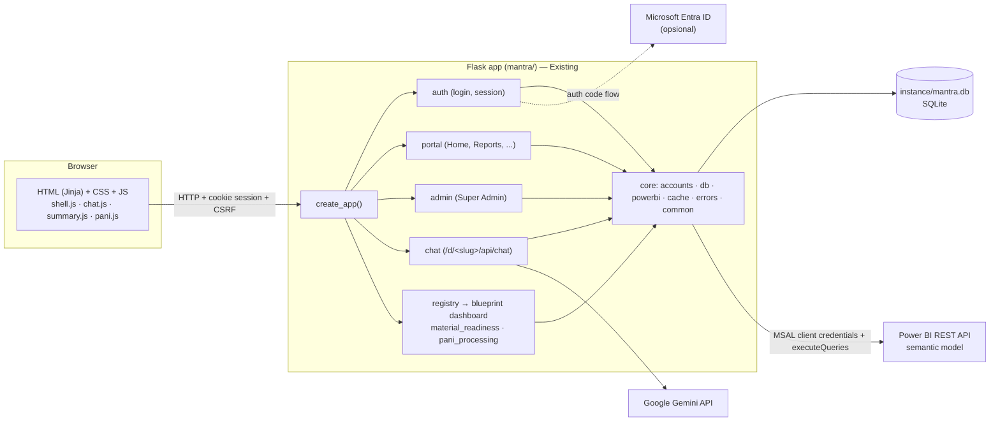

# 01 — Project Overview

## Identitas

| | |
|---|---|
| Nama project / package | **MANTRA**: Multi-Agent Network for Tracking & Reporting Analytics (`mantra/`) |
| Nama yang tampil di website | **Power BI Portal** (seluruh UI berbahasa Inggris) |
| Pemilik data | Grup PT Merdeka Copper Gold |
| Lokasi | `~/Documents/Portfolio/web-pbi-portal` (macOS) |
| Repository | `https://github.com/mhdalfarisy/web-pbi-portal.git`, branch `main` |
| Framework | Flask 3.1 |
| Target development | macOS (Apple Silicon), VS Code, Python 3.13 (Homebrew), `.venv`, `http://localhost:5001`. Tidak ada launcher Windows; padanan perintah PowerShell (referensi) di [04 §Q](04_MACOS_VSCODE_SETUP.md#q-padanan-windows-powershell) |

## Ruang lingkup

**Termasuk (Verified):**

- Portal: Home, Reports (katalog), Favorites, History, Settings.
- Login email + password; opsional login Microsoft Entra untuk email yang sudah terdaftar.
- Lupa password (diteruskan ke Super Admin, tanpa kirim email), ganti password, password sementara wajib diganti.
- Role `super_admin` dan `user`; hak akses per dashboard (default deny); halaman Admin (Users, Dashboards, Audit Log).
- Dashboard plug-in yang dideteksi otomatis. Saat ini ada dua:
  - **Material Readiness** (`/d/material-readiness/`): halaman Summary dan Detail.
  - **PROCESSING, EQUIPMENT, MINING & STOCKPILE PRODUCTION** (dashboard PANI, `/d/pani-processing/`): halaman Processing, Equipment, Mining, Production.
- Data langsung dari semantic model Power BI (`executeQueries`) dengan service principal `mantra-powerbi`.
- AI agent per dashboard (Gemini, provider bisa diganti) dengan tools yang memakai query dashboard.
- Script operasional (`scripts/`) dan test otomatis (`tests/`, pytest).

**Tidak termasuk:**

- Deployment ke cloud/server produksi (`Not Applicable` untuk playbook ini; README hanya mengingatkan
  `SESSION_COOKIE_SECURE=1` untuk HTTPS).
- Penyimpanan data dashboard di SQLite: dilarang secara arsitektur (`core/db.py` docstring).
- Pengiriman email.

## Arsitektur ringkas

Label: semua komponen di diagram ini `Existing` dan `Verified` dari kode.

## Komponen eksternal

| Layanan | Untuk | Kredensial (`.env`) | Wajib? |
|---|---|---|---|
| Power BI REST API | Data semua dashboard | `PBI_TENANT_ID`, `PBI_CLIENT_ID`, `PBI_CLIENT_SECRET` | Ya (tanpa ini halaman dashboard tampil "Could not load data") |
| Google Gemini | AI agent | `GEMINI_API_KEY` | Tidak (kosong = tombol "Ask AI" disembunyikan) |
| Microsoft Entra ID (app "MANTRA Portal") | Login Microsoft | `ENTRA_TENANT_ID`, `ENTRA_CLIENT_ID`, `ENTRA_CLIENT_SECRET` | Tidak (login email + password tetap jalan) |

## Kapan apa bisa dipakai

| Kondisi | Yang sudah bisa |
|---|---|
| `.venv` + `requirements.txt` + `FLASK_SECRET_KEY` di `.env` | Server start, halaman login tampil |
| + akun (`manage_users.py seed`) | Login, portal, admin, favorit, riwayat |
| + kredensial Power BI + akses workspace | Data dashboard tampil |
| + `GEMINI_API_KEY` | Tombol "Ask AI" muncul dan AI agent menjawab |
| + kredensial Entra | Tombol "Sign in with Microsoft" berfungsi |

## Status dashboard (dari README & kode)

| Dashboard | Slug | Semantic model | Halaman | AI tools |
|---|---|---|---|---|
| Material Readiness | `material-readiness` | "All Site - AMNT - Material Readiness" | Summary, Detail | `lookup`, `get_chart_totals`, `get_readiness_kpi`, `get_breakdown`, `get_rows` |
| PROCESSING, EQUIPMENT, MINING & STOCKPILE PRODUCTION (PANI) | `pani-processing` | "PANI - PRCS - Processing" (workspace PANI-MCG) | Processing, Equipment, Mining, Production | `get_processing_metrics`, `get_processing_trend`, `get_variance_drivers`, `get_equipment`, `get_mining`, `get_stockpile` |
