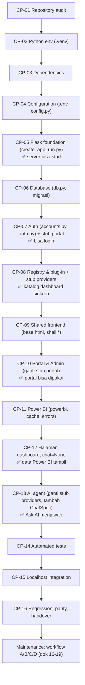

# 03 — Development Roadmap (CP-01 s.d. CP-16)

Urutan membangun MANTRA dari folder kosong sampai siap dikembangkan. Urutan mengikuti **dependency kode aktual**
(file di tahap N hanya meng-import file dari tahap < N). Panduan teknis per langkah ada di
[27_REBUILD_FROM_ZERO](27_REBUILD_FROM_ZERO.md); dokumen ini menjelaskan *apa, kenapa, dan kapan boleh lanjut*.
Versi lengkap dengan link ke setiap file: [PANDUAN_DEVELOPMENT_BERURUTAN](../PANDUAN_DEVELOPMENT_BERURUTAN.md).

Semua perintah untuk **macOS (zsh)**; padanan Windows di [04 §Q](04_MACOS_VSCODE_SETUP.md#q-padanan-windows-powershell).

## Kenapa urutannya begini (revisi 28 Okt 2026)

Versi sebelumnya menaruh Portal & Admin (CP-09) **sebelum** Registry (CP-10). Urutan itu tidak bisa dijalankan apa adanya:

| Fakta di kode | Akibat untuk urutan |
|---|---|
| `mantra/portal.py` meng-import `core.registry` dan `core.chat.providers` | Registry (dan `providers.configured()`) harus ada sebelum Portal |
| `inject_globals` di `mantra/__init__.py` memanggil `registry.current()` dan `providers.configured()` di **setiap** render | Template shell (sidebar/top bar) baru bisa dirender setelah Registry ada |
| Login sukses memanggil `url_for("portal.home")` (`auth._safe_next`) | Login baru bisa dites kalau endpoint `portal.home` sudah ada |
| Manifest dengan `chat=ChatSpec(...)` membuat `registry._load` memanggil `prompt.load()` saat start | Dashboard yang dibangun sebelum mesin AI harus memakai `chat=None` |
| `registry._load` meng-import `core.chat.prompt` di baris pertamanya, **juga untuk dashboard `chat=None`** | `core/chat/prompt.py` harus sudah ada sebelum dashboard pertama (awal CP-12). File ini hanya bergantung pada `core/powerbi.py` (CP-11) |

Karena itu urutan baru: **Auth (CP-07) → Registry (CP-08) → Shared frontend (CP-09) → Portal & Admin (CP-10)**, dengan
dua **stub** (versi sementara) supaya setiap CP bisa dites saat itu juga:

| Stub | Dibuat di | Isi | Diganti di |
|---|---|---|---|
| `mantra/portal.py` | CP-07 | blueprint `portal` + satu route `home` (`@login_required`, kembalikan teks "Login OK") | CP-10 (versi penuh) |
| `mantra/core/chat/providers.py` | CP-08 | `def configured(): return False` | CP-13 (Gemini provider penuh) |

Dan dashboard dibangun **tanpa AI dulu**: `_template` dan dashboard pertama memakai `chat=None` di CP-12; `ChatSpec`,
`tools.py`, `prompts/`, `chat_cases.py` ditambahkan di CP-13 setelah mesin AI siap.

## Peta end-to-end

Label: urutan **Target** untuk rebuild; setiap komponen yang disebut **Existing** di kode saat ini.

**Milestone:**

| Setelah | Yang bisa dilakukan |
|---|---|
| CP-05 | `python run.py` start (membutuhkan `FLASK_SECRET_KEY`) |
| CP-07 | Login email + password, ganti password wajib, halaman "Login OK" (stub) |
| CP-08 | App start dengan registry; katalog `dashboards` di DB sinkron dengan folder `mantra/dashboards/` |
| CP-10 | Portal Home/Reports/Favorites/History/Settings + Admin |
| CP-12 | Kartu dashboard di Reports; data Power BI tampil di halaman (tanpa tombol Ask AI) |
| CP-13 | AI agent menjawab |

---

### CP-01 — Repository Audit

| | |
|---|---|
| Tujuan | Tahu kondisi project sebelum mengubah apa pun |
| Alasan | Mencegah menimpa perubahan lokal yang belum di-commit dan mengubah file yang salah |
| Prasyarat | Git terpasang, akses ke folder |
| File diperiksa | Seluruh repo; fokus `README.md`, `docs/`, `.env.example`, `mantra/`, `tests/` |
| Command | `git status --short` · `git log --oneline -5` · `python -m pytest` (jika `.venv` ada) |
| Expected | Daftar file berubah; baseline test (26 Okt 2026 Windows: 58 passed; 28 Okt 2026 macOS: 58 passed. Kalau `PBI_CLIENT_ID=` kosong di `.env`, 1 test gagal, lihat dok 04 §P) |
| Verifikasi | Catat baseline test **sebelum** mengubah kode |
| Troubleshooting | Banyak file `M`/`D` → jangan `git reset --hard`; tanyakan pemilik perubahan |
| Risiko jika dilewati | Regresi tidak bisa dibedakan dari kegagalan lama |
| Acceptance | Baseline test & status git tercatat |
| Lanjut jika | Baseline jelas (lulus semua, atau kegagalan lama sudah dicatat) |

### CP-02 — Python Environment

| | |
|---|---|
| Tujuan | Interpreter terisolasi untuk project |
| Prasyarat | Python 3.13.x: `brew install python@3.13` |
| File dibuat | `.venv/` |
| Command | `python3.13 -m venv .venv` · `source .venv/bin/activate` · `python --version` · `python -c "import sys; print(sys.executable)"` |
| Expected | `Python 3.13.x`; executable `.../web-pbi-portal/.venv/bin/python` (Tested 28 Okt 2026: 3.13.17, macOS arm64) |
| Troubleshooting | `python3.13` tidak ada → `brew install python@3.13`; executable bukan `.venv` → venv lain masih aktif: `deactivate`, aktifkan ulang / pilih interpreter `./.venv/bin/python` di VS Code |
| Risiko jika dilewati | Paket global bentrok; error `cannot import name 'genai' from 'google'` (README); `python3` menunjuk versi lain (mis. 3.14) |
| Acceptance | `sys.executable` menunjuk `.venv` |
| Detail | [04](04_MACOS_VSCODE_SETUP.md), [05](05_PYTHON_ENVIRONMENT_AND_DEPENDENCIES.md) |

### CP-03 — Dependency Management

| | |
|---|---|
| Tujuan | Paket yang dibutuhkan terpasang dengan versi kompatibel |
| File | `requirements.txt`, `requirements-dev.txt` |
| Command | `pip install -r requirements.txt` · `pip install -r requirements-dev.txt` · `pip list` |
| Expected | Flask 3.1.3, Werkzeug 3.1.9, msal 1.39.0, requests 2.34.2, python-dotenv 1.2.4, google-genai 2.33.0, httpx 0.28.1, pytest 9.1.1 (versi teruji, Windows 26 Okt & macOS 28 Okt) |
| Verifikasi | `python -c "import flask, msal, requests, dotenv, httpx; from google import genai"` tanpa error |
| Troubleshooting | `ModuleNotFoundError` → cek `sys.executable` (CP-02), lalu install ulang |
| Risiko | Upgrade versi mayor tanpa test → API berubah |
| Acceptance | Import di atas sukses |

### CP-04 — Configuration Foundation

| | |
|---|---|
| Tujuan | Konfigurasi & secret di luar kode |
| File | `.env.example` → salin jadi `.env`; `mantra/config.py`; `.gitignore` |
| Urutan | 1) `cp .env.example .env` 2) isi `FLASK_SECRET_KEY` (`python -c "import secrets; print(secrets.token_hex(32))"`) 3) `AUTH_DISABLED=0` 4) kredensial Power BI/Gemini/Entra bila ada |
| Expected | `create_app()` tidak lagi error `FLASK_SECRET_KEY belum diisi di .env` |
| Verifikasi | `python -c "from mantra.config import Config; print(Config.PORT, Config.AUTH_DISABLED)"` |
| Risiko | `.env` ter-commit → secret bocor; `AUTH_DISABLED=1` di production → tanpa login |
| Detail | [06](06_CONFIGURATION_GUIDE.md) |

### CP-05 — Flask Application Foundation

| | |
|---|---|
| Tujuan | Aplikasi bisa start dan menerima request |
| File | `run.py`, `mantra/__init__.py` (`create_app`), `mantra/config.py`; launcher opsional `run_mantra.command` |
| Dependency | CP-04 |
| Isi minimal | factory: `Flask(...)`, `from_object(Config)`, `test_config`, cek `SECRET_KEY`. Hook CSRF / header / error handler ditambahkan di CP-07 bersama blueprint pertama |
| Command | `python run.py` |
| Expected | ` * Power BI Portal: http://localhost:5001  \|  Login: ON (email + password)  \|  Debug: OFF` |
| Verifikasi | `curl -s -o /dev/null -w "%{http_code}\n" http://localhost:5001/` → `404` (wajar, belum ada route) |
| Belum tersedia | Login (CP-07), data dashboard (CP-11/12), AI (CP-13) |
| Troubleshooting | `Address already in use` → `lsof -nP -iTCP:5001 -sTCP:LISTEN`, `kill <PID>`, atau ganti `PORT` di `.env` (dan redirect URI Entra). Hindari 5000 (AirPlay Receiver macOS) |
| Detail | [07](07_FLASK_STARTUP_AND_REQUEST_LIFECYCLE.md) |

### CP-06 — Database Foundation

| | |
|---|---|
| Tujuan | Penyimpanan akun, hak akses, audit, favorit, riwayat |
| File | `mantra/core/db.py` (MIGRATIONS v1-v3); `db.init_app(app)` di `create_app` |
| Perilaku | Saat start: `migrate()` memasang versi yang belum ada; DB berisi data di-backup ke `instance/backups/mantra-<waktu>-before-v<N>.db` |
| Command | `python run.py` (migrasi otomatis) · `sqlite3 instance/mantra.db "PRAGMA user_version; .tables"` |
| Expected | Log `Database dimigrasi dari versi 0 ke 3` di DB baru; `3` + 6 tabel |
| Test (dijalankan di CP-14) | `test_passwords_and_database.py::test_migration_keeps_existing_data_and_backs_up` |
| Risiko | Mengubah migrasi lama → DB berbeda antar laptop |
| Detail | [11](11_DATABASE_AND_MIGRATIONS.md) |

### CP-07 — Authentication & Authorization (+ stub portal)

| | |
|---|---|
| Tujuan | Hanya user terdaftar yang masuk; dasar pengecekan hak akses |
| File | `core/accounts.py` → `core/auth.py` → **stub** `mantra/portal.py` → aset & template akun (`static/img/mantra-mark.svg`, `static/css/shell.css`, `static/css/portal.css`, `portal/_ui.html`, `_auth_layout.html`, `login.html`, `forgot_password.html`, `bare.html`, `change_password.html`, `error.html`) → `scripts/manage_users.py` |
| Di `create_app` | register `auth.bp` + stub `portal.bp`; `csrf_protect` (before_request), `security_headers` (after_request), `inject_globals` versi awal (`csrf_token`, `current_user`), error handler 400/404/500 |
| Kenapa stub portal | `auth._safe_next()` memanggil `url_for("portal.home")`; tanpa endpoint itu login sukses jadi 500 (BuildError). Halaman login sendiri tidak butuh sidebar, jadi bisa dites sebelum CP-09 |
| Stub | `bp = Blueprint("portal", __name__)` + `@bp.get("/") @login_required def home(): return f"Login OK sebagai {current_user()['email']}"` |
| Command | `export MANTRA_SEED_PASSWORD='<sementara>'` · `python scripts/manage_users.py seed` · `unset MANTRA_SEED_PASSWORD` (atau `seed --generate`) · `python run.py` |
| Expected | Login berhasil → wajib ganti password sementara → "Login OK sebagai ..."; POST tanpa token → 400; `X-Frame-Options: DENY` |
| Belum bisa | Halaman error (mis. 404) **saat sudah login** memakai `portal/base.html` + sidebar → baru jalan setelah CP-09/10. Sebelum login, error memakai `bare.html` dan sudah jalan |
| Test (dijalankan di CP-14) | `test_login_and_access.py` (bagian login, lockout, throttle, CSRF), `test_forgot_password.py` |
| Detail | [12](12_AUTHENTICATION_AUTHORIZATION.md) |

### CP-08 — Dashboard Registry (+ stub providers)

| | |
|---|---|
| Tujuan | Sistem plug-in dashboard + guard akses di setiap route dashboard |
| File | **stub** `core/chat/__init__.py` + `core/chat/providers.py` (`configured()` → `False`) → `core/registry.py` (`Tool`, `ChatSpec`, `Dashboard`, `_guard`, `_load`, `module_names`, `manifests`, `init_app`) → `mantra/dashboards/__init__.py` |
| Di `create_app` | `registry.init_app(app)` lalu `accounts.sync_dashboards(conn, registry.all_dashboards())` |
| Kenapa sebelum Portal | `portal.py` dan `inject_globals` memakai `registry` & `providers.configured()` |
| Kenapa stub providers | Mesin AI baru dibangun di CP-13; sampai saat itu `chat_enabled` selalu `False` (tombol Ask AI tersembunyi) |
| Verifikasi | `python run.py` start; `sqlite3 instance/mantra.db "select count(*) from dashboards"` → `0` (folder dashboard masih kosong) |
| Detail | [14](14_DASHBOARD_REGISTRY.md) |

### CP-09 — Shared Frontend Foundation

| | |
|---|---|
| Tujuan | Kerangka tampilan seragam (sidebar, top bar, konten) |
| File | `templates/components/sidebar.html`, `components/topbar.html`, `templates/base.html`, `portal/base.html`, `static/js/shell.js` (`shell.css`, `_ui.html`, logo sudah dari CP-07) |
| Di `create_app` | `inject_globals` lengkap: `user_is_admin`, `pending_resets`, `dashboard`, `chat_enabled`, `report_favorite`; `jinja_env.globals["now_str"]` |
| Catatan | Sidebar memanggil `url_for` ke endpoint portal & admin; **verifikasi tampilan dilakukan di akhir CP-10** |
| Risiko | Satu kesalahan di sini merusak **semua** halaman |
| Detail | [08](08_FRONTEND_ARCHITECTURE.md) |

### CP-10 — Portal Pages & Admin (ganti stub portal)

| | |
|---|---|
| File | `mantra/portal.py` (**timpa stub CP-07**), `templates/portal/{home,reports,favorites,history,settings,denied}.html`, `static/js/portal.js`; `mantra/admin.py` (register `admin.bp`), `templates/admin/*` |
| Verifikasi | Home, Reports (masih kosong), Favorites, History, Settings, Admin > Users/Dashboards/Audit dapat dibuka sesuai role; user biasa → `/admin/users` 403; resize 1200/900 px mengubah mode sidebar |
| Test (dijalankan di CP-14) | `test_login_and_access.py` (admin, favorit tidak bisa untuk dashboard tanpa akses) |
| Detail | [13](13_PORTAL_DEVELOPMENT.md) |

### CP-11 — Power BI Integration

| | |
|---|---|
| File | `core/common.py`, `core/powerbi.py`, `core/cache.py`, `core/errors.py`, `scripts/check_setup.py` |
| Prasyarat eksternal | App registration `mantra-powerbi` + secret; anggota grup `sg-powerbi-api`; Contributor di workspace (README langkah 3) |
| Command | `python scripts/check_setup.py` |
| Expected | Cek `.env`, token Power BI `OK` (`SEMUA CEK LULUS` setelah dashboard punya akses workspace) |
| Detail | [15](15_POWERBI_INTEGRATION.md) |

### CP-12 — Dashboard Pages (tanpa AI: `chat=None`)

| | |
|---|---|
| File (urut) | `core/chat/prompt.py` (versi penuh; dibutuhkan `registry._load` untuk **setiap** dashboard) → kerangka report bersama: `templates/dashboard/{base,_icons,empty,error}.html`, `static/css/dashboard.css`, `static/js/dash-common.js` → `dashboards/_template/{queries,routes}.py`, `templates/__NAME__/overview.html`, `static/.gitkeep`, `__init__.py` (**`chat=None`**) → `scripts/create_dashboard.py` → dashboard nyata: `queries.py` → `routes.py` → `templates/` → `static/` → `__init__.py` (**`chat=None`**) |
| Import manifest tanpa AI | `from ...core.registry import Dashboard` + `from . import queries` saja: **buang** `ChatSpec`, `tools`, dan `Path` dari import (versi final di repo memakainya; `tools.py` belum ada → `ImportError`) |
| Kenapa `chat=None` | `ChatSpec` memicu `prompt.load()` saat start, yang membaca `core/prompts/base.md` + `prompts/*.md` dan mencocokkan nama tool; semua itu baru dibuat di CP-13 → app gagal start |
| Gejala kalau `prompt.py` belum ada | `ImportError: cannot import name 'prompt' from 'mantra.core.chat'` saat start, walaupun manifest `chat=None` |
| Verifikasi | Dashboard `ready=False` tampil "Coming soon"; setelah `ready=True` data tampil; user tanpa akses → 403; angka sama dengan report Power BI (PANI: `python scripts/compare_pani_with_powerbi.py`) |
| Detail | [16](16_DASHBOARD_PAGE_DEVELOPMENT.md), [17](17_NEW_DASHBOARD_DEVELOPMENT.md) |

### CP-13 — AI Agent (ganti stub providers, tambah `ChatSpec`)

| | |
|---|---|
| File (urut) | `core/prompts/base.md` → `core/chat/guards.py` → (`core/chat/prompt.py` sudah dari CP-12) → `core/chat/providers.py` (**timpa stub CP-08**) → `core/chat/engine.py` → `core/chat/routes.py` (register `chat.bp`) → `static/js/chat.js` (panel & tombol sudah ada di `dashboard/base.html` / `topbar.html`) → per dashboard: `tools.py`, `prompts/system.md`, `prompts/data_dictionary.md`, `chat_cases.py`, `window.DashContext`/`DashFilters` di JS halaman, lalu `chat=ChatSpec(...)` di `__init__.py` → `_template` juga diberi `tools.py`, `chat_cases.py`, `prompts/`, `ChatSpec` → `scripts/check_ai_agent.py` |
| Prasyarat | `GEMINI_API_KEY` di `.env` |
| Command | `python scripts/check_ai_agent.py --static` → `SEMUA LULUS`; `--dashboard <slug>` (pakai kuota) |
| Verifikasi | Tombol Ask AI tampil di halaman report; jawaban sama dengan angka chart; `GEMINI_API_KEY` kosong → tombol hilang |
| Detail | [20](20_AI_AGENT_DEVELOPMENT.md), [29-33](29_AI_CHAT_FLOW_AND_TOOL_CALLING.md) |

### CP-14 — Automated Testing

| | |
|---|---|
| Prasyarat | CP-13 selesai **dan** kedua dashboard (`material-readiness`, `pani-processing`) ada: `tests/conftest.py` meng-import `mantra.core.chat.routes` dan memberi akses ke kedua dashboard di setiap test. Sebelum titik ini pytest gagal total, jadi CP-05..CP-13 dicek manual |
| Command | `python -m pytest` |
| Expected | `58 passed` (Tested 26 Okt 2026 Windows, ± 50-75 detik). macOS 28 Okt 2026: 58 passed (± 36 detik) |
| Detail | [21](21_TESTING_AND_REGRESSION.md) |

### CP-15 — Localhost Integration

| | |
|---|---|
| Command | `python run.py` atau double-click `run_mantra.command` |
| Verifikasi | Smoke test dok 22 (redirect login, 401 API, 400 CSRF, header keamanan, 404) |
| Detail | [22](22_LOCALHOST_RUNBOOK.md) |

### CP-16 — Regression, Parity, Handover

| | |
|---|---|
| Isi | Matriks fitur vs test, known issues, langkah lanjutan |
| Detail | [28](28_PARITY_AND_HANDOVER.md) |

## Aturan "lanjut atau perbaiki"

Lanjut ke CP berikutnya **hanya jika** acceptance CP saat ini terpenuhi **dan** `python -m pytest` (mulai CP-14)
tidak menghasilkan kegagalan baru dibanding baseline CP-01. Kalau gagal: perbaiki di CP saat ini; jangan menambal
gejala di CP yang lebih atas (mis. jangan memperbaiki error login dengan mengubah template). Stub dari CP-07/CP-08
**wajib** sudah diganti versi penuh sebelum CP-14; cek dengan `grep -n "Login OK" mantra/portal.py` dan
`grep -n "^class GeminiProvider" mantra/core/chat/providers.py` (yang pertama harus kosong, yang kedua harus ada).
