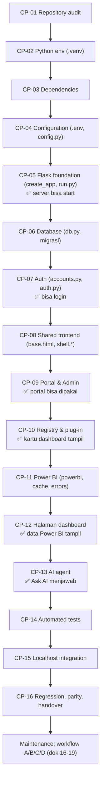

# 03 — Development Roadmap (CP-01 s.d. CP-16)

Urutan membangun MANTRA dari folder kosong sampai siap dikembangkan. Urutan mengikuti **dependency kode aktual**
(file di tahap N hanya meng-import file dari tahap < N). Panduan teknis per langkah ada di
[27_REBUILD_FROM_ZERO](27_REBUILD_FROM_ZERO.md); dokumen ini menjelaskan *apa, kenapa, dan kapan boleh lanjut*.

## Peta end-to-end

Label: urutan **Target** untuk rebuild; setiap komponen yang disebut **Existing** di kode saat ini.

**Milestone:**

| Setelah | Yang bisa dilakukan |
|---|---|
| CP-05 | `python run.py` start (membutuhkan `FLASK_SECRET_KEY`) |
| CP-07 | Login email + password, ganti password |
| CP-09 | Portal Home/Reports/Favorites/History/Settings + Admin |
| CP-10 | Kartu dashboard muncul di Reports (tanpa data) |
| CP-12 | Data Power BI tampil di halaman |
| CP-13 | AI agent menjawab |

---

### CP-01 — Repository Audit

| | |
|---|---|
| Tujuan | Tahu kondisi project sebelum mengubah apa pun |
| Alasan | Mencegah menimpa perubahan lokal yang belum di-commit dan mengubah file yang salah |
| Prasyarat | Git terpasang, akses ke folder |
| File diperiksa | Seluruh repo; fokus `README.md`, `docs/`, `.env.example`, `mantra/`, `tests/` |
| Command | `git status --short` · `git log --oneline -5` · `python -m pytest` (jika `.venv` ada) |
| Expected | Daftar file berubah; baseline test (per 26 Okt 2026: 58 passed) |
| Verifikasi | Catat baseline test **sebelum** mengubah kode |
| Troubleshooting | Banyak file `M`/`D` → jangan `git reset --hard`; tanyakan pemilik perubahan |
| Risiko jika dilewati | Regresi tidak bisa dibedakan dari kegagalan lama |
| Acceptance | Baseline test & status git tercatat |
| Lanjut jika | Baseline jelas (lulus semua, atau kegagalan lama sudah dicatat) |

### CP-02 — Python Environment

| | |
|---|---|
| Tujuan | Interpreter terisolasi untuk project |
| Prasyarat | Python 3.13.x (teruji 3.13.3), opsi "Add python.exe to PATH" |
| File dibuat | `.venv/` |
| Command | `py -m venv .venv` (atau `python -m venv .venv`) · `.\.venv\Scripts\Activate.ps1` · `python --version` · `python -c "import sys; print(sys.executable)"` |
| Expected | `Python 3.13.3`; executable `...\Web App MANTRA\.venv\Scripts\python.exe` (Tested 26 Okt) |
| Troubleshooting | `Activate.ps1` diblokir → `Set-ExecutionPolicy -Scope CurrentUser RemoteSigned`; executable bukan `.venv` → aktifkan ulang / pilih interpreter di VS Code |
| Risiko jika dilewati | Paket global bentrok; error `cannot import name 'genai' from 'google'` (README) |
| Acceptance | `sys.executable` menunjuk `.venv` |
| Detail | [04](04_WINDOWS_VSCODE_SETUP.md), [05](05_PYTHON_ENVIRONMENT_AND_DEPENDENCIES.md) |

### CP-03 — Dependency Management

| | |
|---|---|
| Tujuan | Paket yang dibutuhkan terpasang dengan versi kompatibel |
| File | `requirements.txt`, `requirements-dev.txt` |
| Command | `pip install -r requirements.txt` · `pip install -r requirements-dev.txt` · `pip list` |
| Expected | Flask 3.1.3, Werkzeug 3.1.9, msal 1.39.0, requests 2.34.2, python-dotenv 1.2.4, google-genai 2.33.0, httpx 0.28.1, pytest 9.1.1 (versi teruji, Tested 26 Okt) |
| Verifikasi | `python -c "import flask, msal, requests, dotenv, httpx; from google import genai"` tanpa error |
| Troubleshooting | `ModuleNotFoundError` → cek `sys.executable` (CP-02), lalu install ulang |
| Risiko | Upgrade versi mayor tanpa test → API berubah |
| Acceptance | Import di atas sukses |

### CP-04 — Configuration Foundation

| | |
|---|---|
| Tujuan | Konfigurasi & secret di luar kode |
| File | `.env.example` → salin jadi `.env`; `mantra/config.py`; `.gitignore` |
| Urutan | 1) `Copy-Item .env.example .env` 2) isi `FLASK_SECRET_KEY` (`python -c "import secrets; print(secrets.token_hex(32))"`) 3) `AUTH_DISABLED=0` 4) kredensial Power BI/Gemini/Entra bila ada |
| Expected | `create_app()` tidak lagi error `FLASK_SECRET_KEY belum diisi di .env` |
| Verifikasi | `python -c "from mantra.config import Config; print(Config.PORT, Config.AUTH_DISABLED)"` |
| Risiko | `.env` ter-commit → secret bocor; `AUTH_DISABLED=1` di production → tanpa login |
| Detail | [06](06_CONFIGURATION_GUIDE.md) |

### CP-05 — Flask Application Foundation

| | |
|---|---|
| Tujuan | Aplikasi bisa start dan menerima request |
| File | `run.py`, `mantra/__init__.py` (`create_app`), `mantra/config.py` |
| Dependency | CP-04 |
| Isi minimal | factory, CSRF `before_request`, header keamanan `after_request`, error handler 400/404/500 |
| Command | `python run.py` |
| Expected | ` * Power BI Portal: http://localhost:5001  \|  Login: ON (email + password)  \|  Debug: OFF` |
| Verifikasi | Browser `http://localhost:5001/login` → 200 |
| Belum tersedia | Data dashboard (CP-11), AI (CP-13) |
| Troubleshooting | Port dipakai → ganti `PORT` di `.env` (dan redirect URI Entra) |
| Detail | [07](07_FLASK_STARTUP_AND_REQUEST_LIFECYCLE.md) |

### CP-06 — Database Foundation

| | |
|---|---|
| Tujuan | Penyimpanan akun, hak akses, audit, favorit, riwayat |
| File | `mantra/core/db.py` (MIGRATIONS v1-v3) |
| Perilaku | Saat start: `migrate()` memasang versi yang belum ada; DB berisi data di-backup ke `instance/backups/mantra-<waktu>-before-v<N>.db` |
| Command | `python run.py` (migrasi otomatis) |
| Expected | Log `Database dimigrasi dari versi 0 ke 3` di DB baru |
| Test | `test_passwords_and_database.py::test_migration_keeps_existing_data_and_backs_up` |
| Risiko | Mengubah migrasi lama → DB berbeda antar laptop |
| Detail | [11](11_DATABASE_AND_MIGRATIONS.md) |

### CP-07 — Authentication & Authorization

| | |
|---|---|
| Tujuan | Hanya user terdaftar yang masuk; setiap user hanya membuka dashboard yang diizinkan |
| File | `core/accounts.py`, `core/auth.py`, template `portal/login.html`, `forgot_password.html`, `change_password.html` |
| Command | `python scripts\manage_users.py seed` (dengan `$env:MANTRA_SEED_PASSWORD` atau `--generate`) |
| Expected | Login berhasil → wajib ganti password sementara → Home |
| Test | `test_login_and_access.py`, `test_forgot_password.py` |
| Detail | [12](12_AUTHENTICATION_AUTHORIZATION.md) |

### CP-08 — Shared Frontend Foundation

| | |
|---|---|
| Tujuan | Kerangka tampilan seragam (sidebar, top bar, konten) |
| File | `templates/base.html`, `components/sidebar.html`, `components/topbar.html`, `portal/_ui.html`, `static/css/shell.css`, `static/js/shell.js` |
| Verifikasi | Semua halaman setelah login punya sidebar + top bar; resize 1200/900 px mengubah mode sidebar |
| Risiko | Satu kesalahan di sini merusak **semua** halaman |
| Detail | [08](08_FRONTEND_ARCHITECTURE.md) |

### CP-09 — Portal Pages

| | |
|---|---|
| File | `mantra/portal.py`, `mantra/admin.py`, `templates/portal/*`, `templates/admin/*`, `static/css/portal.css`, `static/js/portal.js` |
| Verifikasi | Home, Reports, Favorites, History, Settings, Admin > Users/Dashboards/Audit dapat dibuka sesuai role |
| Test | `test_login_and_access.py` (admin, favorit tidak bisa untuk dashboard tanpa akses) |
| Detail | [13](13_PORTAL_DEVELOPMENT.md) |

### CP-10 — Dashboard Registry

| | |
|---|---|
| File | `core/registry.py`, `mantra/dashboards/__init__.py`, `dashboards/<x>/__init__.py` (manifest) |
| Perilaku | Auto-discovery; `_guard` di setiap route dashboard; `accounts.sync_dashboards` menyamakan katalog DB |
| Verifikasi | Kartu muncul di Reports untuk Super Admin; user hanya melihat dashboard yang di-assign |
| Detail | [14](14_DASHBOARD_REGISTRY.md) |

### CP-11 — Power BI Integration

| | |
|---|---|
| File | `core/powerbi.py`, `core/cache.py`, `core/errors.py`, `core/common.py` |
| Prasyarat eksternal | App registration `mantra-powerbi` + secret; anggota grup `sg-powerbi-api`; Contributor di workspace (README langkah 3) |
| Command | `python scripts\check_setup.py` |
| Expected | Semua cek `OK` |
| Detail | [15](15_POWERBI_INTEGRATION.md) |

### CP-12 — Dashboard Pages

| | |
|---|---|
| File | `dashboards/<x>/queries.py`, `routes.py`, `templates/`, `static/`, `templates/dashboard/base.html`, `static/css/dashboard.css`, `static/js/dash-common.js` |
| Verifikasi | Angka sama dengan report Power BI (untuk PANI: `python scripts\compare_pani_with_powerbi.py`) |
| Detail | [16](16_DASHBOARD_PAGE_DEVELOPMENT.md), [17](17_NEW_DASHBOARD_DEVELOPMENT.md) |

### CP-13 — AI Agent

| | |
|---|---|
| File | `core/chat/*`, `core/prompts/base.md`, `dashboards/<x>/tools.py`, `prompts/`, `chat_cases.py`, `static/js/chat.js` |
| Command | `python scripts\check_ai_agent.py --static` → `SEMUA LULUS`; `--dashboard <slug>` (pakai kuota) |
| Detail | [20](20_AI_AGENT_DEVELOPMENT.md), [29-33](29_AI_CHAT_FLOW_AND_TOOL_CALLING.md) |

### CP-14 — Automated Testing

| | |
|---|---|
| Command | `python -m pytest` |
| Expected | `58 passed` (Tested 26 Okt 2026, ± 50-75 detik) |
| Detail | [21](21_TESTING_AND_REGRESSION.md) |

### CP-15 — Localhost Integration

| | |
|---|---|
| Command | `python run.py` atau double-click `run_mantra.bat` |
| Verifikasi | Smoke test dok 22 (Tested 26 Okt: redirect login, 401 API, 400 CSRF, header keamanan, 404) |
| Detail | [22](22_LOCALHOST_RUNBOOK.md) |

### CP-16 — Regression, Parity, Handover

| | |
|---|---|
| Isi | Matriks fitur vs test, known issues, langkah lanjutan |
| Detail | [28](28_PARITY_AND_HANDOVER.md) |

## Aturan "lanjut atau perbaiki"

Lanjut ke CP berikutnya **hanya jika** acceptance CP saat ini terpenuhi **dan** `python -m pytest` (mulai CP-14)
tidak menghasilkan kegagalan baru dibanding baseline CP-01. Kalau gagal: perbaiki di CP saat ini; jangan menambal
gejala di CP yang lebih atas (mis. jangan memperbaiki error login dengan mengubah template).
