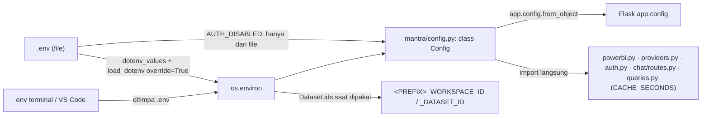

# 06 — Configuration Guide

### A. Objective
Memahami dan mengisi konfigurasi MANTRA dengan aman.

### B. When to use
Setup, ganti kredensial, menambah variabel baru, debugging perilaku yang "tidak sesuai `.env`".

### C. Prerequisites
`.env` disalin dari `.env.example`. **Jangan pernah** menampilkan/commit isi `.env`.

### D. Architecture context



Catatan penting (Verified dari `config.py`):
1. `.env` **selalu menang** atas variabel yang sudah ada di environment. Konsekuensi: `$env:PORT=5002; python run.py`
   tidak berpengaruh jika `.env` berisi `PORT`. Ubah `.env`.
2. `AUTH_DISABLED` **hanya** dibaca dari file `.env` (`_env_file_flag`), supaya login tidak bisa dimatikan lewat
   environment.
3. Test tidak bisa mengandalkan environment; `tests/conftest.py` mengisi `Config` langsung.

### E. Files involved
`.env`, `.env.example`, `mantra/config.py`, `mantra/core/powerbi.py` (`Dataset.ids`), `.gitignore`.

### F. Step-by-step instructions
1. `Copy-Item .env.example .env`
2. Isi `FLASK_SECRET_KEY`: `python -c "import secrets; print(secrets.token_hex(32))"`
3. Pastikan `AUTH_DISABLED=0` (login wajib).
4. Isi `PBI_CLIENT_ID`, `PBI_CLIENT_SECRET` (dan `PBI_TENANT_ID` atau `ENTRA_TENANT_ID`).
5. Opsional: `GEMINI_API_KEY`, `ENTRA_*`.
6. Jalankan `python scripts\check_setup.py` (memanggil layanan asli; tidak mencetak secret).

### G. Code or patch — configuration matrix (Verified)

| Variabel | Default di kode | Dibaca oleh | Fungsi |
|---|---|---|---|
| `PORT` | 5001 | `run.py` | Port lokal; redirect URI Entra harus sama |
| `FLASK_SECRET_KEY` | — (**wajib**) | `create_app` | Menandatangani cookie session; ganti = semua user logout |
| `SESSION_COOKIE_SECURE` | 0 | Flask | Wajib 1 bila HTTPS |
| `FLASK_DEBUG` | 0 | `run.py` | Debugger + reload (bisa eksekusi kode: dev saja) |
| `SESSION_HOURS` | 8 | Flask (`PERMANENT_SESSION_LIFETIME`) | Lama sesi |
| `DASHBOARD_STRICT` | 1 | `registry.init_app` | 1 = dashboard rusak → app gagal start; 0 = disembunyikan + log |
| `ENTRA_TENANT_ID`, `ENTRA_CLIENT_ID`, `ENTRA_CLIENT_SECRET` | kosong | `auth.py` | Login Microsoft (opsional) |
| `AUTH_DISABLED` | 0 (hanya file) | `auth.py`, template | 1 = tanpa login sebagai Super Admin dev |
| `PBI_TENANT_ID` | = `ENTRA_TENANT_ID` | `powerbi.py` | Tenant service principal |
| `PBI_CLIENT_ID`, `PBI_CLIENT_SECRET` | kosong | `powerbi.py` | Service principal `mantra-powerbi` |
| `PBI_MAX_QUERIES_PER_MINUTE` | 100 | `powerbi._RateLimiter` | Batas bersama semua dashboard |
| `PBI_TIMEOUT_SECONDS` | 120 | `powerbi.request` | Timeout per request |
| `CACHE_MINUTES` | 10 | `Config.CACHE_SECONDS` → `Cache` | TTL cache query |
| `AI_PROVIDER` | gemini | `providers.py` | Kunci `PROVIDERS` |
| `GEMINI_API_KEY` | kosong | `providers.py` | Kosong = AI dimatikan |
| `GEMINI_MODEL` | gemini-3.5-flash | `providers.py` | Model utama |
| `GEMINI_FALLBACK_MODELS` | gemini-3.1-flash-lite,gemini-flash-latest | `providers.py` | Cadangan (koma) |
| `CHAT_MAX_PER_MINUTE` | 10 | `chat/routes.py` | Batas pertanyaan per user |
| `MATERIAL_READINESS_WORKSPACE_ID` / `_DATASET_ID` | ID di `queries.py` | `Dataset.ids` | Timpa dataset (mis. dev) |
| `PANI_PROCESSING_WORKSPACE_ID` / `_DATASET_ID` | ID di `queries.py` | `Dataset.ids` | Sama (prefix `PANI_PROCESSING`; tidak tercantum di `.env.example`) |
| `MANTRA_SEED_PASSWORD` | — | `manage_users.py seed` | Hanya saat seed; jangan simpan di `.env` |

### H. Code explanation
`Config` adalah class biasa yang dievaluasi **sekali saat import**. Mengubah `.env` butuh **restart** proses.
Nilai yang dipakai Flask (`SECRET_KEY`, `SESSION_*`, `PERMANENT_SESSION_LIFETIME`) masuk lewat
`app.config.from_object(Config)`; modul lain membaca `Config.X` langsung.

### I. Commands
```powershell
python -c "from mantra.config import Config; print(Config.PORT, Config.AUTH_DISABLED, Config.AI_PROVIDER)"
python scripts\check_setup.py
```

### J. Expected result
Nilai sesuai `.env`; `check_setup.py` diakhiri `SEMUA CEK LULUS`.

### K. Validation
`test_passwords_and_database.py::test_auth_disabled_is_read_only_from_env_file` dan
`::test_env_file_wins_over_inherited_terminal_variables`.

### L. Troubleshooting
| Gejala | Solusi |
|---|---|
| `RuntimeError: FLASK_SECRET_KEY belum diisi di .env` | Isi `FLASK_SECRET_KEY` |
| Perubahan `.env` tidak berpengaruh | Restart server |
| Variabel terminal "tidak terbaca" | `.env` menang; ubah `.env` |
| Tombol Ask AI tidak muncul | `GEMINI_API_KEY` kosong atau `AI_PROVIDER` bukan `gemini` |

### M. Regression impact
Variabel baru harus: ditambahkan di `Config`, didokumentasikan di `.env.example` + tabel ini, dan default-nya aman.

### N. Acceptance criteria
App start tanpa error konfigurasi; `.env` tidak masuk `git status`.

### O. Documentation updates
`.env.example`, tabel G, `docs/AUTH.md` bagian Konfigurasi bila menyangkut login.

### P. Actual status
| Item | Status |
|---|---|
| Semua variabel `.env` dibaca kode | PASS (audit nama variabel, nilai tidak dibaca) |
| `check_setup.py` | NOT RUN (layanan asli) |
