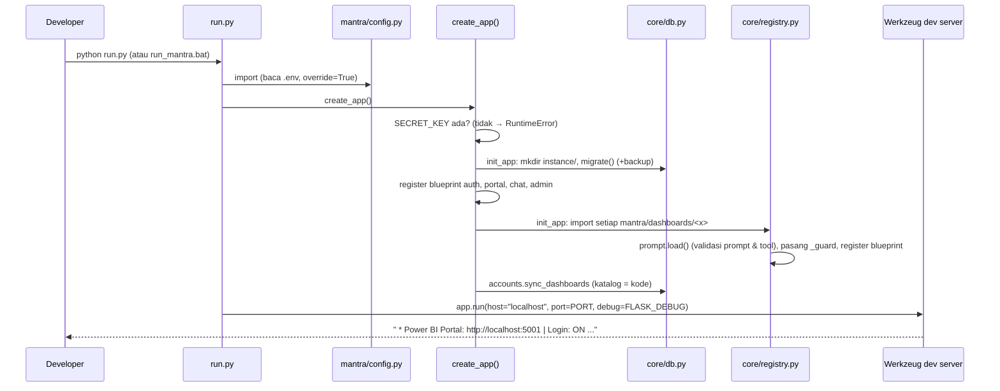
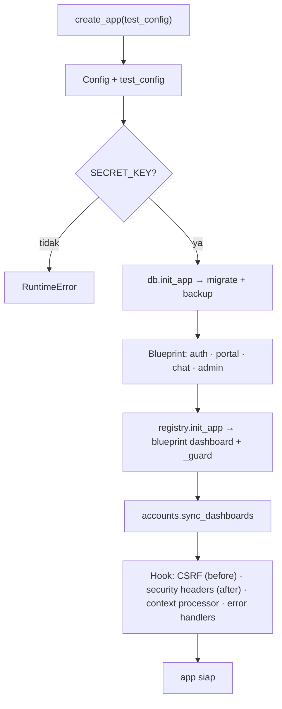
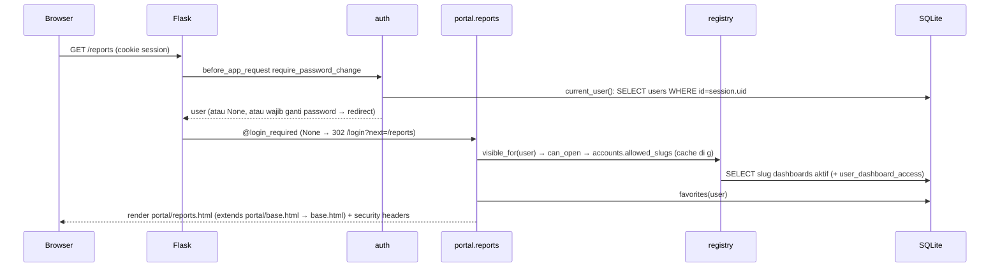
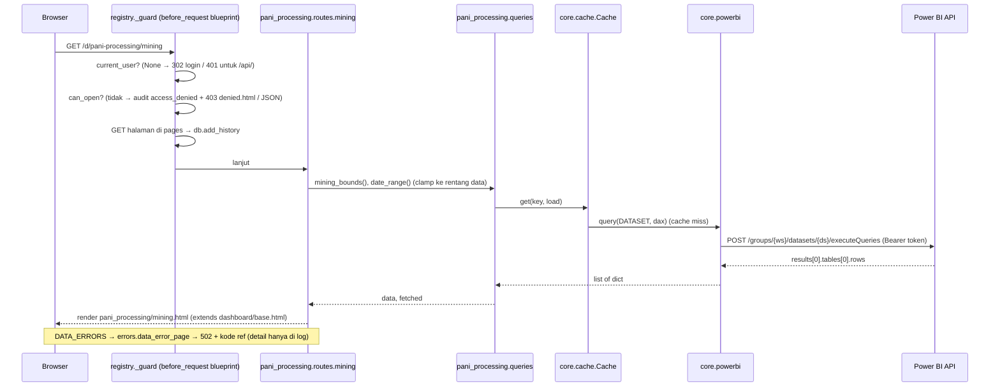

# 07 — Flask Startup & Request Lifecycle

Semua diagram di sini `Existing` dan `Verified` dari kode.

## 1. Project startup (terminal → server siap)

| | |
|---|---|
| Titik awal | `python run.py` |
| File | `run.py`, `config.py`, `__init__.py`, `core/db.py`, `core/registry.py`, `core/chat/prompt.py`, `core/accounts.py`, `dashboards/*/__init__.py` |
| Input / output | `.env`, `instance/mantra.db` → server mendengar di `localhost:<PORT>` |
| Kondisi gagal | `FLASK_SECRET_KEY` kosong; DB versi lebih baru dari kode; prompt rusak (placeholder/tool tidak dikenal); manifest dashboard salah (`DASHBOARD_STRICT=1` → gagal start); port dipakai (`OSError`) |
| Cara uji | `python run.py` lalu buka `/login`; `test_errors_and_security.py::test_create_app_can_run_twice` |

`run.py` selalu mencetak penyebab berhenti: `stopped (Ctrl+C or terminal closed)` atau `crashed (exit code N)`.

## 2. Application factory (`create_app`) — urutan aktual

1. `Flask(__name__, instance_path=Config.INSTANCE_DIR)`; `app.config.from_object(Config)`; `test_config` menimpa (test).
2. `db.init_app(app)` — migrasi + `teardown_appcontext` untuk menutup koneksi.
3. `register_blueprint`: `auth.bp`, `portal.bp`, `chat_routes.bp`, `admin.bp`.
4. `registry.init_app(app)` — semua dashboard.
5. `accounts.sync_dashboards(conn, registry.all_dashboards())`.
6. Log peringatan: variabel env yang tertimpa `.env`; `AUTH_DISABLED=1`.
7. `jinja_env.globals["now_str"]`.
8. `before_request csrf_protect` — setiap **POST** wajib `_csrf` (form) atau header `X-CSRF-Token` (fetch) sama dengan
   `session["_csrf"]` (`hmac.compare_digest` atas bytes). Gagal → 400.
9. `after_request security_headers` — `X-Frame-Options: DENY`, `X-Content-Type-Options: nosniff`,
   `Referrer-Policy: same-origin`.
10. `context_processor inject_globals` — `csrf_token()`, `current_user`, `user_is_admin`, `pending_resets`,
    `dashboard` (dashboard request ini), `chat_enabled`, `report_favorite`.
11. Error handler 400/404/500 — JSON bila path mengandung `/api/` atau request JSON, selain itu `portal/error.html`.

## 3. Kapan aplikasi pertama kali bisa jalan

Cukup `.venv` + dependency + `FLASK_SECRET_KEY`. Tanpa akun, halaman login tampil tetapi tidak ada yang bisa masuk
(kecuali `AUTH_DISABLED=1`). Tanpa kredensial Power BI, halaman dashboard tampil "Could not load data from Power BI"
(HTTP 502). Tanpa `GEMINI_API_KEY`, tombol Ask AI tidak ada.

## 4. Portal request lifecycle (contoh `GET /reports`)

| | |
|---|---|
| Kondisi gagal | Session tidak valid (akun nonaktif / `session_version` berubah) → `session.clear()` → redirect login |
| Cara uji | `test_login_and_access.py::test_anonymous_is_redirected_or_401`, `::test_user_sees_only_granted_dashboards`; smoke: `curl -I http://localhost:5001/reports` → 302 ke `/login?next=/reports` (Tested 26 Okt) |

## 5. Dashboard request lifecycle (contoh `GET /d/pani-processing/mining?start=...&end=...`)

| | |
|---|---|
| Kondisi gagal | 403 (tanpa akses), 502 (Power BI), halaman "No data available yet" (tabel kosong) |
| Cara uji | `test_login_and_access.py::test_direct_url_to_other_dashboard_is_403`, `test_errors_and_security.py::test_empty_model_shows_no_data_page` |

## 6. Urutan hook per request

`before_request` app (CSRF, hanya POST) → `before_app_request` auth (`require_password_change`) →
`before_request` blueprint (dashboard: `_guard`) → view → `after_request` (security headers) →
`teardown_appcontext` (tutup koneksi DB).

Pengecualian: `require_password_change` mengizinkan endpoint `auth.change_password`, `auth.logout`, `auth.login`,
`static`, dan `*.static`.
