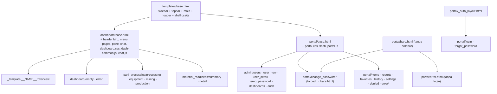
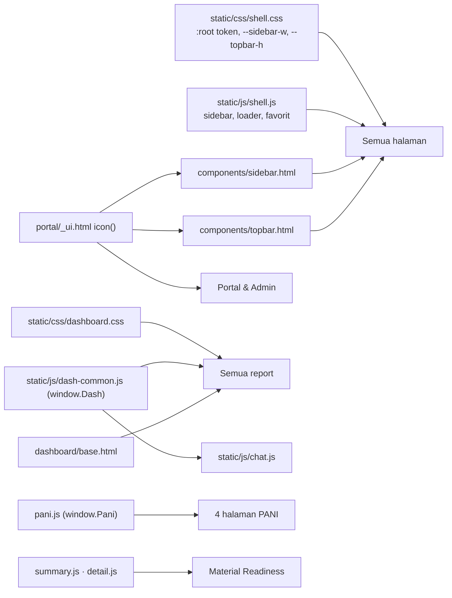

# 08 — Frontend Architecture

Frontend = template **Jinja** yang dirender server + CSS + JavaScript vanilla (tanpa framework, tanpa build step).
Report **bukan** iframe Power BI: Flask merender HTML dari data semantic model.

## 1. Template inheritance (Verified)

`*` memakai ``.

**Komponen (macro, di-import, bukan di-extend):** `components/sidebar.html`, `components/topbar.html`,
`portal/_ui.html` (`icon`, `report_card`, logo), `admin/_ui.html`, `admin/_audit_table.html`, `dashboard/_icons.html`,
`pani_processing/_ui.html` (`filters`, `picon`, `scripts`).

**Blok yang bisa diisi halaman report** (`dashboard/base.html`): `title`, `head`, `main_title`, `pill`, `desc`,
`stat_note`, `content`, `scripts`. Halaman portal: `title`, `content`, `scripts`.

## 2. Urutan render halaman dashboard

1. View me-render `pani_processing/mining.html`.
2. Template itu `extends "dashboard/base.html"`, yang men-set `report = dashboard` (variabel `dashboard` dari context
   processor = `registry.current()` berdasarkan blueprint request).
3. `dashboard/base.html` `extends "base.html"`; `base.html` memanggil `sidebar(report)` dan `topbar(report)` sehingga
   menu **Reports** aktif, nama report tampil, breadcrumb `Reports › <report> › <halaman>` dan tombol favorit muncul.
4. Blok `overlays` menambah panel chat + `window.CHAT` (jika `chat_enabled`); blok `layer_scripts` memuat
   `dash-common.js`, blok `scripts` halaman, lalu `chat.js`.

## 3. Shared component dependency

Contoh dampak: mengganti `--topbar-h` di `shell.css` menggeser panel chat (`dashboard.css` memakai
`var(--topbar-h)`) di **semua** report; mengganti nama fungsi di `window.Dash` merusak Material Readiness, PANI,
dan `chat.js` sekaligus.

**Regression checklist shared component:** Home, Reports, satu halaman Admin, halaman login, Material Readiness
Summary & Detail, satu halaman PANI, panel Ask AI (jika aktif), lebar 1280 / 1000 / 800 px.

## 4. CSS

| File | Dimuat oleh | Cakupan |
|---|---|---|
| `shell.css` | `base.html`, `_auth_layout.html`, `bare.html` | Token warna `:root`, sidebar, top bar, loader |
| `portal.css` | `portal/base.html`, `bare.html`, `_auth_layout.html` | Portal, login, admin, kartu `tone-<warna>`, pill `act-good/act-bad` |
| `dashboard.css` | `dashboard/base.html` | `.dash`, header `.hd`, panel, tabel, chat panel |
| `pani.css` | template PANI | Di atas `dashboard.css` |

Responsif:
- Sidebar ditentukan oleh skrip inline di `base.html` (sebelum render, supaya tidak berkedip):
  - lebar ≥ 1200 px: sidebar bisa diringkas, pilihan disimpan di `localStorage['mantra.sidebar']`;
  - 900-1199 px: sidebar selalu ringkas;
  - di bawah 900 px: sidebar menjadi drawer.
- Isi report memakai container query `@container dash (...)`, bukan `@media`, supaya mengikuti lebar area report.

## 5. JavaScript

| File | Global | Tanggung jawab | Request ke server |
|---|---|---|---|
| `shell.js` | — | Sidebar, loader, favorit | `POST /api/favorites/<slug>` (URL dari meta `favorite-url`, header `X-CSRF-Token` dari meta `csrf-token`) |
| `portal.js` | — | Filter Reports (search + kategori) di browser | — |
| `dash-common.js` | `window.Dash` | `esc`, `fmt`, `statusRank`, `badgeColor`, `setHeaderCompany`, `moName` | — |
| `chat.js` | baca `window.CHAT`, `window.DashContext`, `window.DashFilters` | Panel AI | `POST /d/<slug>/api/chat` |
| `summary.js` | baca `window.SUMMARY`; set `DashContext/DashFilters` | Chart & slicer Material Readiness di browser | — (data di-embed) |
| `detail.js` | baca `window.DETAIL`; set `DashContext/DashFilters` | Tabel Detail, state di URL, copy/export | `GET /api/detail`, `GET /api/detail/export` |
| `pani.js` | `window.Pani`; baca `window.PANI`; set `DashContext/DashFilters` | Header, sparkline, chart bar+garis SVG | — (filter = form GET, reload halaman) |

## 6. Pola pengambilan data per halaman (jangan diasumsikan sama)

| Halaman | Pola |
|---|---|
| Portal & Admin | Server-side render penuh; form POST + `_csrf` lalu redirect (Admin: 303; login: 302) |
| Material Readiness Summary | SSR + data cube di-embed (`window.SUMMARY`); filter/slicer diproses JS di browser |
| Material Readiness Detail | SSR kerangka + **AJAX** `fetch` ke `/api/detail` (paging, sort, filter di server) |
| PANI (4 halaman) | SSR penuh; filter tanggal = `<form method="get">` yang auto-submit (`?start=&end=`), reload halaman |
| Chat | AJAX `fetch` POST JSON |
