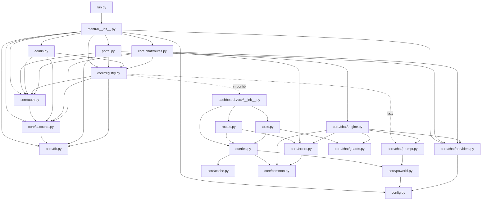

# 09 — Backend Architecture

## 1. Lapisan

| Lapisan | Modul | Tanggung jawab | Boleh import |
|---|---|---|---|
| Entry | `run.py` | Start server | `mantra` |
| App | `mantra/__init__.py` | Merakit app, hook global | semua di bawah |
| Konfigurasi | `config.py` | `Config` | — |
| Blueprint portal | `portal.py`, `admin.py`, `core/auth.py`, `core/chat/routes.py` | Route HTTP | core |
| Plug-in | `core/registry.py` + `dashboards/<x>/` | Manifest, guard, blueprint dashboard | core |
| Domain dashboard | `dashboards/<x>/queries.py`, `tools.py` | Aturan bisnis & DAX | `core.powerbi`, `core.cache`, `core.common`, `core.chat.guards`, `core.registry.Tool` |
| AI | `core/chat/engine.py`, `providers.py`, `prompt.py`, `guards.py` | Orkestrasi agent | `powerbi.DATA_ERRORS`, `errors`, `common` |
| Data portal | `core/accounts.py`, `core/db.py` | SQLite | sqlite3, werkzeug |
| Integrasi | `core/powerbi.py`, `core/cache.py`, `core/errors.py`, `core/common.py` | Power BI, cache, error, helper | msal, requests |

Aturan arah dependency (Verified dari import): `core` **tidak pernah** meng-import `dashboards/<x>` secara statis;
dashboard ditemukan lewat `importlib` di `registry`. Dashboard **tidak** saling meng-import.

## 2. Dependency map file utama (dependency contract map)

### Kontrak antar modul (yang tidak boleh dilanggar tanpa analisis dampak)

| Kontrak | Pemilik | Pemakai | Isi |
|---|---|---|---|
| `Dashboard`, `ChatSpec`, `Tool` (dataclass) | `registry.py` | setiap manifest & `tools.py`, portal, admin, chat, scripts | Field & arti di dok 14 |
| `DASHBOARD` variabel modul | setiap `dashboards/<x>/__init__.py` | `registry._load`, `registry.manifests` | Wajib bertipe `Dashboard` |
| `queries.DATA_ERRORS`, `queries.stamp_info`, `queries.now_wib` | re-export di `queries.py` | `routes.py` dashboard | Tuple exception & helper |
| `query(dataset, dax) -> list[dict]` | `powerbi.py` | semua `queries.py` | Nama kolom dibersihkan dari `'Tabel'[Kolom]` |
| `Cache.get(key, load) -> (data, ts)` | `cache.py` | `queries.py` | `ts` dipakai untuk "Last Update" |
| `tool.fn(args, dash) -> dict` | `tools.py` | `engine.call_tool` | dict dikirim ke AI; `error` + `valid_options` untuk parameter salah |
| `provider.chat(system, history, message, tools, call_tool, max_rounds) -> (text, model)` | `providers.py` | `engine.py` | Provider baru wajib mengikuti signature ini |
| `current_user() -> dict / None` | `auth.py` | hampir semua | Key: `id`, `db_id`, `name`, `email`, `role`, `role_label`, `must_change_password` |
| `accounts.audit(action, target_type, target_id, actor, **detail)` | `accounts.py` | auth, admin, registry, chat | Detail **tanpa secret** |

## 3. Penanganan error backend

| Jenis | Ditangani di | Respons |
|---|---|---|
| Power BI / jaringan (`DATA_ERRORS`) | `routes.py` dashboard → `core/errors.py` | 502 HTML/JSON/teks + kode ref; detail di log |
| Error di tool AI | `engine.call_tool` | Dikirim ke AI sebagai `{"error": ...}`; percakapan tetap jalan |
| Provider AI | `chat/routes.py` | 503 (`AIUnavailable`), 502 (`AIError`) |
| Input akun tidak valid | `accounts.AccountError` | Pesan aman ke user (flash / CLI) |
| CSRF | `create_app.csrf_protect` | 400 |
| Lainnya | Flask → `server_error` | 500 halaman umum (Flask sudah mencatat exception) |

## 4. State di memori (per proses)

`_IpThrottle` (auth), `_hits` rate limit chat, `_RateLimiter` Power BI, `Cache` per dashboard, client MSAL &
Power BI, provider AI. Semua **hilang saat restart** dan **tidak dibagi** jika ada lebih dari satu proses.
Ini memadai untuk dev server satu proses (`Verified`); untuk multi-proses lihat known issues dok 28.

## 5. Concurrency

Dev server Werkzeug multi-thread. Material Readiness `detail()` memakai `ThreadPoolExecutor` (`_pool`) untuk dua
query paralel. Karena itu `powerbi.py` memakai `requests.Session` per thread dan `Cache` punya lock per key.
