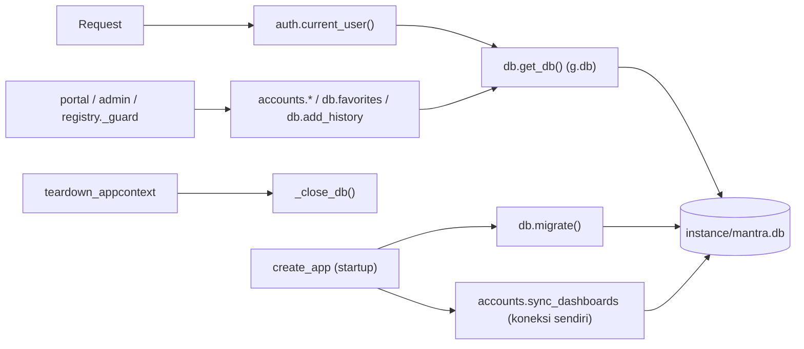

# 11 — Database & Migrations (SQLite)

Detail skema & rollback juga ada di [docs/AUTH.md](../AUTH.md). Dokumen ini fokus pada cara kerja dan prosedur.

## 1. Fakta (Verified dari `core/db.py`)

| | |
|---|---|
| Engine | SQLite (`sqlite3` standar Python) |
| Lokasi | `instance/mantra.db` (`Config.APP_DB`); folder dibuat otomatis |
| Isi | akun, katalog dashboard, hak akses, audit log, Favorites, History. **Bukan** data dashboard |
| Koneksi | `get_db()` satu koneksi per request (`g.db`), `row_factory=sqlite3.Row`, `PRAGMA foreign_keys=ON`; ditutup di `teardown_appcontext` |
| Versi skema | `PRAGMA user_version` = jumlah migrasi yang sudah jalan (saat ini **3**) |
| Backup | Sebelum migrasi pada DB yang berisi tabel: `instance/backups/mantra-<YYYYmmdd-HHMMSS>-before-v<N>.db` (SQLite backup API). Manual: `python scripts/manage_users.py backup` → `...-manual.db` |

## 2. Skema

| Tabel | Migrasi | Kolom penting | Dipakai oleh |
|---|---|---|---|
| `favorites` | v1 | `user_id TEXT`, `slug`, PK (user_id, slug) | `db.favorites`, `toggle_favorite` |
| `history` | v1 | `user_id TEXT`, `slug`, `title`, `url`, `visited_at` | `db.add_history` (simpan 100/user, kunjungan ulang URL sama < 30 menit hanya update waktu), `db.history` |
| `users` | v2 (+ `reset_requested_at` v3) | `email UNIQUE NOCASE`, `password_hash`, `role CHECK (super_admin,user)`, `is_active`, `must_change_password`, `session_version`, `failed_logins`, `locked_until`, `last_login_at`, `password_changed_at` | `accounts.*`, `auth.current_user` |
| `dashboards` | v2 | `slug UNIQUE`, `name`, `workspace_id`, `dataset_id`, `report_id` (tidak dipakai kode), `is_active` | `sync_dashboards`, `allowed_slugs`, admin |
| `user_dashboard_access` | v2 | `user_id` → users (CASCADE), `dashboard_id` → dashboards (CASCADE), `granted_by`, UNIQUE pair | `allowed_slugs`, `set_access` |
| `audit_log` | v2 | `at`, `actor_id`, `actor_email`, `action`, `target_type`, `target_id`, `detail` (JSON), `ip` | `accounts.audit`, halaman Audit |

`user_id` di `favorites`/`history` bertipe TEXT (`current_user()["id"]` = `str(id)`; mode `AUTH_DISABLED` memakai
`"dev-local"`).

## 3. Akses database dari request



| | |
|---|---|
| Titik awal | Startup (`migrate`, `sync_dashboards`) dan setiap request (`get_db`) |
| Kondisi gagal | DB versi > kode → `RuntimeError` "Database versi N lebih baru dari kode"; migrasi gagal → rollback transaksi, app tidak start |
| Cara uji | `test_passwords_and_database.py::test_migration_keeps_existing_data_and_backs_up`, `::test_access_table_constraints` |

## 4. Prosedur menambah migrasi

### A. Objective
Menambah tabel/kolom/index tanpa merusak data.
### B. When to use
Fitur baru butuh data portal baru (bukan data dashboard).
### C. Prerequisites
Backup: `python scripts/manage_users.py backup`.
### D. Architecture context
`migrate()` menjalankan `MIGRATIONS[version:]` berurutan, masing-masing dalam `BEGIN ... PRAGMA user_version=N; COMMIT`.
### E. Files involved
`mantra/core/db.py`, modul yang memakai tabel baru, `docs/AUTH.md` (skema), test.
### F. Step-by-step instructions
1. Tambahkan string SQL **di akhir** list `MIGRATIONS` (jangan ubah elemen lama).
2. Hanya `CREATE TABLE IF NOT EXISTS`, `ALTER TABLE ... ADD COLUMN`, `CREATE INDEX IF NOT EXISTS`.
3. Tambahkan fungsi akses di `db.py` atau `accounts.py`.
4. Tambah test (pola `test_migration_keeps_existing_data_and_backs_up`).
5. Restart server → log `Database dimigrasi dari versi 3 ke 4 (backup: ...)`.
### G. Code or patch (contoh pola, `Proposed`)
```python
MIGRATIONS = [
    ...,   # v1-v3 tidak diubah
    # 4: <alasan>
    """
    ALTER TABLE users ADD COLUMN contoh_kolom TEXT;
    """,
]
```
### H. Code explanation
`user_version` membuat setiap migrasi berjalan tepat sekali di setiap database.
### I. Commands
`python -m pytest tests/test_passwords_and_database.py` · `python run.py`
### J. Expected result
Test lulus; backup `before-v4` dibuat; data lama utuh.
### K. Validation
`python -c "import sqlite3; print(sqlite3.connect('instance/mantra.db').execute('PRAGMA user_version').fetchone())"`
### L. Troubleshooting
"Database versi N lebih baru dari kode" → kode lama dijalankan pada DB baru: pakai kode terbaru atau pulihkan backup.
### M. Regression impact
Semua fitur login/akses. Jalankan seluruh test.
### N. Acceptance criteria
Migrasi idempoten, backup ada, test lulus, dokumentasi skema diperbarui.
### O. Documentation updates
`docs/AUTH.md` (skema), dokumen ini.
### P. Actual status
Migrasi v1-v3: PASS (test). Migrasi v4: Not Applicable (belum ada).

## 5. Restore

Lihat [25_RELEASE_AND_ROLLBACK](25_RELEASE_AND_ROLLBACK.md). Ringkas: hentikan server → salin `mantra.db` saat ini
ke backup → salin file backup menjadi `instance/mantra.db` → start.

**Kondisi saat ini (26 Okt 2026):** folder `instance/backups/` tidak ada (`Not Found`), jadi belum ada titik rollback.
Disarankan menjalankan `python scripts/manage_users.py backup` sebelum perubahan berikutnya.

## 6. Database test

`tests/conftest.py` membuat DB di folder temp (`tempfile.mkdtemp(prefix="mantra-test-")`) lewat
`create_app({"INSTANCE_DIR": tmp, "APP_DB": tmp / "mantra.db"})`. `instance/mantra.db` tidak disentuh. Fixture
`fresh_data` mengosongkan tabel dan membuat 3 akun di setiap test.
