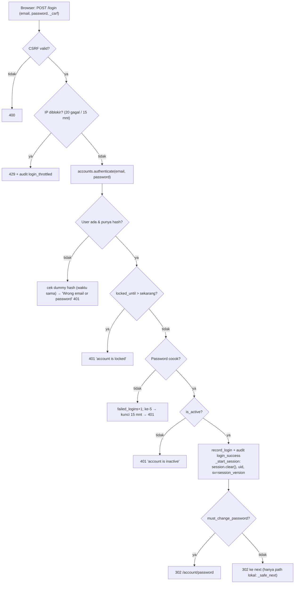
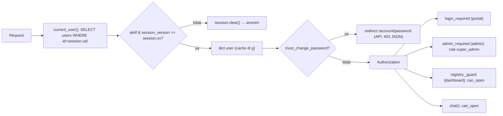

# 12 — Authentication & Authorization

**Authentication** = membuktikan siapa user (login). **Authorization** = menentukan apa yang boleh dibuka.
Di MANTRA keduanya diputuskan **di server** dari database pada **setiap request**. Menyembunyikan tombol/menu di
frontend hanya kenyamanan: siapa pun bisa mengetik URL atau memanggil API langsung, karena itu `_guard`,
`admin_required`, dan cek di `chat()` wajib ada. Dokumen pelengkap: [docs/AUTH.md](../AUTH.md).

## 1. Alur login email + password (Verified)



## 2. Setiap request setelah login



Akibat desain ini (Verified + Tested): menonaktifkan akun, reset password, mengganti role, atau mencabut akses
**langsung berlaku di request berikutnya** (`test_deactivated_user_is_logged_out_immediately`,
`test_revoked_access_applies_on_next_request`, `test_reset_password_logs_out_user`).

## 3. Role & hak akses

| Role | Dari mana | Dashboard yang boleh dibuka | Admin |
|---|---|---|---|
| `super_admin` | Hanya `scripts/manage_users.py set-role` atau seed (tidak bisa lewat web: `test_no_web_route_can_promote_to_super_admin`) | Semua dashboard **aktif** di katalog | Ya |
| `user` | Admin > Users > Add User | Dashboard aktif yang punya baris di `user_dashboard_access` (default deny) | Tidak (403 + audit) |
| Dev (`AUTH_DISABLED=1`) | `.env` saja | Seperti Super Admin, tanpa akun (`db_id=None`) | Ya |

`accounts.allowed_slugs` (SQL) + `auth.allowed_slugs` (cache per request) + `auth.can_open(user, dashboard)`.

## 4. Fitur akun

| Fitur | Aturan (Verified) | Test |
|---|---|---|
| Password baru | ≥ 10 karakter, huruf + angka, tidak memuat nama email | `test_new_user_must_change_temporary_password` |
| Password sementara | `secrets.token_urlsafe(9)`, tampil sekali (`no-store`), wajib diganti | idem |
| Ganti password | Naikkan `session_version` → sesi lain logout; sesi ini tetap | `test_reset_password_logs_out_user` |
| Lockout akun | 5 gagal berturut → 15 menit | `test_account_locks_after_repeated_failures` |
| Throttle IP | 20 login gagal / 5 permintaan reset per 15 menit (memori) | `test_ip_throttle`, `test_requests_are_throttled_per_ip` |
| Lupa password | Pesan selalu sama; permintaan muncul di Admin > Users (badge); tidak kirim email | `test_forgot_password.py` |
| Logout | POST + CSRF; jika login SSO → juga logout Microsoft | — |
| Login Microsoft | Hanya email yang terdaftar & aktif; app roles Entra tidak dipakai | NOT RUN (butuh tenant) |
| Cookie | `HttpOnly`, `SameSite=Lax`, `Secure` jika `SESSION_COOKIE_SECURE=1`; ditandatangani `FLASK_SECRET_KEY` | `test_session_cookie_cannot_be_forged`; header Tested di localhost |

## 5. Prosedur: mengubah aturan akses

### A. Objective
Mengubah siapa boleh membuka apa tanpa membuka celah.
### B. When to use
Role baru, aturan dashboard baru, halaman admin baru.
### C. Prerequisites
Baca `core/auth.py` dan `core/accounts.py` seluruhnya; baseline test.
### D. Architecture context
Sumber kebenaran = database; session hanya `uid` + `sv`.
### E. Files involved
`core/accounts.py` (`ROLES`, `allowed_slugs`), `core/auth.py`, `core/db.py` (CHECK role → migrasi baru), `admin.py`, `templates/admin/*`, `tests/test_login_and_access.py`.
### F. Step-by-step instructions
1. Tulis test yang gagal dulu (mis. user role X tidak boleh membuka Y).
2. Ubah `accounts.py`/`auth.py`. Role baru butuh migrasi (CHECK constraint `role IN (...)`).
3. Pastikan route baru memakai `login_required` / `admin_required` / `role_required(...)`.
4. Jalankan seluruh test.
### G. Code or patch
Proteksi route admin baru (pola aktual `admin.py`):
```python
@bp.get("/something")
@admin_required
def something():
    ...
```
### H. Code explanation
`role_required` = `login_required` + cek role + audit `access_denied` + 403.
### I. Commands
`python -m pytest tests\test_login_and_access.py`
### J. Expected result
Semua lulus.
### K. Validation
Coba URL langsung sebagai user tanpa akses → 403.
### L. Troubleshooting
Lihat dok 23 "Login/session failure", "Authorization failure".
### M. Regression impact
Semua halaman.
### N. Acceptance criteria
Default deny tetap; tidak ada route web yang bisa menaikkan role ke `super_admin`.
### O. Documentation updates
`docs/AUTH.md`, dokumen ini, dok 30.
### P. Actual status
Aturan saat ini: PASS (58 test). Login Entra: NOT RUN.
