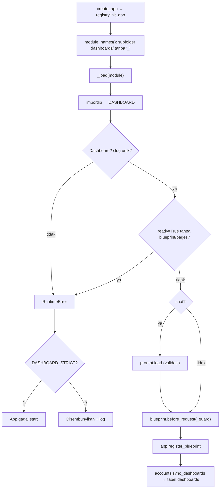

# 14 — Dashboard Registry & Plug-in Framework

## 1. Mekanisme (Verified dari `core/registry.py`)

Registry memakai **auto-discovery + manifest**:

1. `module_names()` → `pkgutil.iter_modules(mantra/dashboards)` → setiap **sub-package** yang namanya **tidak** diawali `_`.
2. `_load()` → `importlib.import_module("mantra.dashboards.<x>")` → ambil variabel `DASHBOARD`; harus instance
   `Dashboard`, slug tidak boleh dobel.
3. Jika `ready=True` wajib punya `blueprint` dan `pages`.
4. Jika ada `chat` → `prompt.load(dashboard)` (gagal kalau prompt rusak).
5. Pasang `_guard` sebagai `before_request` blueprint, catat di `_BY_BLUEPRINT`, simpan di `_DASHBOARDS`, register blueprint.
6. Setelah semua: `accounts.sync_dashboards` mengisi/memperbarui tabel `dashboards` (nama & ID dari kode; `is_active`
   hanya diisi untuk dashboard baru, setelah itu diatur di Admin > Dashboards).

Error saat memuat: `DASHBOARD_STRICT=1` (default) → aplikasi gagal start; `0` → dashboard disembunyikan + log
`Dashboard ... gagal dimuat dan disembunyikan`.



## 2. Kontrak manifest

```python
@dataclass
class Dashboard:
    slug: str            # URL /d/<slug>/ ; juga kunci hak akses & favorit
    title: str
    description: str     # teks kartu & header
    category: str        # filter di halaman Reports
    icon: str            # nama ikon di templates/portal/_ui.html (macro icon)
    color: str           # blue, green, orange, purple, teal, red, indigo, cyan, slate (class tone-<warna>)
    dataset: object = None       # core.powerbi.Dataset
    blueprint: Blueprint | None = None
    pages: list = []     # [(label, endpoint)] → menu header & breadcrumb; pages[0] = URL kartu
    chat: ChatSpec | None = None
    ready: bool = True   # False = kartu "Coming soon"
    order: int = 100     # urutan kartu

@dataclass
class ChatSpec:
    tools: list                    # [Tool]
    prompt_dir: Path               # folder prompts/*.md
    suggestions: list = []         # contoh pertanyaan di panel chat
    clean_args: Callable | None    # normalkan args dari AI sebelum tool jalan
    parse_dash: Callable | None    # filter dari browser → dict 'dash' untuk tool
    placeholders: tuple = ()       # placeholder prompt tambahan
    prompt_values: Callable | None # nilai placeholder tambahan

@dataclass
class Tool:
    name: str; label: str; description: str
    parameters: dict               # JSON schema
    fn: Callable                   # fn(args, dash) -> dict
```

## 3. Kenapa membuat folder saja belum cukup

| Kondisi | Akibat |
|---|---|
| Folder diawali `_` | Diabaikan registry (by design, mis. `_template`) |
| Tidak ada `__init__.py` / bukan package | Tidak terdeteksi `pkgutil.iter_modules(ispkg)` |
| Tidak ada variabel `DASHBOARD` | `RuntimeError ... tidak punya variabel DASHBOARD` |
| `ready=False` | Kartu "Coming soon", `Dashboard.url = None`; **route tetap terpasang dan dijaga `_guard`** (Tested di salinan sandbox) |
| User biasa belum diberi akses | Kartu tidak tampil untuk user itu (Super Admin tetap melihat) |
| Dashboard dinonaktifkan di Admin > Dashboards | Tidak tampil & 403 untuk semua orang (`test_inactive_dashboard_is_blocked_for_everyone`) |
| Server belum di-restart | Registry hanya dibaca saat start |
| Prompt berisi tool yang tidak ada | App gagal start (strict) |

## 4. `_guard` (Verified)

Untuk setiap request ke blueprint dashboard (halaman, API, **file static**):

1. Belum login → `/api/`: 401 JSON; selain itu 302 ke login dengan `next`.
2. `can_open` gagal → audit `access_denied` → `/api/`: 403 JSON; selain itu `portal/denied.html` 403.
3. GET ke endpoint yang ada di `pages` → `db.add_history`.

Endpoint chat (`/d/<slug>/api/chat`) ada di blueprint `chat`, bukan blueprint dashboard, sehingga punya cek sendiri
yang setara di `core/chat/routes.py`.

## 5. Helper registry

| Fungsi | Dipakai oleh |
|---|---|
| `all_dashboards()` (urut `order`, `title`) | admin, settings, `sync_dashboards` |
| `get(slug)` | chat routes, favorit |
| `current()` | context processor (`dashboard` di template) |
| `visible_for(user)` | Home, Reports, Favorites, History, Settings |
| `manifests()` | scripts (tanpa memasang ke Flask) |

## 6. Test
`test_login_and_access.py` (`test_super_admin_sees_all_active_dashboards`, `test_user_sees_only_granted_dashboards`,
`test_direct_url_to_other_dashboard_is_403`, `test_data_api_static_and_chat_are_protected`),
`test_errors_and_security.py::test_create_app_can_run_twice`.
