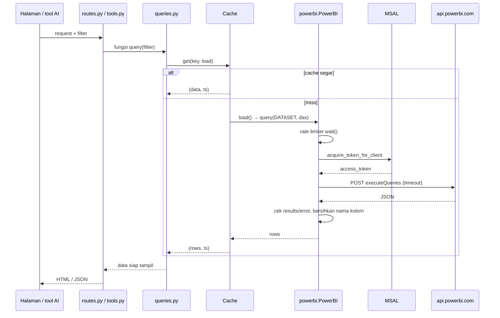

# 15 — Power BI Integration

## 1. Komponen (Verified)

| Bagian | File | Detail |
|---|---|---|
| Autentikasi | `core/powerbi.py:PowerBI.token` | MSAL `ConfidentialClientApplication.acquire_token_for_client`, scope `https://analysis.windows.net/powerbi/api/.default`; token di-cache MSAL |
| Identitas | `.env` | Service principal `mantra-powerbi` (`PBI_CLIENT_ID`/`SECRET`, tenant `PBI_TENANT_ID` atau `ENTRA_TENANT_ID`) |
| Workspace & semantic model | `dashboards/<x>/queries.py: DATASET = Dataset(prefix, workspace_id, dataset_id)` | Bisa ditimpa `<PREFIX>_WORKSPACE_ID` / `_DATASET_ID` |
| Query | `PowerBI.execute_query` | `POST {API}/groups/{ws}/datasets/{ds}/executeQueries`, body `{"queries":[{"query": dax}], "serializerSettings":{"includeNulls":true}}` |
| Parsing | idem | `results[0].tables[0].rows`; nama kolom `'Tabel'[Kolom]` → `Kolom` (kecuali bentrok) |
| Batas API | docstring | 100.000 baris / 1 juta nilai per query |
| Rate limit | `_RateLimiter` | `PBI_MAX_QUERIES_PER_MINUTE` (default 100) untuk **semua** dashboard; query berikutnya menunggu |
| Timeout | `PowerBI.request` | `PBI_TIMEOUT_SECONDS` (default 120) |
| Cache | `core/cache.py` + `_cache` per dashboard | TTL `CACHE_MINUTES` (default 10); key per filter |
| Error | `PowerBIError`, `DATA_ERRORS = (PowerBIError, requests.RequestException)` | Ditangkap routes → `core/errors.py` (502 + kode ref) |
| Escape DAX | `core/common.dax_str` | Gandakan `"`; **wajib** untuk setiap nilai dari user |

## 2. Alur query



| | |
|---|---|
| Kondisi gagal | Kredensial kosong (`Belum diisi di .env: ...`), token gagal, HTTP ≠ 2xx, respons tanpa `results`, `DAX error: ...`, timeout |
| Cara uji (lokal, tanpa Power BI) | `test_errors_and_security.py::test_power_bi_error_details_are_not_shown` (request di-stub), test cache |
| Cara uji (asli) | `python scripts\check_setup.py`; `python scripts\check_setup.py --dashboard <slug> --dax "EVALUATE ..."` |

## 3. Jenis error & cara membedakan

| Jenis | Tanda di log server (cari kode ref) | Penyebab umum | Cek |
|---|---|---|---|
| Lokal / konfigurasi | `Belum diisi di .env: PBI_CLIENT_ID...` | `.env` kosong | dok 06 |
| Autentikasi | `Gagal ambil token: invalid_client ...` / `AADSTS...` | Secret salah/kedaluwarsa, tenant salah | Entra > App registrations |
| Permission | `HTTP 401` / `HTTP 403` | SP belum di grup `sg-powerbi-api`, tenant setting belum aktif (~15 menit) | `check_setup.py` |
| Workspace | `HTTP 404` pada `/groups/<ws>` | SP bukan anggota workspace / ID salah | Manage access → Contributor |
| Semantic model | `HTTP 404` pada `/datasets/<ds>` | ID dataset salah | URL Power BI `groups/<WS>/datasets/<DS>` |
| DAX | `DAX error: ...` | Nama tabel/kolom salah, sintaks | `check_setup.py --dax` |
| Jaringan / timeout | `requests.exceptions...` | Koneksi, query berat | Perkecil query, cek jaringan |

User **hanya** melihat "Could not load data from Power BI... (ref XXXXXXXX)". Detail (ID workspace/dataset, isi
respons) hanya di log server: `Power BI request failed [ref XXXXXXXX]: ...`.

## 4. Menulis query DAX (pola aktual)

- Satu modul `queries.py` per dashboard; semua DAX di sana, bukan di routes/tools.
- Bungkus dengan cache: `_cache.get(key, load)`, key memuat semua filter.
- Nilai dari user selalu lewat `dax_str()` (string) atau dikonversi ke angka/tanggal (mis. `_int`, `parse_date`).
- Kembalikan `(data, fetched)` agar header "Last Update" konsisten.
- Struktur model bisa dibaca: `python scripts\check_setup.py --dashboard <slug> --dax "EVALUATE INFO.VIEW.COLUMNS()"`.

Contoh nyata (template, `Verified`):
```python
DATASET = Dataset("__ENV__", workspace_id="TODO-workspace-id", dataset_id="TODO-dataset-id")
_cache = Cache(Config.CACHE_SECONDS)

def tables():
    def load():
        return query(DATASET, 'EVALUATE SELECTCOLUMNS(FILTER(INFO.VIEW.TABLES(), NOT [IsHidden]), "table", [Name])')
    return _cache.get("tables", load)
```

## 5. Konsistensi dengan report Power BI

- Material Readiness: logika chart/slicer diambil dari measure `dax_html_material_readiness_v16`; README mencatat
  66 perbandingan identik dengan project lama.
- PANI: rumus measure report tidak bisa dibaca service principal, jadi angka **direkonstruksi** dari tabel model dan
  dibandingkan dengan measure HTML report memakai `python scripts\compare_pani_with_powerbi.py` (14 skenario).
  README mencatat hasil: 272 sama, 76 beda karena bug di report. Opsi `--fixed` membutuhkan `docs/powerbi_fixes/`
  yang saat ini dihapus dari working tree (pulihkan: `git restore docs/powerbi_fixes`).
- Status di sesi dokumentasi ini: **NOT RUN** (butuh akses Power BI asli).

## 6. Prasyarat Power BI (dari README, Pending verifikasi di tenant)

1. App registration `mantra-powerbi` (single tenant) + client secret.
2. Anggota grup `sg-powerbi-api` (yang diizinkan memakai API Power BI); berlaku ± 15 menit.
3. Contributor di setiap workspace dashboard.
