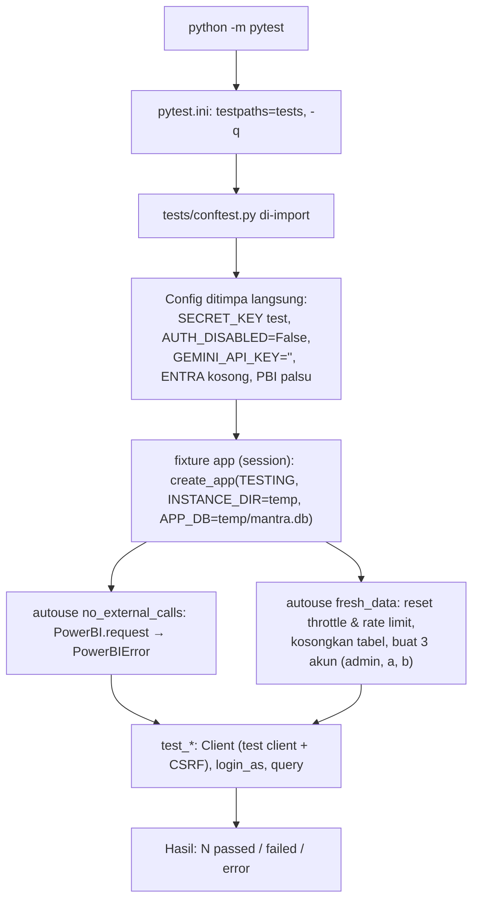

# 21 — Testing & Regression

### A. Objective
Memastikan perubahan tidak merusak login, hak akses, data portal, keamanan, dan dashboard.

### B. When to use
Sebelum & sesudah **setiap** perubahan kode; sebelum commit.

### C. Prerequisites
`pip install -r requirements-dev.txt`; `.venv` aktif.

Saat **membangun dari nol** (dok 03 / 27), pytest baru bisa dijalankan setelah mesin AI **dan** kedua dashboard ada:

| Syarat | Alasan | Error kalau belum ada (diuji 28 Okt 2026) |
|---|---|---|
| `mantra/core/chat/routes.py` (CP-13) | `conftest.py` meng-import `mantra.core.chat.routes` | `ImportError while loading conftest ... cannot import name 'routes' from 'mantra.core.chat'` |
| `mantra/dashboards/pani_processing/` (CP-12) | `test_errors_and_security.py` meng-import modul PANI; `fresh_data` memberi akses ke `pani-processing` | `ModuleNotFoundError: No module named 'mantra.dashboards.pani_processing'` |
| `mantra/dashboards/material_readiness/` (CP-12) | `fresh_data` memberi akses ke `material-readiness`; `PAGES`/`APIS` menguji URL-nya | `AccountError: Dashboard not in the catalog yet` |
| `PBI_CLIENT_ID` terisi di `.env` (nilai apa saja) | `test_env_file_wins_over_inherited_terminal_variables` membandingkan `Config.PBI_CLIENT_ID` dengan `None` | 1 failed, 57 passed |

Sebelum syarat itu terpenuhi, setiap tahap dicek manual (bagian "Cek" di [PANDUAN_DEVELOPMENT_BERURUTAN](../PANDUAN_DEVELOPMENT_BERURUTAN.md)).

### D. Architecture context



| | |
|---|---|
| Titik awal | `python -m pytest` |
| Isolasi | DB sementara (bukan `instance/mantra.db`), Power BI diblokir, Gemini tidak dikonfigurasi (test AI memakai provider palsu lewat monkeypatch) |
| Kondisi gagal | Import error (cek `.venv`), assertion |

### E. Files involved

| File | Jumlah test | Cakupan |
|---|---|---|
| `tests/test_login_and_access.py` | 28 | Login, pesan generik, normalisasi email, daftar dashboard per role, 403 URL langsung (halaman, API, static, chat), anonim 302/401, admin, nonaktif, cabut akses, dashboard nonaktif, manipulasi request, CSRF, password sementara, reset, lockout, throttle IP, cookie palsu, audit log, root redirect |
| `tests/test_passwords_and_database.py` | 8 | Hash password, seed idempotent & tanpa secret, seed tidak menimpa, migrasi + backup, constraint tabel akses, log tanpa secret, `AUTH_DISABLED` hanya dari `.env`, `.env` menang atas env terminal |
| `tests/test_forgot_password.py` | 8 | Link di login, permintaan sampai ke admin, respons sama, dismiss, email invalid, throttle, user login diarahkan ke home, CSRF |
| `tests/test_errors_and_security.py` | 14 | Tanggal ekstrem di-clamp, halaman no-data, detail error Power BI tidak bocor, argumen tool salah → `valid_options`, error tool tidak memutus chat, rate limit chat, security headers, CSRF non-ASCII → 400, 404, `create_app` dua kali, cache concurrency, cache tidak menyimpan error, foto login opsional |
| **Total** | **58** | |

Pemeriksaan non-pytest:

| Perintah | Cakupan | Biaya |
|---|---|---|
| `python scripts/check_ai_agent.py --static` | Prompt terbaca, placeholder & nama tool valid, komentar developer tidak terkirim, guards | Gratis |
| `python scripts/check_ai_agent.py --dashboard <slug> [filter]` | Pertanyaan acuan `chat_cases.py` | Kuota Gemini + query Power BI |
| `python scripts/compare_pani_with_powerbi.py [halaman]` | Angka PANI vs measure report | Query Power BI |
| `python scripts/check_setup.py` | Konfigurasi & koneksi | Entra, Power BI, Gemini |
| `python -m compileall -q mantra scripts tests run.py` | Sintaks | Gratis |

**Tidak ada** (Not Found): test JavaScript, test visual/browser otomatis, test integrasi Power BI/Gemini di pytest.

### F. Step-by-step instructions
1. Sebelum mengubah: `python -m pytest` → catat baseline.
2. Ubah kode.
3. Jalankan test terkait dulu (cepat), lalu semua test.
4. Prompt/tools diubah → `check_ai_agent.py --static`.
5. Data diubah → validasi manual / script dengan Power BI.
6. Bandingkan dengan baseline.

### G. Code or patch — pola test baru
```python
def test_contoh_halaman_baru_dilindungi(login_as):
    a = login_as("a")                       # user dengan akses material-readiness saja
    assert a.get("/d/pani-processing/").status_code == 403
```
Fixture tersedia: `app`, `client` (tidak login), `login_as("admin"|"a"|"b")`, `query(sql, params)`,
`fresh_data` (dict id akun). Untuk POST gunakan `client.post(url, data)` (CSRF otomatis).

### H. Code explanation
`Client` di `conftest.py` menyuntikkan `_csrf` ke session test dan form, sehingga test bisa melewati proteksi CSRF
yang sama dengan browser.

### I. Commands
```bash
python -m pytest                                        # semua
python -m pytest tests/test_login_and_access.py         # satu file
python -m pytest -k "csrf"                              # berdasarkan nama
python -m pytest tests/test_login_and_access.py::test_ip_throttle   # satu test
python -m pytest -x -vv                                 # berhenti di gagal pertama, detail
```

### J. Expected result
`58 passed` (Tested 26 Okt 2026 Windows: ± 50-75 detik; 28 Okt 2026 macOS Apple Silicon: ± 36-38 detik).
Satu file: `python -m pytest tests/test_login_and_access.py` → `28 passed` (± 18 detik).

### K. Validation — membaca hasil
| Output | Arti |
|---|---|
| `.` | lulus |
| `F` | assertion gagal (perilaku berubah) |
| `E` | error di fixture/setup (mis. import, DB) — test **tidak bisa dijalankan**, bukan gagal perilaku |
| `s` / `x` | skip / expected fail (saat ini tidak ada) |

### L. Troubleshooting
| Gejala | Penyebab |
|---|---|
| `ModuleNotFoundError: conftest` | Dijalankan bukan dari root project |
| Banyak `E` sekaligus | `create_app` gagal (prompt rusak, manifest salah) — lihat traceback pertama |
| Test halaman dashboard mendapat 502 | Normal: Power BI diblokir; test membedakan 502 (lolos akses) dari 403 |
| Gagal hanya setelah dashboard baru `ready=True` | Perbarui `ALL` di `test_login_and_access.py` |

Membedakan regresi vs kegagalan lama: jalankan test yang sama pada kode sebelum perubahan
(`git stash` → test → `git stash pop`), atau bandingkan dengan baseline CP-01.

### M. Regression impact
`conftest.py` dipakai semua test; mengubah akun seed/`PAGES` memengaruhi banyak test.

### N. Acceptance criteria
Tidak ada `F`/`E` baru; test baru untuk perilaku baru.

### O. Documentation updates
Tabel E dan [tests/README.md](../../tests/README.md).

### P. Actual status
| Pemeriksaan | Hasil |
|---|---|
| `python -m pytest` (26 Okt Windows, 28 Okt macOS) | PASS — 58 passed |
| `check_ai_agent.py --static` | PASS — SEMUA LULUS |
| `compileall` | PASS |
| `check_ai_agent.py --dashboard ...` | NOT RUN (kuota) |
| `compare_pani_with_powerbi.py` | NOT RUN (Power BI) |
| `check_setup.py` | NOT RUN (layanan asli) |
