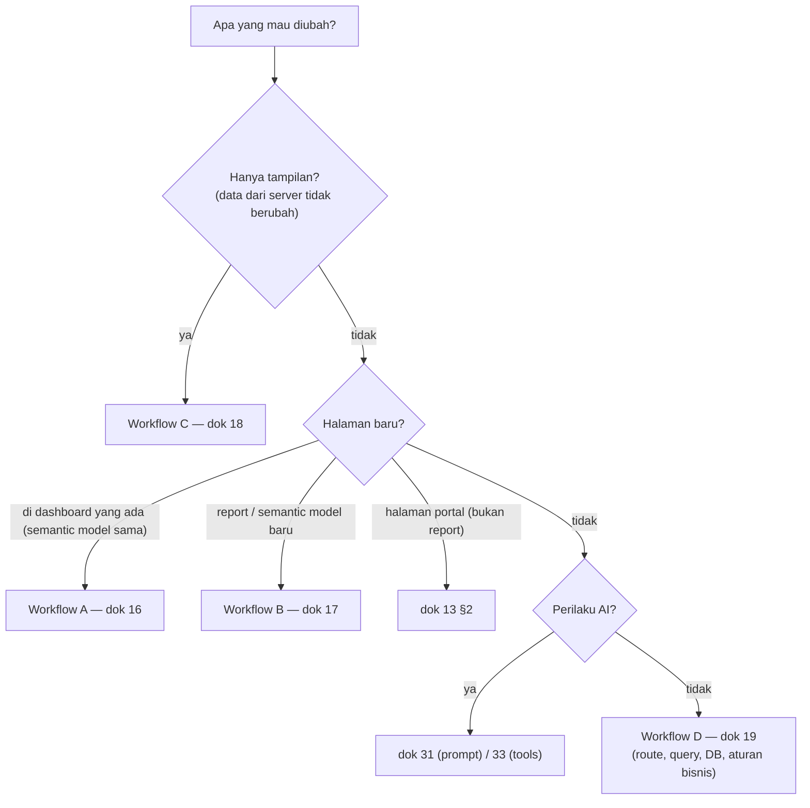

# 26 — Development Decision Guide

## 1. Memilih workflow

## 2. Pertanyaan cepat

| Pertanyaan | Mulai dari | Test |
|---|---|---|
| Hanya ingin mengubah tampilan, file mana? | Dok 18 §E (tabel "yang dilihat di layar → file"); DevTools Elements → class → grep | Regression checklist dok 08 §3 |
| Menambah halaman Summary/Detail? | `dashboards/<x>/routes.py` + `__init__.py` (`pages`) + template; pola `routes.mining` / `material_readiness.detail` | `PAGES` di `conftest.py` |
| Menambah dashboard baru, cek apa dulu? | `scripts/create_dashboard.py`, `_template/`, `core/registry.py` (kontrak `Dashboard`) | `test_login_and_access.py` (`ALL`) |
| Angka dashboard salah? | Telusuri: template (format `fmt`) → payload (`Ctrl+U` / response `/api/...`) → fungsi `queries.py` → DAX (`check_setup.py --dax`) → report Power BI dengan filter sama; PANI: `compare_pani_with_powerbi.py` | Stub test untuk logika |
| Power BI gagal diakses? | Kode ref di layar → log server → dok 15 §3 / dok 23 entri 12-14 → `check_setup.py` | — |
| AI menjawab tidak sesuai data? | Response JSON `tools` (tool & args yang dipakai) → jalankan fungsi tool yang sama → `prompts/system.md` / `data_dictionary.md` → `clean_args` | `check_ai_agent.py --static` + `--dashboard` |
| Sidebar tidak muncul? | Template harus extend `portal/base.html` atau `dashboard/base.html` (bukan `bare.html`, yang memang tanpa sidebar); `base.html` memanggil `sidebar(report)`; cek console JS & `shell.css` termuat | Render halaman di test |
| Login gagal? | Dok 23 entri 7: Audit Log (reason), lock, throttle, aktif, `session_version`, `localhost` vs `127.0.0.1`; file `core/auth.py`, `core/accounts.py` | `test_login_and_access.py` |
| Localhost tidak bisa dibuka? | Dok 23 "Diagnosis localhost" | Smoke test dok 22 |
| Test gagal setelah perubahan? | `pytest -x -vv`; bandingkan dengan `git stash` (dok 21 §L) | — |
| Perlu data portal baru (tabel)? | Migrasi baru di akhir `MIGRATIONS` (dok 11 §4) | `test_passwords_and_database.py` |
| Ganti provider AI? | `core/chat/providers.py` (dok 20 §4) | pytest (provider palsu) |
| Tambah variabel konfigurasi? | `config.py` + `.env.example` + dok 06 | — |

## 3. File yang boleh diubah tanpa analisis dampak besar
`dashboards/<x>/*` (kecuali kontrak `DASHBOARD`), template/CSS/JS khusus dashboard, `templates/portal/<halaman>.html`,
`prompts/*.md` (dengan `check_ai_agent.py --static`), dokumentasi.

## 4. File yang wajib dianalisis dampaknya
Daftar "Fondasi" di [02_PROJECT_STRUCTURE](02_PROJECT_STRUCTURE.md#tingkat-risiko-file).
