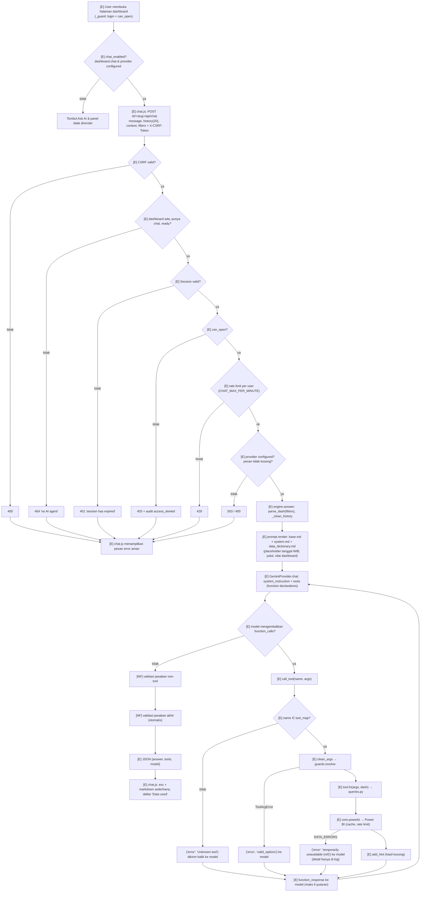
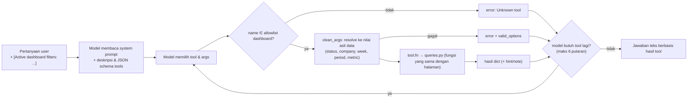

# 29 — AI Chat Flow & Tool Calling

## 1. Alur utama (disesuaikan dengan implementasi aktual)

Label: **[E]** = Existing & Verified, **[NF]** = Not Found (tidak ada di kode), **[P]** = Proposed.

Catatan penting: setelah 6 putaran tool tanpa jawaban, provider mengembalikan *"Sorry, this question needs too many
steps. Please make it more specific."*. `AIUnavailable` → 503, `AIError` → 502, `DATA_ERRORS` di luar tool → 502.

## 2. Detail setiap tahap

| Tahap | File / fungsi | Input → output | Validasi / hak akses | Potensi error | Cara uji |
|---|---|---|---|---|---|
| Render panel | `dashboard/base.html`, context `chat_enabled` | dashboard → `window.CHAT {url,title,suggestions}` | Halaman sudah lewat `_guard` | — | Buka halaman dengan/tanpa `GEMINI_API_KEY` |
| Kirim | `chat.js send()` | teks → POST JSON | CSRF header | 400 | DevTools Network |
| Pintu masuk | `core/chat/routes.py:chat` | JSON → JSON | 404/401/403/429/503/400 | — | `test_data_api_static_and_chat_are_protected`, `test_chat_is_rate_limited_per_user` |
| Konteks | `engine._clean_history`, `ChatSpec.parse_dash` | history (≤20, teks ≤4000), filters → `dash` | Panjang dibatasi; role hanya `user`/`model` | — | `test_errors_and_security.py` |
| Prompt | `prompt.render` | template + nilai → system | Placeholder divalidasi saat **start** | `prompt_values` gagal (DATA_ERRORS) → nilai `-` | `check_ai_agent.py --static` |
| Provider | `GeminiProvider.chat/_generate` | contents + config → response | Model cadangan | 503/502 | Provider palsu di test |
| Tool call | `engine.call_tool` | name, args → dict | Allowlist `tool_map`; `clean_args`; exception ditangkap | Unknown tool, ToolArgError, DATA_ERRORS, exception lain | `test_invalid_tool_argument_returns_valid_options`, `test_unexpected_tool_error_does_not_break_chat` |
| Query | `queries.py` → `powerbi.query` | filter → rows | `dax_str`, konversi tipe | PowerBIError | stub |
| Hasil kosong | `guards.add_hint` | `total==0` / `total_rows==0` / `groups==[]` → `hint` | — | — | `check_ai_agent.py` |
| Jawaban | provider → routes | teks + `used` | **Tidak** ada validasi teks otomatis | Angka salah di teks | `chat_cases.py` |

## 3. Perbedaan 8 skenario

| # | Skenario | Yang terjadi (Verified) |
|---|---|---|
| 1 | Bisa dijawab tanpa query (mis. "apa arti FP Ready?") | Model menjawab dari prompt/kamus data tanpa `function_calls`; `tools: []` |
| 2 | Butuh tool | Model memanggil tool → hasil dikirim kembali → jawaban + daftar "Data used" |
| 3 | Parameter tidak valid | `ToolArgError` → `{"error": "... is not recognised. Use one of valid_options.", "valid_options": [...]}`; `base.md` aturan 4: perbaiki sekali, lalu tanya user |
| 4 | Query berhasil, hasil kosong | `add_hint` menambah `hint` ("No rows for these filters..."); aturan 3 & 5 di `base.md` |
| 5 | Query gagal (Power BI) | Tool mengembalikan `{"error": "Power BI data is temporarily unavailable (ref X). Tell the user and do not guess any numbers."}`; detail di log |
| 6 | Provider gagal | Semua model dicoba; `AIUnavailable` → 503 "The AI service is busy..."; kode lain → 502 |
| 7 | Jawaban tidak didukung hasil query | Dicegah lewat prompt (aturan 1, 2) saja; **tidak** ada penolakan otomatis [NF]; deteksi lewat `chat_cases.py` |
| 8 | User tanpa akses dashboard | 403 di `chat()` sebelum AI dipanggil; audit `access_denied` |

## 4. Tool-calling flow

Jaminan yang **ada di kode** (Verified):
- Model **tidak pernah** mengirim DAX/SQL; hanya nama tool + argumen JSON. DAX dibangun di `queries.py`.
- Hanya tool di `ChatSpec.tools` dashboard yang sedang dibuka yang bisa dipanggil (tidak ada akses ke tool dashboard lain).
- Otorisasi diputuskan **sebelum** AI dipanggil (`chat()`), bukan oleh model.
- Error tool dikembalikan sebagai `error`, tidak pernah sebagai data valid; detail error Power BI tidak dikirim ke model.
- Batas putaran (`MAX_TOOL_ROUNDS = 6`) mencegah loop tak terkendali; beberapa function call dalam satu putaran
  dijalankan berurutan.
- Hasil tool dibatasi oleh tool itu sendiri (mis. `get_rows` maks 30 baris; `ToolArgError.result` maks 40 opsi).

## 5. Grounded answer contract

Ditetapkan oleh `base.md` (Verified):
- Angka hanya dari hasil tool (penjumlahan sederhana boleh); tidak menghitung ulang persentase yang sudah diberikan tool.
- Hasil kosong ≠ data tidak ada → sebut filter, sarankan perluas periode / cari kode.
- `note`, `hint`, `dashboard_notes` dari tool **wajib** disampaikan.
- Data yang tidak bisa dibaca agent → katakan belum tersedia; jangan memakai kolom lain.
- Format angka sesuai bahasa; tabel markdown jika > 3 baris; **baris terakhir miring berisi sumber & filter**.

Yang perlu dicantumkan bila relevan (target): angka, periode, filter aktif, satuan, definisi KPI (dari
`data_dictionary.md`), pembanding, batasan data. Interpretasi model harus dibedakan dari fakta hasil tool
(aturan 2 `base.md`: jangan menyimpulkan hubungan yang tidak ada di satu baris/kelompok hasil).
